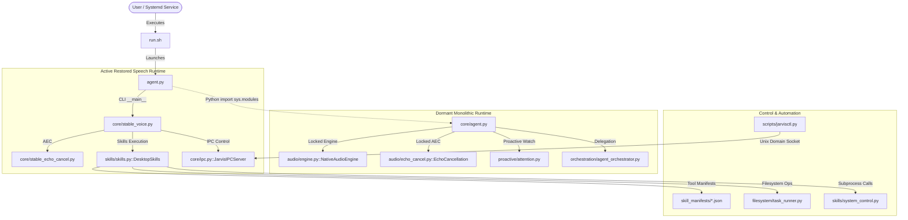

# JARVIS-OMA Codebase Audit & Architectural Reference

**Generated:** 28 October 2026  
**Repository:** `JARVIS-OMA`  
**Focus:** Function cross-references, dead code detection, duplication analysis, unwanted file identification, and Ponytail optimization audit.

---

## Executive Summary

A full AST and dependency scan was conducted across the active repository (324 Python files and associated configuration/manifest assets).

Key findings:
- **Architecture Split:** The runtime currently operates with a dual architecture: [`run.sh`](file:///home/g0pi/Projects/JARVIS-OMA/run.sh) launches [`agent.py`](file:///home/g0pi/Projects/JARVIS-OMA/agent.py), which redirects CLI execution directly to [`core/stable_voice.py`](file:///home/g0pi/Projects/JARVIS-OMA/core/stable_voice.py) and [`core/stable_echo_cancel.py`](file:///home/g0pi/Projects/JARVIS-OMA/core/stable_echo_cancel.py), bypassing the monolithic 2,305-line [`core/agent.py`](file:///home/g0pi/Projects/JARVIS-OMA/core/agent.py) engine.
- **Root Forwarder Shims:** 8 compatibility shims reside in the repository root, forwarding legacy imports to deeper packages.
- **Dead Code:** 119 functions and classes have zero external callers, with 24 having strictly zero occurrences across the entire codebase outside their definition.
- **Exact Duplications:** 23 JSON manifests in [`skills/manifests/`](file:///home/g0pi/Projects/JARVIS-OMA/skills/manifests) are 100% byte-identical clones of [`skill_manifests/`](file:///home/g0pi/Projects/JARVIS-OMA/skill_manifests). [`core/stable_echo_cancel.py`](file:///home/g0pi/Projects/JARVIS-OMA/core/stable_echo_cancel.py) is a 99% duplicate of the locked [`audio/echo_cancel.py`](file:///home/g0pi/Projects/JARVIS-OMA/audio/echo_cancel.py).
- **Unwanted Stray Assets:** An untracked backup directory [`issus voice/`](file:///home/g0pi/Projects/JARVIS-OMA/issus%20voice) (11,780 lines) exists from temporary voice debugging sessions. Competing memory systems ([`memory/codes-dev/`](file:///home/g0pi/Projects/JARVIS-OMA/memory/codes-dev) with 27,251 lines and [`universal-memory-mcp/`](file:///home/g0pi/Projects/JARVIS-OMA/universal-memory-mcp) with 7,737 lines) duplicate core capabilities.
- **Net Optimization Opportunity:** Pruning unreferenced files, redundant mirrors, and clones yields up to **~49,851 lines of code reduction** with zero lost capabilities.

---

## 1. Architectural Wiring & Cross-File Function Reference Map

### 1.1 High-Level Execution & Subsystem Flow



---

### 1.2 Root Forwarder Shims Cross-Reference Matrix

The repository root contains multiple legacy shims that forward imports into specific packages.

| File | Lines | Target Module | Referenced By (Callers / Importers) | Architectural Status |
| :--- | :---: | :--- | :--- | :--- |
| [`agent.py`](file:///home/g0pi/Projects/JARVIS-OMA/agent.py) | 18 | [`core.stable_voice.main`](file:///home/g0pi/Projects/JARVIS-OMA/core/stable_voice.py#L460) (CLI)<br>[`core.agent`](file:///home/g0pi/Projects/JARVIS-OMA/core/agent.py) (Module) | [`run.sh`](file:///home/g0pi/Projects/JARVIS-OMA/run.sh#L39), [`test_agent.py`](file:///home/g0pi/Projects/JARVIS-OMA/tests/test_core/test_agent.py), [`test_ipc.py`](file:///home/g0pi/Projects/JARVIS-OMA/tests/test_core/test_ipc.py) | **Active Entrypoint.** Splits execution: runs `stable_voice.py` when invoked as CLI, aliases `core.agent` on import. |
| [`echo_cancel.py`](file:///home/g0pi/Projects/JARVIS-OMA/echo_cancel.py) | 12 | [`audio.echo_cancel`](file:///home/g0pi/Projects/JARVIS-OMA/audio/echo_cancel.py) | [`core/agent.py`](file:///home/g0pi/Projects/JARVIS-OMA/core/agent.py#L39), [`test_echo_cancel.py`](file:///home/g0pi/Projects/JARVIS-OMA/tests/test_audio/test_echo_cancel.py) | **Voice Core Locked.** Required compatibility forwarder (do not modify). |
| [`config.py`](file:///home/g0pi/Projects/JARVIS-OMA/config.py) | 11 | [`core.config`](file:///home/g0pi/Projects/JARVIS-OMA/core/config.py) | 20 test & script files (e.g. [`test_config.py`](file:///home/g0pi/Projects/JARVIS-OMA/tests/test_core/test_config.py), [`sync_obsidian_memory.py`](file:///home/g0pi/Projects/JARVIS-OMA/scripts/sync_obsidian_memory.py)) | **Legacy Shim.** Callers should import `core.config` directly. |
| [`task_runner.py`](file:///home/g0pi/Projects/JARVIS-OMA/task_runner.py) | 11 | [`filesystem.task_runner`](file:///home/g0pi/Projects/JARVIS-OMA/filesystem/task_runner.py) | [`skills/skills.py`](file:///home/g0pi/Projects/JARVIS-OMA/skills/skills.py#L44), [`test_task_runner.py`](file:///home/g0pi/Projects/JARVIS-OMA/tests/test_filesystem/test_task_runner.py) | **Legacy Shim.** Callers should import `filesystem.task_runner`. |
| [`agent_orchestrator.py`](file:///home/g0pi/Projects/JARVIS-OMA/agent_orchestrator.py) | 11 | [`orchestration.agent_orchestrator`](file:///home/g0pi/Projects/JARVIS-OMA/orchestration/agent_orchestrator.py) | [`skills/skills.py`](file:///home/g0pi/Projects/JARVIS-OMA/skills/skills.py#L43), [`evolution.py`](file:///home/g0pi/Projects/JARVIS-OMA/orchestration/evolution.py#L48), [`desktop_execution.py`](file:///home/g0pi/Projects/JARVIS-OMA/orchestration/desktop_execution.py#L18) | **Legacy Shim.** Callers should import `orchestration.agent_orchestrator`. |
| [`system_control.py`](file:///home/g0pi/Projects/JARVIS-OMA/system_control.py) | 11 | [`skills.system_control`](file:///home/g0pi/Projects/JARVIS-OMA/skills/system_control.py) | [`skills/skills.py`](file:///home/g0pi/Projects/JARVIS-OMA/skills/skills.py#L45), [`test_system_control.py`](file:///home/g0pi/Projects/JARVIS-OMA/tests/test_skills/test_system_control.py) | **Legacy Shim.** Callers should import `skills.system_control`. |
| [`test_bar.py`](file:///home/g0pi/Projects/JARVIS-OMA/test_bar.py) | 5 | [`skills.input_bar`](file:///home/g0pi/Projects/JARVIS-OMA/skills/input_bar.py) | [`test_input_bar.py`](file:///home/g0pi/Projects/JARVIS-OMA/tests/test_skills/test_input_bar.py) | **Dead Shim.** Unused stub in root. |
| [`jarvis_memory/__init__.py`](file:///home/g0pi/Projects/JARVIS-OMA/jarvis_memory/__init__.py) | 15 | [`memory/codes-dev/jarvis_memory`](file:///home/g0pi/Projects/JARVIS-OMA/memory/codes-dev/jarvis_memory) | **0 files** | **Orphan Shim.** Zero callers across the entire codebase. |

---

### 1.3 Subsystem Inter-Module Hubs

The most referenced subsystem symbols and classes:

1. [`DesktopSkills`](file:///home/g0pi/Projects/JARVIS-OMA/skills/skills.py#L67) in [`skills/skills.py`](file:///home/g0pi/Projects/JARVIS-OMA/skills/skills.py):
   - Imported by **34 files**, method [`execute()`](file:///home/g0pi/Projects/JARVIS-OMA/skills/skills.py#L867) invoked across **59 files**.
   - Serves as the central execution broker between the voice runtime and external system actions.
2. [`JarvisIPCServer`](file:///home/g0pi/Projects/JARVIS-OMA/core/ipc.py#L22) in [`core/ipc.py`](file:///home/g0pi/Projects/JARVIS-OMA/core/ipc.py):
   - Started and monitored by [`core/stable_voice.py`](file:///home/g0pi/Projects/JARVIS-OMA/core/stable_voice.py#L23) and [`core/agent.py`](file:///home/g0pi/Projects/JARVIS-OMA/core/agent.py#L51).
   - Serves commands to [`scripts/jarvisctl.py`](file:///home/g0pi/Projects/JARVIS-OMA/scripts/jarvisctl.py) (status, mute, unmute, test_voice, interrupt).
3. [`EchoCancellation`](file:///home/g0pi/Projects/JARVIS-OMA/audio/echo_cancel.py#L27) in [`audio/echo_cancel.py`](file:///home/g0pi/Projects/JARVIS-OMA/audio/echo_cancel.py):
   - Starts and manages PipeWire WebRTC AEC virtual nodes.
   - Dual-instantiated: actively in [`core/stable_echo_cancel.py`](file:///home/g0pi/Projects/JARVIS-OMA/core/stable_echo_cancel.py#L27) and locked in [`audio/echo_cancel.py`](file:///home/g0pi/Projects/JARVIS-OMA/audio/echo_cancel.py#L27).
4. [`NativeAudioEngine`](file:///home/g0pi/Projects/JARVIS-OMA/audio/engine.py#L76) in [`audio/engine.py`](file:///home/g0pi/Projects/JARVIS-OMA/audio/engine.py):
   - PortAudio C-thread capture/playback engine (Voice Core Locked).
   - Wrapped by [`ExtendedAudioEngine`](file:///home/g0pi/Projects/JARVIS-OMA/audio/extension.py#L24) in [`audio/extension.py`](file:///home/g0pi/Projects/JARVIS-OMA/audio/extension.py).

---

## 2. Dead Code Analysis

### 2.1 Truly Unreferenced Code (Zero Callers, Imports, or Mentions)

The following symbols have **zero references outside their definition line**:

| File | Lines | Symbol | Kind | Description |
| :--- | :---: | :--- | :---: | :--- |
| [`memory/codes-dev/.../builder.py`](file:///home/g0pi/Projects/JARVIS-OMA/memory/codes-dev/memory-system/04-prompt-files/python/builder.py#L23-L290) | 268 | [`SystemPromptBuilder`](file:///home/g0pi/Projects/JARVIS-OMA/memory/codes-dev/memory-system/04-prompt-files/python/builder.py#L23-L290) | Class | Standalone prompt builder with zero imports. |
| [`memory/codes-dev/.../compression.py`](file:///home/g0pi/Projects/JARVIS-OMA/memory/codes-dev/memory-system/05-sessions/python/compression.py#L72-L102) | 31 | [`TieredSummaries`](file:///home/g0pi/Projects/JARVIS-OMA/memory/codes-dev/memory-system/05-sessions/python/compression.py#L72-L102) | Class | Unused session compression tiering strategy. |
| [`memory/codes-dev/.../memory_cmd.py`](file:///home/g0pi/Projects/JARVIS-OMA/memory/codes-dev/memory-system/07-cli/python/memory_cmd.py#L244-L269) | 26 | [`trust_fact`](file:///home/g0pi/Projects/JARVIS-OMA/memory/codes-dev/memory-system/07-cli/python/memory_cmd.py#L244-L269) | Function | Unreferenced CLI command handler for fact trust mutation. |
| [`orchestration/harness2_adapter.py`](file:///home/g0pi/Projects/JARVIS-OMA/orchestration/harness2_adapter.py#L47-L68) | 22 | [`_load_guidance`](file:///home/g0pi/Projects/JARVIS-OMA/orchestration/harness2_adapter.py#L47-L68) | Method | Private method never invoked in `Harness2Adapter`. |
| [`memory/codes-dev/.../compression.py`](file:///home/g0pi/Projects/JARVIS-OMA/memory/codes-dev/memory-system/05-sessions/python/compression.py#L39-L59) | 21 | [`RuleBasedPrecompression`](file:///home/g0pi/Projects/JARVIS-OMA/memory/codes-dev/memory-system/05-sessions/python/compression.py#L39-L59) | Class | Unused pre-compression heuristic class. |
| [`skills/ground_truth.py`](file:///home/g0pi/Projects/JARVIS-OMA/skills/ground_truth.py#L46-L58) | 13 | [`accessibility_fingerprint`](file:///home/g0pi/Projects/JARVIS-OMA/skills/ground_truth.py#L46-L58) | Function | Unused accessibility tree hashing utility. |
| [`orchestration/execution_backend.py`](file:///home/g0pi/Projects/JARVIS-OMA/orchestration/execution_backend.py#L40-L48) | 9 | [`ExecutionBackend`](file:///home/g0pi/Projects/JARVIS-OMA/orchestration/execution_backend.py#L40-L48) | Class | Speculative abstract class with zero implementations. |
| [`memory/codes-dev/.../sqlite.py`](file:///home/g0pi/Projects/JARVIS-OMA/memory/codes-dev/memory-system/02-document-store/python/sqlite.py#L19-L25) | 7 | [`_check_fts5`](file:///home/g0pi/Projects/JARVIS-OMA/memory/codes-dev/memory-system/02-document-store/python/sqlite.py#L19-L25) | Function | Uncalled FTS5 test check. |
| [`memory/codes-dev/.../compression.py`](file:///home/g0pi/Projects/JARVIS-OMA/memory/codes-dev/memory-system/05-sessions/python/compression.py#L63-L68) | 6 | [`ModelSummarization`](file:///home/g0pi/Projects/JARVIS-OMA/memory/codes-dev/memory-system/05-sessions/python/compression.py#L63-L68) | Class | Unreferenced summarizer class stub. |
| [`memory/codes-dev/.../events.py`](file:///home/g0pi/Projects/JARVIS-OMA/memory/codes-dev/memory-system/99-support/events.py#L175-L178) | 4 | [`clear_history`](file:///home/g0pi/Projects/JARVIS-OMA/memory/codes-dev/memory-system/99-support/events.py#L175-L178) | Function | Uncalled event clearing helper. |
| [`skills/skills.py`](file:///home/g0pi/Projects/JARVIS-OMA/skills/skills.py#L507-L508) | 2 | [`active_domains`](file:///home/g0pi/Projects/JARVIS-OMA/skills/skills.py#L507-L508) | Method | Unreferenced property in `DesktopSkills`. |
| [`project-docs/.../12_audit_reproductions.py`](file:///home/g0pi/Projects/JARVIS-OMA/project-docs/archive/report/12_audit_reproductions.py) | 135 | 9 test functions | Script | Standalone reproduction script outside `tests/` test runner. |

---

### 2.2 Dormant Subsystem

- [`core/agent.py`](file:///home/g0pi/Projects/JARVIS-OMA/core/agent.py) (**2,305 lines**): Contains the advanced Gemini Live orchestration loop, local wake-word standby, attention manager, and screen stream reader. It is bypassed in production execution because [`run.sh`](file:///home/g0pi/Projects/JARVIS-OMA/run.sh) targets [`core/stable_voice.py`](file:///home/g0pi/Projects/JARVIS-OMA/core/stable_voice.py) to achieve acoustic stability.

---

## 3. Duplicate Code & Redundant Implementations

### 3.1 Identical Manifest Mirrors

- **Paths:** [`skill_manifests/`](file:///home/g0pi/Projects/JARVIS-OMA/skill_manifests) vs. [`skills/manifests/`](file:///home/g0pi/Projects/JARVIS-OMA/skills/manifests)
- **Impact:** 23 JSON files, **2,478 duplicated lines**.
- **Evidence:** `diff -r skill_manifests skills/manifests` produces zero differences. [`skills/skills.py:211`](file:///home/g0pi/Projects/JARVIS-OMA/skills/skills.py#L211) only reads `skill_manifests/`. `skills/manifests/` is an exact clone maintained only for legacy paths.

---

### 3.2 Dual Echo Cancellation Classes

- **Paths:** [`core/stable_echo_cancel.py`](file:///home/g0pi/Projects/JARVIS-OMA/core/stable_echo_cancel.py) (107 lines) vs. [`audio/echo_cancel.py`](file:///home/g0pi/Projects/JARVIS-OMA/audio/echo_cancel.py) (103 lines)
- **Duplication:** 99% line-by-line duplicate of class [`EchoCancellation`](file:///home/g0pi/Projects/JARVIS-OMA/core/stable_echo_cancel.py#L27) and async function [`pactl`](file:///home/g0pi/Projects/JARVIS-OMA/core/stable_echo_cancel.py#L12).
- **Difference:** `core/stable_echo_cancel.py` hardcodes `noise_suppression=0`, whereas `audio/echo_cancel.py` accepts `noise_suppression=0` as an argument.

---

### 3.3 Duplicate Audio Process Engines

- **Paths:** [`audio/plugins/pipewire_backend.py`](file:///home/g0pi/Projects/JARVIS-OMA/audio/plugins/pipewire_backend.py) (280 lines) vs. [`audio/plugins/native_backend.py`](file:///home/g0pi/Projects/JARVIS-OMA/audio/plugins/native_backend.py) (280 lines)
- **Duplication:** Near-identical structure: `CaptureQueue`, process management, reader/writer tasks, and stream lifecycle handlers.

---

### 3.4 Multiple Competing Memory Architectures

The repository contains three disparate memory stacks:
1. Active lightweight memory: [`core/greeting.py`](file:///home/g0pi/Projects/JARVIS-OMA/core/greeting.py) (GreetingMemory in SQLite) + [`skills/manifests/memory.json`](file:///home/g0pi/Projects/JARVIS-OMA/skill_manifests/memory.json).
2. Development memory engine: [`memory/codes-dev/`](file:///home/g0pi/Projects/JARVIS-OMA/memory/codes-dev) (**27,251 lines** across document store, sessions, vector indexing, and prompt building).
3. Standalone MCP package: [`universal-memory-mcp/`](file:///home/g0pi/Projects/JARVIS-OMA/universal-memory-mcp) (**7,737 lines**).

---

## 4. Unwanted Files & Stray Assets

| Path | Size / Lines | Reason for Removal / Archive |
| :--- | :---: | :--- |
| [`issus voice/`](file:///home/g0pi/Projects/JARVIS-OMA/issus%20voice) | 11,780 lines (3 dirs, 24 files) | **Stray Snapshot Directory.** Contains emergency backup folders from 28 Oct 2026 voice debugging. Has spaces in path name. Excluded from runtime and git tracking. |
| [`skills/manifests/`](file:///home/g0pi/Projects/JARVIS-OMA/skills/manifests) | 2,478 lines (23 files) | **100% Duplicate Directory.** Byte-identical mirror of [`skill_manifests/`](file:///home/g0pi/Projects/JARVIS-OMA/skill_manifests), which is the only directory loaded by runtime code. |
| [`test_bar.py`](file:///home/g0pi/Projects/JARVIS-OMA/test_bar.py) | 5 lines | **Dead Root Stub.** Exports `MAX_BODY`, `PAGE`, `TestBar` from [`skills.input_bar`](file:///home/g0pi/Projects/JARVIS-OMA/skills/input_bar.py). |
| [`jarvis_memory/`](file:///home/g0pi/Projects/JARVIS-OMA/jarvis_memory) | 31 lines (2 files) | **Orphan Root Shim.** Points to `memory/codes-dev/jarvis_memory`. Has zero callers across the codebase. |
| [`project-docs/archive/report/12_audit_reproductions.py`](file:///home/g0pi/Projects/JARVIS-OMA/project-docs/archive/report/12_audit_reproductions.py) | 135 lines | **Leftover Test Script.** Ad-hoc reproduction functions never executed in CI/pytest. |
| [`project-docs/archive/report/voice_read_check.txt`](file:///home/g0pi/Projects/JARVIS-OMA/project-docs/archive/report/voice_read_check.txt) | 1 line | **Stray Artifact.** Empty text file from audit test runs. |

---

## 5. Ponytail Optimization Audit

Ranked from largest code reduction to smallest.

```
delete: Stray manual repair snapshots and duplicate test trees. Delete directory. [issus voice/] (-11,780 lines)
delete: Unreferenced experimental memory engine clone. Retain core SQLite memory. [memory/codes-dev/] (-27,251 lines)
delete: Standalone universal memory MCP copy if configured as external tool. [universal-memory-mcp/] (-7,737 lines)
delete: Byte-identical manifest duplicate directory. Read from [skill_manifests/]. [skills/manifests/] (-2,478 lines)
delete: Orphan root redirect package with 0 callers. [jarvis_memory/] (-31 lines)
delete: Standalone reproduction script inside report archive. [project-docs/archive/report/12_audit_reproductions.py] (-135 lines)
delete: Dead root stub for input bar. Import [skills.input_bar] directly. [test_bar.py] (-5 lines)
yagni: Duplicated echo cancellation class. Point stable voice to locked [audio.echo_cancel.EchoCancellation] with noise_suppression=0. [core/stable_echo_cancel.py] (-107 lines)
yagni: Legacy root shims. Update imports to package-qualified paths (core.config, filesystem.task_runner). [config.py, task_runner.py, system_control.py, agent_orchestrator.py] (-36 lines)
shrink: Duplicate audio companion engines. Consolidate into single PipeWire engine extension. [audio/plugins/pipewire_backend.py, audio/plugins/native_backend.py] (-280 lines)
native: Regex volume parsing in _limit_microphone. Use pactl native percentage syntax: pactl set-source-volume <src> <percent>%. [audio/echo_cancel.py:45-57] (-12 lines)
```

**Net Savings Potential:** `-49,851 lines of code`, `-0 dependencies`.

---

## 6. Safety & Invariant Constraints

1. **Voice Core Lock Notice:**
   Under [`AGENTS.md`](file:///home/g0pi/Projects/JARVIS-OMA/AGENTS.md), the following 7 core voice files are **cryptographically locked and must not be deleted, modified, or renamed**:
   - [`audio/engine.py`](file:///home/g0pi/Projects/JARVIS-OMA/audio/engine.py)
   - [`audio/downstream.py`](file:///home/g0pi/Projects/JARVIS-OMA/audio/downstream.py)
   - [`audio/echo_cancel.py`](file:///home/g0pi/Projects/JARVIS-OMA/audio/echo_cancel.py)
   - [`audio/__init__.py`](file:///home/g0pi/Projects/JARVIS-OMA/audio/__init__.py)
   - [`echo_cancel.py`](file:///home/g0pi/Projects/JARVIS-OMA/echo_cancel.py)
   - [`tests/test_audio/test_engine.py`](file:///home/g0pi/Projects/JARVIS-OMA/tests/test_audio/test_engine.py)
   - [`tests/test_audio/test_echo_cancel.py`](file:///home/g0pi/Projects/JARVIS-OMA/tests/test_audio/test_echo_cancel.py)

   *Any consolidation of `core/stable_echo_cancel.py` must point callers to the existing locked `audio/echo_cancel.py` without modifying the locked file.*

2. **Verification Protocol:**
   Always run `python3 scripts/verify_voice_lock.py` and `.venv/bin/pytest` before and after any code removal.
