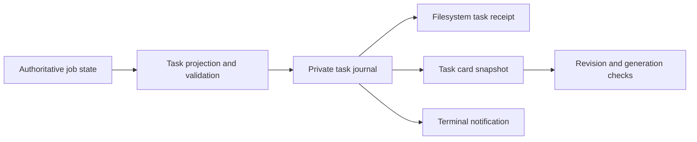

# Step 3: consistent task and UI events

Built and tested in the working checkout. The installed JARVIS voice release and
shell plugin were not changed during this step.

## What changed

Task presentation now has one canonical JSON Schema:
`contracts/task-event-v1.json`. It defines identity, source, attempt generation,
revision, sequence, state, measured progress and verification scope. Python
validates serialized events against it; the QML consumer uses a generated copy
of that same schema. A regression check rejects a stale generated copy.

The active voice implementation's existing background-notification path now
reconciles filesystem tasks, model jobs, Hermes goals, delegated desktop agents
and teams into a bounded SQLite presentation journal. No task execution is
replayed by this journal. Full model transcripts, worker instructions and widget
layouts remain separate from task state.

Filesystem start/status/cancel receipts include a `task_event` envelope. The UI
snapshot and terminal notification carry that same envelope. Existing worker
queues and provider status APIs remain compatible; they are not all replaced
with this new wire format. Native control-supervisor notices retain their
existing delivery path and are outside this presentation cohort.



## State and evidence

| Observed fact | Presentation |
| --- | --- |
| Work admitted | Queued |
| Work executing | Working |
| Approval pending | Needs your response |
| Cancellation requested but operation still running | Stopping |
| File steps completed and existing step/disk checks passed | Completed; file-step scope shown |
| Hermes workspace checks passed | Completed; functional behavior explicitly unverified |
| Model answer or agent response returned without effect verification | Result ready; actions not verified |
| Local waiting stopped but remote cancellation is uncertain | Needs review; execution unknown |
| Operation actually cancelled | Cancelled; partial completed-step counts retained |

Result text and a zero process exit code cannot become verified action success.
Unknown progress is not converted to a percentage. File progress uses actual
completed/total step counts, and counters cannot move backwards within an
attempt. Closing a card does not cancel the underlying task or undo effects.

## Ordering, recovery and limits

- The private journal stores a persistent stream identity, global sequence and
  per-task revision. Source generations and available producer revisions reject
  delayed updates. An unchanged projection still advances its producer fence.
- A terminal attempt cannot become active again. Resuming the same identity
  needs a larger owner generation. A new attempt may reopen a card explicitly
  dismissed in an earlier generation.
- Python keeps up to 256 event records and 128 current snapshots. If a replay
  cursor falls behind retained history, it receives a current-state resync.
- Unacknowledged terminal outcomes are not evicted to make room. At capacity,
  projection reports an error while the existing admitted job remains admitted;
  a presentation failure must not encourage duplicate task submission.
- One presenter owns a profile at a time. Process death releases its lease.
  After restart, missing in-memory tasks become Needs review, not indefinitely
  Working. Hermes execution remains reconciled through its existing durable
  authority, not inferred from missing local workers.
- Notification acknowledgement includes the stream and exact sequence. A late
  acknowledgement cannot acknowledge a newer result. Already-acknowledged legacy
  producer outcomes are recognized when initially observed.
- UI delivery retries from retained snapshots. A shell timeout does not discard
  the task result, acknowledge a notification or affect task execution.
- Cards reject older revisions, older generations, another stream and malformed
  or falsely verified events. Generic widget creation cannot use reserved task
  IDs or overwrite task-owned cards.
- Active cards do not expire. Terminal cards have a fixed 120-second lifetime;
  duplicate snapshots do not extend it or resurrect an expired/dismissed card.
- The existing 24-card display limit remains. Active snapshots take priority;
  omitted/projection-error counts are exposed by canvas status. UI ordering
  metadata is bounded separately.

The journal lives under `$XDG_STATE_HOME/jarvis/task-ui/events.sqlite`, defaulting
to `~/.local/state/jarvis/task-ui/events.sqlite`. The directory is private and
user-owned; the database is mode 0600. It stores bounded presentation metadata,
not an authoritative execution ledger or a complete audit of every worker event.

Reconciliation uses the existing background monitor (normally a two-second
interval). It coalesces observed state, so very short intermediate worker phases
may never be rendered. A status receipt and UI are eventually consistent, with
identity/revision checks preventing stale rollback. This is not a guaranteed
real-time, lossless stream of all underlying worker events.

## Implementation

- `orchestration/task_events.py`: validation, atomic journal, snapshots, replay,
  retention and exact-result acknowledgement.
- `orchestration/task_presentation.py`: source projection and UI/notice delivery.
- `skills/skills.py`: filesystem receipt integration and lazy presenter lifecycle.
- `jarvis_control/skills.py`: current voice background delivery and acknowledgement.
- `ui/jarvis_widgets/TaskEvents.js`: consumer validation, ordering and task cards.
- `Widgets.qml`, `WidgetModel.js`, `WidgetCard.qml`: task-event IPC, protected
  identities and plain-text state/evidence rendering.
- `scripts/generate_task_event_contract.py`: derives `TaskEventContract.js`.

The original attachment input bar and existing widgets remain covered by the
required regression gate. No input-bar routing or appearance was changed.
Runtime requirements now explicitly pin `jsonschema==4.26.0`.

## Validation

- Final required behavior gate: **148 passed across ten contracts**, including
  all prior input, vision, parsing, permissions, evidence and rollback checks.
- Broader background/durable-Hermes/task/widget checks: **86 passed, 10 subtests**
  before the final two additional task-event cases; those cases passed in the
  final required gate. These suites overlap.
- Offscreen Qt rendering/interaction suite: **16 passed, no skips**. It renders
  the task card, checks its evidence/progress state, and exercises stale replay,
  dismissal and explicit new-generation rendering.
- Python and the actual JavaScript consumer accept/reject shared serialized
  fixtures, including Unicode text and unverified-success rejection.
- A real temporary-file task produced identical canonical status, card and
  notification events. Cancellation waited for an in-flight operation and kept
  its partial effects while skipping the next step.
- Static QML lint exited successfully; Quickshell PanelWindow/Margins type
  metadata still produces warnings. The installed live shell was not modified
  or acceptance-tested in this build.

Saved evidence: `CONSISTENT-TASK-UI-EVENTS-EVIDENCE-2026-11-03.json`.

Run the main gate from the checkout:

```bash
.venv/bin/python scripts/behavior_gate.py --report /tmp/jarvis-task-events-gate.json
```

Regenerate the consumer after a deliberate schema change:

```bash
.venv/bin/python scripts/generate_task_event_contract.py
```

The [Fury review](voice-gui/08-fury-analysis.md) supplied the separation-of-events
design reference. No Fury code or dependency was imported; its unresolved reuse
licensing remains unchanged.

Attribution: CSE-OS by CSE-OS Contributors, adapted from Founder OS by Adam M.
Adamek (Impact Brussels ASBL).
