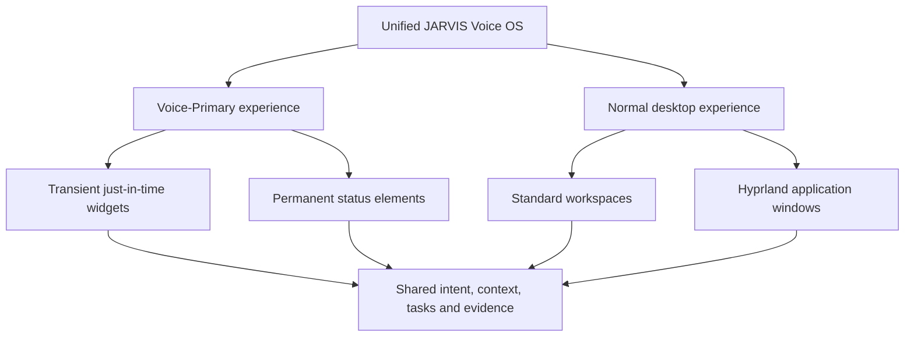
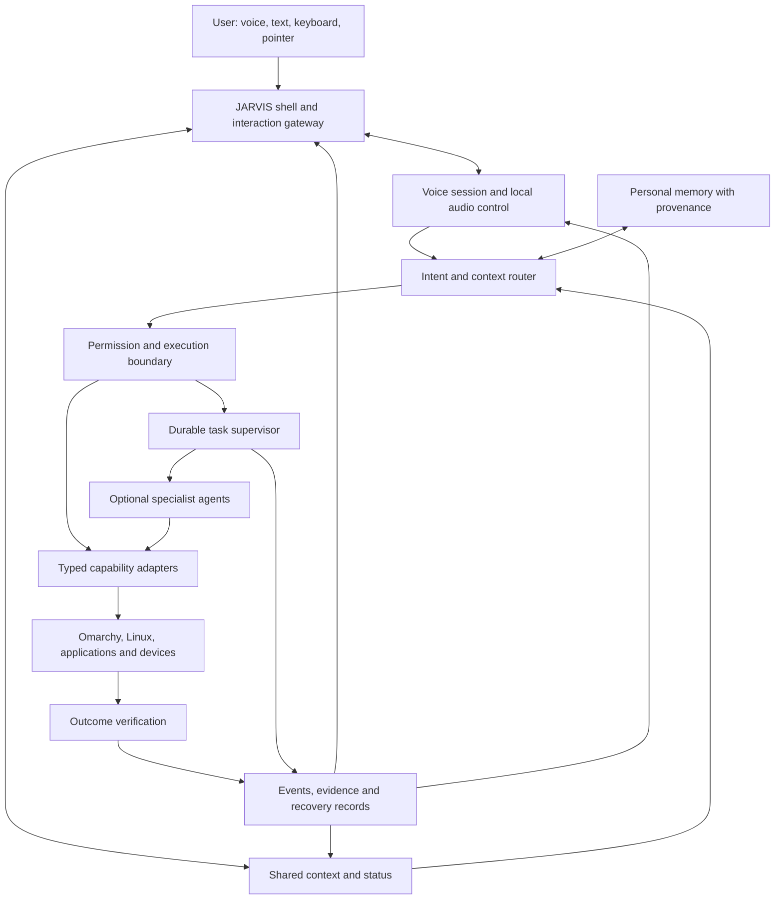

# JARVIS OS
## Master plan for transforming Omarchy into a voice-first personal AI operating system

**Product:** JARVIS OS  
**Version:** 1.0 - consolidated five-pillar product and architecture specification  
**Date:** 2 November 2026, Asia/Kolkata  
**Owner:** Gopi  
**Document role:** Product definition, target architecture, experience requirements, and delivery plan

**Documentation home:** [JARVIS OS DOCS index](README.md). Unique supporting
sources from both repositories are listed in the [consolidation catalogue](CONSOLIDATION-REPORT.md).
The [OpenVoiceOS reference](OPENVOICEOS-REFERENCE.md) records proposed upstream
speech and skill integration experiments.

> **The final goal is to transform the normal Omarchy computing experience into a voice-first personal AI OS.** The user speaks intentions; JARVIS understands the relevant context, operates the computer, checks the outcome, remembers appropriate context, and continues the conversation. Voice becomes the main way to use the computer across everyday work.

The JARVIS-OMA and JARVIS OS folders supply implementation references. Their current structure, individual features, personas, and older roadmaps do not limit this product goal. This document defines the destination and the order of work. The companion reference audit records what the inspected projects currently establish.

The system is **voice-first and agent-native**. Its intent coordination, concurrent cognitive runtime, epistemic and episodic memory, evaluation/autonomy boundary, and hybrid shell are first-class architectural layers. Individual tools and plugins extend those layers; they do not define the whole product.

## Contents

1. [The product we are building](#1-the-product-we-are-building)
2. [What the transformation changes](#2-what-the-transformation-changes)
3. [A day using JARVIS OS](#3-a-day-using-jarvis-os)
4. [The operating principles](#4-the-operating-principles)
5. [Conversation and voice behavior](#5-conversation-and-voice-behavior)
6. [The JARVIS desktop and visual identity](#6-the-jarvis-desktop-and-visual-identity)
7. [The complete capability map](#7-the-complete-capability-map)
8. [System architecture](#8-system-architecture)
9. [Shared state and action contracts](#9-shared-state-and-action-contracts)
10. [System integration and execution](#10-system-integration-and-execution)
11. [Personal memory and continuity](#11-personal-memory-and-continuity)
12. [Tasks, agents, and autonomy](#12-tasks-agents-and-autonomy)
13. [Privacy, identity, and permissions](#13-privacy-identity-and-permissions)
14. [Lifecycle, reliability, and offline behavior](#14-lifecycle-reliability-and-offline-behavior)
15. [Phone, connected services, and home devices](#15-phone-connected-services-and-home-devices)
16. [Installation, updates, and the OS identity](#16-installation-updates-and-the-os-identity)
17. [What the existing projects contribute](#17-what-the-existing-projects-contribute)
18. [Build phases and completion gates](#18-build-phases-and-completion-gates)
19. [The first implementation sequence](#19-the-first-implementation-sequence)
20. [Acceptance scenarios](#20-acceptance-scenarios)
21. [Measurements and release standards](#21-measurements-and-release-standards)
22. [Decisions, boundaries, and the finish line](#22-decisions-boundaries-and-the-finish-line)

## 1. The product we are building

JARVIS OS is a personal AI operating environment built on the working Linux and Omarchy foundation. It owns the everyday interaction experience: starting work, opening applications, finding information, managing files, controlling devices, remembering projects, coordinating tasks, and recovering from failures.

The JARVIS and FRIDAY inspiration means natural conversation, useful awareness, continuity, quick responses, capable system operation, and a coherent visual presence. These qualities must come from functioning integrations and measured behavior. The product does not depend on reproducing a film interface or giving a chatbot unrestricted system access.

The intended experience is simple: **speak a goal, see the computer respond, and remain in control.** Keyboard, pointer, touch, and text remain available. An existing application can keep its normal interface while JARVIS provides the primary route into its useful actions.

The transformation starts as an installable layer on a normal Omarchy machine. It grows into a complete JARVIS session with its own interaction shell, setup, settings, activity history, recovery experience, and update channel. A dedicated installation image is a later packaging option, after the transformation works reproducibly on a fresh Omarchy installation.

### Product success

A user should be able to complete a normal work session mainly through conversation, understand what the computer is doing, interrupt or correct it, resume unfinished work, and recover when something fails. Success is measured through completed workflows and actual user experience, rather than tool counts, agent counts, or animated screens.

## 2. What the transformation changes

| Computing area | Normal Omarchy workflow | Target JARVIS OS workflow |
|---|---|---|
| Starting work | Open applications and locate files manually | “Resume my website project”; restore an approved workspace and show its current work |
| Launching and switching | Launcher, shortcuts, workspace navigation | Speak the application or task; resolve the correct window and confirm focus |
| System settings | Open menus or run commands | Ask for a change; apply it through a supported adapter and read back the state |
| Information | Search multiple applications and tabs | Ask once; retrieve current sources and show supporting material |
| Files | Navigate, search, copy, and organize manually | Describe the intended file operation; resolve ambiguity and verify the result |
| Longer work | Watch terminals and check completion | Start a trackable task; continue talking; receive a useful completion notice |
| Personal context | Re-explain preferences and project state | Resume from relevant, inspectable memory and fresh system observations |
| Notifications | Separate alerts without shared context | Prioritize meaningful events with quiet hours and spoken or visual delivery |
| Recovery | Interpret disconnected tools and service errors | Show the affected capability, preserve work, and offer the next valid action |
| Desktop identity | Distribution shell and separate utilities | One coherent JARVIS interaction, settings, activity, and recovery experience |

The Linux kernel, drivers, filesystem, networking, compositor, audio server, and applications continue doing their jobs. JARVIS integrates them through a stable control layer. Replacing working infrastructure is justified only by a concrete product requirement.

## 3. A day using JARVIS OS

**Start.** After login, JARVIS shows a clear ready, muted, standby, or degraded state. A brief greeting is optional. It can summarize selected tasks and battery status when useful; it does not recite every notification.

**Work.** “Open my JARVIS project, put the editor on workspace two, and show the pending tasks.” JARVIS identifies the project, opens the right applications, checks window placement, and presents the task list. If two projects match, it asks one focused question.

**Continue naturally.** “Explain what changed yesterday.” While it answers: “Wait, only the voice changes.” Old speech stops, the new request replaces the relevant part of the conversation, and previously completed actions are not repeated.

**Delegate.** “Investigate the failing tests and prepare a fix.” JARVIS records the objective, workspace, limits, and acceptance criteria, then runs suitable background work. The desktop and conversation stay responsive. Completion means an inspectable result with evidence.

**Move between devices.** “Open that report on my phone.” JARVIS resolves the paired device, checks the allowed transfer route, and reports whether the report actually reached it. Without a connection, it explains the limitation.

**Finish.** “Save where we are and enter privacy mode.” JARVIS checkpoints eligible tasks, records an appropriate project summary, stops the configured observation and transmission, and makes the privacy state visible.

These are target acceptance journeys. Their presence here is not a claim that every step is implemented today.

## 4. The operating principles

1. **Voice is the primary interaction.** Ordinary work should not require remembering command names or opening a terminal.
2. **Intent becomes observable action.** A model request passes through an execution boundary; completion requires suitable evidence.
3. **Context has a source and age.** Current desktop observations override remembered state. Missing context remains unknown.
4. **Control remains local.** Mute, cancellation, status, and recovery must remain available during provider or network failure.
5. **Memory serves the user.** Useful continuity comes with inspection, correction, export, and deletion.
6. **Autonomy has a scope.** Every independent task has an owner, budget, permitted resources, and stop conditions.
7. **Visuals explain real state.** Motion, color, progress, and speech reflect the same underlying events.
8. **Updates preserve the computer.** Configuration, credentials, memory, user files, and a usable recovery route survive upgrades.
9. **Availability respects privacy.** Local standby, active conversation, microphone mute, and full shutdown are distinct states.
10. **Claims follow evidence.** Software tests, live provider checks, and physical microphone/speaker checks prove different things.

## 5. Conversation and voice behavior

### 5.1 Modes and state

The interaction model distinguishes offline/stopped, local standby, listening, processing, acting, verifying, speaking, waiting for clarification, waiting for approval, muted, and degraded states. Background tasks can continue independently, so one animated “thinking” state cannot represent the whole system.

Each request progresses through an identifiable turn. A spoken correction, explicit cancellation, or new request can supersede it. Old audio and stale tool requests are fenced from the new turn.

### 5.2 Natural conversation

JARVIS accepts everyday wording, follow-up references, and ordered multi-step requests. It resolves “that window” or “the report” using recent, permitted context. It asks when an uncertain target would change the result. It avoids making the user repeat information that is already available and still valid.

Replies are brief by default, with details shown in a panel or saved document when appropriate. Longer explanations remain available when requested. Acknowledgements describe actual progress; they do not pretend that a task is complete or conceal a stalled request.

### 5.3 Natural interruption

The target is reliable spoken interruption while the assistant talks, followed by a useful response to the new request. The complete behavior includes:

- detecting user speech during playback while rejecting the assistant's own speaker echo;
- stopping audible playback and discarding old queued response audio;
- preserving the opening words of the new request;
- ending the new input turn correctly after the user stops;
- retaining completed tool results without replaying their effects; and
- recovering visibly if the provider never acknowledges or responds.

“Stop speaking,” “cancel this task,” “pause automation,” “mute the microphone,” and “stop JARVIS” have different effects. The UI and spoken acknowledgements must preserve those distinctions.

### 5.4 Availability and language

Users can choose an explicit shortcut, local wake phrase, or an activated conversational session. Local standby must clearly state whether audio leaves the machine. After physical or software microphone mute, spoken unmute cannot be the only recovery method.

The first release targets the user's English usage, including their accent and everyday wording. Additional languages, mixed-language turns, pronunciation dictionaries, and voice choices are later capabilities with their own acceptance recordings and evaluations. Persona and voice selection do not change permissions.

### 5.5 Concurrent thought, speech, and dual tracking

The **Reflex Track** serves local, time-sensitive interaction: capture/playback supervision, accepted interruption, mute, cancellation, ready-state changes, and short cached acknowledgements. Deterministic supported controls can use fast adapters once the intent and authorization are established. Reflex operations use supported operating-system interfaces; they do not require arbitrary application code in a hardware driver or the kernel.

The **Deep Background Track** performs planning, retrieval, research, file workflows, builds, test analysis, and agent assignments. It uses bounded queues and independent workers. The two tracks exchange intent/task events rather than waiting for one another's full completion. Linux remains the process/thread scheduler; dual tracking describes JARVIS's concurrency and priority design.

JARVIS can continue reasoning or retrieving while speech streams. Speculative plans remain provisional; partial speech or a changing hypothesis cannot authorize an irreversible action. The assistant can narrate progress while a tool works, but its final explanation must incorporate the actual result. Local fillers are feedback with a per-request budget, never fabricated evidence of thought or completion.

Voice persistence means preserved application context, receipts, and reconnectable sessions. Desktop-shell reloads should not terminate unrelated background work. A network failure may require a new provider session; a reboot requires durable checkpoints. Neither in-memory state nor a provider resumption token guarantees uninterrupted conversation across every failure.

## 6. The JARVIS desktop and visual identity

The visual direction combines the restrained clarity associated with Apple interfaces and a distinctive JARVIS presence: carefully spaced surfaces, readable typography, responsive transitions, subtle depth, and a recognizable assistant core. Effects should help the user interpret state without filling the desktop with decorative instrumentation.

### 6.1 Three interface layers

**Compact island.** The always-available presence shows the assistant state, useful time/context, real battery percentage, and charging state. Preserve the user's requested layout: no weather or microphone button in the compact face. A privacy state must still be visible through a clear label or state marker. Unavailable battery data displays unknown rather than an invented percentage.

**Expanded assistant.** Opening the island reveals the current request, brief conversation, verified action outcomes, task progress, clarifications, approvals, and stop controls. Preserve the user's removal of sound and brightness sliders from this expansion. Voice commands for those system controls remain supported; detailed controls can live in Settings.

**Activity and settings.** A dedicated surface provides tasks, history, memory controls, routines, connected devices, permissions, health, voice preferences, and recovery. Detailed technical logs belong in diagnostics, outside ordinary task flows.

### 6.2 Reactive effects

Listening motion uses measured input activity. Speaking motion uses actual output measurements when available; otherwise it is labeled activity, not a fabricated waveform. Processing has a restrained animation. Progress bars require measurable progress; unknown-duration work shows elapsed time and meaningful stage changes.

Transitions between compact and expanded views should feel continuous, preserve focus, and avoid shifting unrelated desktop content. Battery changes, connection loss, task completion, and approval requests receive distinct, brief responses. Decorative loops reduce or stop when idle, on battery, or in reduced-motion mode.

### 6.3 Interaction and accessibility

The shell supports keyboard navigation, Escape to close, visible focus, readable contrast, display scaling, multi-monitor placement, and screen-reader descriptions where supported. Color is accompanied by text or shape. Clicking mute waits for acknowledged state. A disconnected bridge displays stale/offline state with its last-update age.

Existing shortcuts are retained unless the user chooses a migration. In particular, Super+H remains dedicated to the existing dictation workflow. No shell redesign should steal application focus merely to animate an event.

### 6.4 Hybrid Shift Interface and just-in-time widgets

The **Hybrid Shift Interface** lets the user move freely between a Voice-Primary workspace and the normal Hyprland desktop. Voice-Primary emphasizes the assistant and contextual cards; Normal emphasizes application windows, pointer and keyboard work. This changes presentation and interaction emphasis, not the owner of tasks or the shared context. User keyboard/mouse intervention pauses conflicting automation and triggers a fresh observation before it continues.

**Dynamic JIT widgets** present information that speech alone handles poorly: a chart, test summary, file comparison, code diff, research sources, task checklist, device selector, or concrete approval. A request creates a bounded widget description tied to its request/task ID. The shell renders an approved component with validated data and allowed interactions. Widgets do not receive unrestricted generated code, shell access, credentials, or independent execution authority. Optional rich web surfaces require sandboxing and restricted navigation/network access.

Widgets appear near relevant work without covering critical content, can be pinned or dismissed, and expire by an explicit lifecycle policy. End-of-conversation cleanup removes eligible temporary cards; pinned evidence, unsaved user input, pending approvals, and active task results remain available. Dismissing a widget does not silently cancel its task or delete its evidence.

**Permanent widgets** anchor assistant/privacy state, battery, time, meaningful device health and active task indicators. Input levels and token/cost telemetry belong in optional detailed views, preserving the compact battery-first layout. Permanent widgets use the same event feed as JIT cards.

**Multimodal screen awareness** combines window geometry, application metadata, permitted accessibility/text buffers, OCR, and optional screenshots or camera frames. It is scoped, timestamped, and sometimes incomplete. Fresh targeting is required after focus, layout, navigation, or user changes. Visual interpretation does not establish absolute access to every application or hidden text.

## 7. The complete capability map

Each domain needs discovery, a typed operation, appropriate permission, observable results, failure behavior, and user-facing controls. Support is advertised per capability rather than assuming every application behaves identically.

| Domain | Required product capabilities | Completion evidence |
|---|---|---|
| Desktop and workspaces | Launch, focus, arrange, move, switch, restore a work context | Correct application/window identity and compositor readback |
| Files and projects | Find, inspect, create, edit, organize, copy, move, trash, restore | Correct paths and content/state checks appropriate to the operation |
| Browser and research | Search, open, read, compare, summarize, cite | Bound tab/page identity, retrieved content, source and freshness |
| Productivity | Notes, reminders, calendar, tasks, documents | Saved record, correct time zone, explicit delivery or draft state |
| Communication | Read or prepare messages through authorized accounts | Correct account/recipient; sending requires the authorized scope |
| Media | Playback, pause, seek, audio routing, current media | Actual player, sink, and playback state |
| System and devices | Battery, power, audio, brightness, displays, networking, Bluetooth, input devices, printers, services | Adapter-specific state readback and capability availability |
| Development | Repository context, tests, changes, builds, review, bounded agent work | Workspace diff, meaningful checks, artifact and review state |
| Personal intelligence | Preferences, project continuity, goals, routines | Provenance-aware memory and user-reviewable decisions |
| Perception | Active application, selected screen content, optional camera | Timestamp, target, consent and freshness; no implied continuous access |
| Health and recovery | Dependency status, failed services, resource pressure, restoration | Local probes, affected feature, recovery outcome |
| Connected ecosystem | Paired phone, external services, optional home devices | Device/account identity, scoped access and independently checked state |

A “full OS transformation” means a coherent experience across these domains and a maintained route for adding adapters. It does not require rebuilding every application or promising unsupported automation.

## 8. System architecture

### 8.1 The five structural pillars

| Pillar | First-class responsibility | Operational contract |
|---|---|---|
| 1. Core System Architecture | Unified Intent Bus and capability/control coordination | Route all JARVIS entry points through typed, authorized, traceable intents |
| 2. Cognitive Pipeline | Concurrent thoughts/speech, Reflex and Deep Background tracks, negative/self-correction reflexes, voice continuity | Keep interaction responsive while bounded work proceeds independently |
| 3. Cognitive State and Epistemic Memory | Active/Evaluation layers; lexical, schematic, fusion, and Obsidian reflections | Preserve useful context while tracking source, uncertainty, corrections, and freshness |
| 4. Self-Evaluation and Sandbox Autonomy | Proactive work, isolated experimentation, protected verification, activation gates | Permit improvement within scope without allowing a candidate to approve itself |
| 5. Hybrid UI Architecture | JIT widgets, permanent indicators, screen awareness, Hybrid Shift Interface | Provide one consistent experience across voice-first and traditional desktop work |

### 8.2 Unified Intent Bus

The bus is JARVIS's logical nervous system. Voice, typed requests, UI interactions, permitted screen observations, system events, routines, and agent/task results enter a shared coordination protocol. Raw observations first become typed observations; a router may derive an intent. A screenshot, downloaded document, or background result is never automatically an instruction from the user.

Producers submit versioned envelopes. Admission validates identity, schema, source trust, authorization context, target, deadline, and request key. The router assigns conversation, reflex, or durable-work handling. Adapters execute only admitted actions, and verification publishes the resulting evidence and state.

Use a protected user-session IPC boundary and a persistent event/outbox store for work needing recovery. Apply priority, bounded payloads, backpressure, cancellation generations, and deduplication. Do not send real-time PCM frames or large screenshots through the durable intent log: carry references to bounded data channels with explicit lifetimes.

The bus unifies JARVIS coordination **above** Linux services. D-Bus, application event loops, Hyprland IPC, PipeWire, systemd and kernel interfaces remain substrate protocols reached through adapters. The Linux kernel executes supported system calls, not natural-language intents. “Native OS intent execution” means a first-class JARVIS action contract backed by these interfaces. Existing well-scoped subprocess adapters remain valid where an API is unavailable; eliminate unsafe disconnected ownership rather than banning subprocesses categorically.

### 8.3 End-to-end architecture

### 8.4 Component responsibilities

The **shell** owns interaction and presentation. The **voice runtime** owns conversational transport and its audio lifecycle. The **context service** supplies fresh, privacy-controlled observations. The **memory service** supplies personal continuity. The **policy/execution boundary** validates tool requests. The **task supervisor** owns background execution and delivery. **Adapters** operate the platform and applications. **Verification** establishes what happened. The **release manager** owns installation, activation, and rollback.

These are responsibility boundaries, not a requirement for a separate daemon per box. Start with a modular implementation and split processes when isolation, lifecycle, or responsiveness requires it. CPU-intensive inference, slow tools, database work, and agent execution must not block the audio loop.

One component owns microphone capture at a time. Independently supervised tasks, device transport, and health monitoring may run as separate services. Multiple services must not create competing microphone owners or separate desktop executors that disagree about policy.

### 8.5 Implementation technology policy

Keep the current working implementation unless measurements justify replacing a component. Python can continue coordinating models, memory, tools, and tasks. Quickshell/Qt can provide the native desktop shell; isolated web components can serve richer bounded widgets. Rust/C++/Zig are options for a proven audio/DSP or low-latency boundary; Go or an actor runtime are options for a supervisor whose requirements justify them. Mojo and other acceleration approaches remain experiments until the actual hardware and workload support them.

The polyglot blueprint contributes separation of latency-sensitive and experimental work, bounded IPC, and process fault isolation. It does not mandate introducing eight languages, a new microkernel, or replacing the locked voice core. Versioned protocols, observable failure handling, and supported dependency packaging matter more than language count.

### 8.6 Protected voice boundary

The original JARVIS-OMA files `audio/engine.py`, `audio/downstream.py`, `audio/echo_cancel.py`, `audio/__init__.py`, `echo_cancel.py`, `tests/test_audio/test_engine.py`, and `tests/test_audio/test_echo_cancel.py` must not be modified, deleted, renamed, monkeypatched, or overridden. New audio behavior uses `audio/extension.py`, supported hooks/processors, or isolated modules such as `audio/plugins/`. A proposed native companion or new language must respect that boundary and receive its own integration evidence.

## 9. Shared state and action contracts

Voice, UI, CLI, notifications, and agents consume one logical source of state. Existing stores may be reused behind adapters; unification does not mean blindly merging databases or changing every API at once.

### Minimum shared records

| Record | Required information |
|---|---|
| Intent | Request/turn ID, origin, goal, target, constraints, ambiguity and authorization context |
| ContextSnapshot | Observation time, source, application/window/device IDs, permitted fields, freshness and privacy mode |
| Action | ID, parent request/task, capability, normalized arguments, target, policy decision and execution state |
| Evidence | Observation method, timestamp, expected and observed state, outcome and limitations |
| Task | Owner, objective, workspace, budget, request key, checkpoints, descendants and delivery state |
| MemoryRecord | Claim, source, confidence/uncertainty, scope, revision and retention policy |
| Capability | Availability, preconditions, risk, schema, verification method and available recovery |
| Event | ID, schema version, correlation/parent IDs, actor, time, privacy label and bounded payload |

Action states include proposed, awaiting clarification, awaiting approval, queued, executing, verifying, completed, failed, cancelled, partially completed, and unknown. “Unknown” is essential when a process dies after an effect may have occurred; it prevents unsafe automatic replay.

Event delivery needs deduplication and replay-safe consumers. A completion notification accepted by a transport is not proof the user heard or read it. Task execution state and notification delivery state remain separate.

## 10. System integration and execution

### 10.1 Preferred execution order

Use a supported application or platform API first, then a structured CLI or IPC route, then accessibility-based interaction, then bounded vision-assisted GUI interaction where necessary. Prefer operations with clear targets and readback. A raw shell is a restricted capability, not the universal default tool.

Omarchy command discovery reads the installed catalogue. Customization uses supported user overrides, themes, plugins, and hooks. Packaged `/usr/share/omarchy` files remain read-only so normal updates remain possible.

### 10.2 Every action follows the same loop

1. Interpret the user's goal and identify the target.
2. Read relevant fresh state and confirm capability availability.
3. Validate arguments, scope, preconditions, and any required approval.
4. Record an action identity before an externally visible effect.
5. Execute with a timeout, cancellation path, and appropriate resource limits.
6. Read back the result through a meaningful independent observation.
7. Report completed, partial, failed, or unknown truthfully; save permitted evidence.

A failed or held prerequisite stops dependent steps. Independent steps may continue only when the plan makes that independence explicit. Retrying an uncertain effect requires inspection before execution.

### 10.3 Verification examples

Opening an application requires identifying its actual window, not merely a successful launcher process. Moving a window requires the selected window's resulting workspace. A file copy requires appropriate content checks; a move also checks source disposition. Opening a URL proves navigation only; summarizing it requires successful content retrieval. Typed input distinguishes delivered keystrokes from observed text and submitted application state.

Undo is advertised only for capabilities that implement it. File trash, reversible settings, drafts, and workspace changes are useful early candidates. Interrupting speech does not automatically undo completed actions.

### 10.4 Application bridges and shared desktop ownership

Provide editor/document APIs, terminal buffer and command-state readers, clipboard operations with explicit scope, media-player interfaces, and application-specific adapters before relying on generic keystrokes. Discover supported shortcuts from the installed environment rather than freezing an old hotkey count into the product. Pointer motion can be smooth for usability; it is not a security or automation-detection bypass.

Only one controller holds the shared desktop input lease. Parallel workers can use isolated repositories or independent services while the desktop is busy. A controller revalidates focus and its target after handoff or user intervention. Modal recovery can close a known harmless dialog or retry a supported operation within scope; it cannot approve authentication, accept new permissions, or dismiss destructive warnings on the user's behalf.

## 11. Personal memory and continuity

The memory model separates temporary conversation context, explicit personal facts, project history, task records, and current observations. Sensitive credentials are never ordinary memories.

JARVIS should remember useful preferences and ongoing work, retrieve only relevant context, and explain a memory's source when asked. Explicit requests such as “remember this,” “correct that,” and “forget this preference” have inspectable outcomes. Automatic capture is visible and configurable; uncertain inference is not promoted to a confirmed fact.

Use the existing durable memory foundation where suitable. Lexical retrieval remains available when embeddings are disabled or unavailable. Semantic search is optional and must be evaluated for useful matches, false associations, provider use, and cost. Optional Obsidian synchronization is a view/integration with conflict handling, not an excuse to create inconsistent authoritative copies.

The target includes retention controls, export, correction history, and deletion across active stores and retrieval indexes. Backup retention and third-party copies require explicit handling; a local delete must not imply that every external copy has disappeared.

Project continuity links recent decisions, relevant files, open tasks, and verified outcomes. Resuming work reads the current repository and desktop before acting on an old summary.

### 11.1 Active and Evaluation Layers

The **Active Layer** contains the current conversation, admitted intent, focused context, in-flight action state, and immediately relevant memories. Its size is bounded; it does not load the entire life history into every model request.

The **Evaluation Layer** checks retrieved historical context against source trust, current goal, freshness, contradictions, deletion state, and outcome evidence. Evaluation is query-driven or scheduled within a budget; “continuous” does not mean an unbounded model loop over every stored record. Current-state queries override remembered battery, weather, price, open-window, or service state.

**Epistemic memory** distinguishes what is observed, user-confirmed, inferred, uncertain, contradicted, or expired. **Episodic memory** records what happened in an interaction or task: environment, goal, attempts, result, errors, verification, and useful lessons. The machine's identity or “soul” is a reviewable persona/preferences profile, not authority to rewrite policy.

### 11.2 Four reflection mechanisms

| Mechanism | Meaning in JARVIS OS | Required checks |
|---|---|---|
| Lexical Reflection | Exact identifiers, filenames, commands, phrases and searchable text indexes | Source attribution, deletion propagation and appropriate exact-match behavior |
| Schematic Reflection | Structured task patterns, entities, relationships and reusable procedures | Preconditions, environment/version scope, outcome evidence and retirement rules |
| Fusion Reflection | Combine lexical retrieval, optional semantic candidates and structured relationships | Deduplicate, filter by trust/freshness, rank relevance and retain uncertainty |
| Obsidian Reflection | Human-readable selected knowledge, project decisions and links in a Markdown vault | Redaction, provenance, conflict resolution, retention and correction synchronization |

Lexical indexes are not vectors by definition; embeddings and semantic similarity are a separate optional retrieval path. A fused result is contextual evidence rather than an unquestionable fact. Obsidian can expose an auditable knowledge graph without mirroring secrets, every raw transcript, or unrestricted internal state.

Scheduled reflection can summarize completed work and propose validated procedures. Run it at a configured time and budget with quiet-hour/battery policy, rather than hard-coding a universal 3 AM job. Retain evidence links and let the user review significant learned preferences.

## 12. Tasks, agents, and autonomy

JARVIS is the primary user-facing assistant. FRIDAY may be an optional named specialist or persona. Hermes and other installed agents can supply orchestration or worker capabilities. These names do not require separate always-running models, duplicate memories, or authority beyond the user's scope.

Simple supported actions use direct adapters. Longer work becomes a durable task with an ID, objective, scope, workspace, acceptance criteria, budget, owner, and result location. Specialist agents receive bounded assignments in isolated workspaces when their work can affect source or system state.

### Coordination requirements

- Admit each logical request once using a stable request key.
- Persist execution receipts and checkpoints before acknowledging background ownership.
- Record parent/child lineage, ownership generation, and cancellation acknowledgements.
- Reject stale owners, duplicate effects, and recursive delegation loops.
- Keep independent tasks independent when a conversation is cancelled.
- On parent-task cancellation, stop owned descendants and report unresolved execution honestly.
- Verify artifacts and task-specific acceptance; a worker's “done” text is insufficient.
- Keep the desktop and voice responsive under worker CPU, memory, disk, and network load.

### Autonomy levels

| Level | Permitted behavior |
|---|---|
| Observe | Gather only permitted state; report when asked |
| Suggest | Notify about meaningful conditions; propose an action |
| Prepare | Draft a change or plan without applying its external effect |
| Execute within scope | Perform explicitly allowed reversible actions under configured limits |
| Sensitive execution | Require the applicable fresh approval or OS authentication |

Routines specify triggers, time zone, quiet hours, cooldowns, permissions, failure handling, and delivery. Continuous operation should stay quiet when nothing meaningful changes. An assistant may schedule work only within the user's configured authorization.

### 12.1 Negative Reflex

The Negative Reflex rejects malformed, stale, denied, or out-of-scope intents before they reach execution. Fast schema checks, capability allowlists, target/path validation, ownership generations, cancellation checks and risk policy implement this boundary. Token or regex filters may supplement it; they cannot be its sole security mechanism. Encoded instructions, changed targets, and tool combinations must still face the typed execution policy.

### 12.2 Self-Correction Reflex

For a failed task within the existing authorization, JARVIS can inspect the error, propose a cause, create a bounded candidate in an isolated workspace, rerun meaningful checks, and retry within a defined budget. It preserves the original failure and each attempt. Repeated failure, ambiguous effects, exhausted budgets, or a need for broader authority cause an explicit stop or escalation.

The reflex cannot weaken permissions, edit protected audio, change the verifier to accept its own output, install arbitrary dependencies, or patch the running OS merely to make a test green. External effects with unknown outcomes are reconciled before retry.

### 12.3 Self-Evaluation Engine and Sandbox Autonomy

Proactive improvement is a controlled lifecycle: collect allowed task evidence -> select a recurring problem -> define a hypothesis and baseline -> generate a candidate in isolation -> compare against the incumbent -> evaluate unseen cases -> review/approve promotion -> stage/canary -> observe and roll back if needed.

Separate candidate generation, evaluator authority, and release authority. Candidates cannot edit protected tests, reference data, acceptance criteria, production state, or their own permission boundary. Use process/filesystem/network/resource isolation appropriate to the task; an ordinary Git worktree alone is not a security sandbox. The evaluator records real functional outcomes, scope compliance, total cost and regressions.

Safety gates block critical configuration, production deployment, privileged operations, or expanded scope pending the applicable explicit authorization. Voice can supply a concrete confirmation when allowed; OS authentication or a local approval surface may still be required. User cancellation revokes new action admission and propagates to owned workers even when speech has stopped.

Learning includes better memories, procedures, prompts, routing, and reviewed software capabilities. Model-weight training is a distinct optional research program requiring datasets, privacy review, compute, and independent evaluation. Better test scores on rehearsed examples do not establish general intelligence.

### 12.4 Specialist roles and operating economics

The older corporate matrix maps to configurable responsibilities: JARVIS for interaction; FRIDAY for continuity/operations; Hermes for research or orchestration; Prime for engineering; Ultron/OpenClaw for a security-review role where deliberately integrated. Enforce policy in the trusted broker even if a named security agent is unavailable. Actual installed/authenticated adapters determine which roles can run; a name is not an executable integration.

Agent-native operation includes a shared task board, dependency graph, bounded messages, visible worker output, usage/cost records, and explicit model/provider routing. Set concurrency, time, token and monetary limits; include retries and failed experiments in accounting. Provider routing respects supported protocols, configured accounts, backoff and quota limits. No key rotation or fallback can promise unlimited availability or equivalent voice/tool behavior without validation.

## 13. Privacy, identity, and permissions

The trusted execution boundary sits outside model prose. Web pages, files, screen text, task results, and agent responses remain untrusted content. They cannot expand tool permissions, approve a pending action, or authorize external transmission.

Ordinary reversible actions within a user's request should proceed without repeated confirmations. High-impact actions use a concrete, target-bound approval when required: recipient and content for sending, paths for deletion, amount/payee for financial actions, affected services for privileged administration. Approval expires or becomes invalid when the target, request, owner, or execution generation changes.

Session lock, presence, and authentication constrain sensitive work. A voice match alone is not sufficient authorization for privileged or financial operations. OS authentication remains an explicit user action.

Microphone capture, cloud transmission, camera/screen observation, memory capture, proactive work, and external connectors have separate controls. Privacy mode names exactly which of these stop. Status remains useful without exposing transcripts, page contents, tool arguments, or secrets by default.

Credentials use a private credential store or protected configuration and minimum connector scopes. Child processes receive only required credentials. Paired devices have revocable identity and permissions. A desktop pairing code is private data, never a report illustration or a public log item.

Optional out-of-band approval can extend the same action-bound policy to a trusted paired device or configured channel. It requires authenticated identity, expiry, replay protection, a specific action digest, and local audit. A Telegram message or an agent's approval prose alone is not OS authentication. Snapshot/backup protection is chosen from the machine's actual filesystem and recovery setup; do not assume Btrfs, encryption, a particular recovery partition, or that snapshots undo an external service action.

## 14. Lifecycle, reliability, and offline behavior

### 14.1 A managed session

At login, the system checks local dependencies, active audio devices, user-session readiness, and configured features. It shows ready or an accurate degraded condition. Startup must not quietly expose an empty tool registry while advertising capabilities that have not loaded.

Audio workers, provider transport, slow tools, task execution, and storage work have independent supervision. Queues have limits and age policies. Reconnects discard stale audio and preserve tool deduplication. Suspend, resume, device replacement, provider quota, and network loss receive explicit recovery paths.

One conversational request must not remain “thinking” forever. Distinguish speech that has not ended, provider delay, a running tool, failed playback, and a missing final answer. Each has a bounded recovery policy. Waiting acknowledgements cannot reset a watchdog indefinitely or count as the requested answer.

### 14.2 Capability-based degradation

| Condition | Required behavior |
|---|---|
| Internet/provider unavailable | Local mute, status, cancel, and desktop/CLI recovery remain usable; cloud conversation is marked unavailable |
| Local offline speech not installed | Do not promise arbitrary offline voice requests; offer available text/local controls |
| Microphone unavailable or muted | Show the exact condition and expose a keyboard/pointer recovery route |
| Memory unavailable | Continue supported immediate work; disclose lost continuity and failed writes |
| Desktop session locked or absent | Defer session-dependent actions; continue only tasks authorized for that state |
| External agent unavailable | Keep ordinary desktop functions usable and show that worker's readiness |
| Unknown task outcome | Preserve receipts and inspect; do not automatically repeat a possible effect |

An eventual offline speech adapter may support a bounded local command set before general offline conversation. It is an extension milestone, not an assumption about current provider-backed voice.

### 14.3 Resource policy

Measure the actual target laptop before setting budgets. Reserve responsiveness for audio and the interactive desktop, cap worker concurrency, and reduce observation/animation on battery or under pressure. CPU topology must be discovered before applying affinity; guessed core numbers are not a portable policy. Cloud-first operation can remain the first deployment profile on constrained hardware, with local models optional after measurement.

### 14.4 Health, diagnostics, and continuity

Monitor enabled services, gateway/DNS/network availability, configured server endpoints, CPU/memory/disk pressure, thermal state, battery, and audio readiness. Use debouncing, meaningful-change notifications, recovery events, and quiet hours. Distinct optional audio alerts must coexist with conversation and respect privacy/mute preferences. A failed remote probe does not automatically justify restarting healthy local services.

Retain redacted error categories, crash context, queue/backlog measurements, and source/release identity for diagnosis. Derive repair proposals from this evidence. A warm standby specialist can restore context only through an explicit failover ownership protocol; two conversational runtimes must never capture or execute the same request concurrently.

## 15. Phone, connected services, and home devices

The PC experience is the first complete product. Phone and home features extend it without weakening its local controls or duplicating the execution authority.

A paired phone has a visible identity and explicit target selection: “on my PC” and “on my phone.” Prefer the existing shared executor for PC actions. Every remote action has a request ID, policy decision, and replay-safe receipt. Disconnection leaves local capabilities available; it does not imply a remote action succeeded.

The PC is the default target for every new request. Use Android control only
when the current request explicitly targets the phone/mobile/Android. Earlier
phone work and pairing status must not change this default. Clear ordinary PC
commands execute without an extra permission question; tool-required sensitive
action confirmations remain in force. See the
[PC-default control verification](PC-DEFAULT-CONTROL-FIX-2026-11-02.md).

Connected accounts provide narrow capabilities such as reading calendar entries, creating a task, or preparing a message. Connector installation, account login, data access, and permission to send are distinct. Provider/model fallback is advertised only after equivalent conversational and tool behavior has been tested.

For home/IoT work, build read-only discovery and a device registry before switches, scenes, and schedules. Add explicit device identity, local protocol or gateway adapters, state verification, room naming, permissions, and recovery. Safety-critical devices need a dedicated policy and are excluded from general-purpose unchecked automation.

Cross-device/cloud synchronization is a separate capability from pairing and a local execution tunnel. It needs authenticated transport, minimum shared data, encryption, version/conflict handling, revocation, and deletion semantics. The current mobile implementation must be checked separately from earlier plans for remote synchronization; a working same-network phone link does not prove operation from anywhere.

## 16. Installation, updates, and the OS identity

### Migration stages

1. **Omarchy with JARVIS:** install the assistant, verified controls, island, and local recovery on an ordinary system.
2. **JARVIS session:** make the assistant the main entry point, integrate settings/activity/tasks, and provide a consistent visual identity.
3. **Managed JARVIS distribution layer:** ship reproducible installation, dependency checks, migrations, tested updates, rollback, backup/restore, and uninstall.
4. **Optional installation image:** package the proven experience for new installations after its maintenance and recovery requirements are met.

Branding includes the welcome flow, shell, launcher, settings, notifications, help, wallpapers, icons, documentation, and update experience. Preserve accurate distribution and dependency metadata. Renaming an OS label alone does not establish a functional migration.

### Release contract

Development workspaces and the installed runtime remain separate. Releases identify their source revision and configuration/schema expectations. Build in staging, run checks, activate atomically, verify application readiness, and retain a known-good previous release.

Rollback must account for user-state compatibility. Databases require a consistent backup method and migration plan; copying arbitrary live SQLite files is insufficient proof of safe recovery. Do not roll back newer user data silently. Service “active” is only one health signal; check imports, IPC, capability loading, memory access, and the relevant feature readiness.

The installed voice service can own capture while task, monitor, and transport services have separate lifetimes. Startup behavior, logout/sleep behavior, update draining, and stop-all semantics must be documented per service.

## 17. What the existing projects contribute

The inspected references establish substantial reusable foundations: voice capture/transport/playback, turn handling, local control, persistent memory, desktop/system adapters, retrieval, tasks, orchestration, mobile integration, and a reactive island. They do not establish the complete OS experience by themselves.

| Reference area | Reuse direction | Work still required for the product |
|---|---|---|
| JARVIS-OMA | Historical requirements, adapters, verification patterns, extension and voice-lock constraints | Reconcile legacy entry points and avoid operating two competing voice services |
| Active JARVIS OS | `jarvis_voice`, `jarvis_memory`, `jarvis_control`, task/agent and release components | Unified product contracts, full workflow proof, maintained setup/recovery experience |
| Island and Orbit sources | State presentation, battery face, interaction and motion patterns | Validate current bridge compatibility, accessibility and desktop integration |
| Older master blueprints | Broad personal-OS vision and integration ideas | Revalidate every implementation, timing and readiness claim before adoption |

The fresh JARVIS OS regression run on 2 November passed **1,157 tests and 142 subtests**, with two ONNX provider warnings. This is software regression evidence. It does not prove acoustic conversation quality, every connected provider, every phone action, or full product readiness.

The required JARVIS-OMA voice-lock check currently fails for an existing modification to `audio/downstream.py`. That is a release blocker to reconcile separately. This documentation work does not alter that file or any voice implementation. See the companion reference audit for commands, source locations, conflicts, and verification limits.

There is no defensible overall completion percentage yet. Track each capability through specified, implemented, automated-tested, live-verified, and release-ready stages against the gates below.

## 18. Build phases and completion gates

Phases are ordered by dependency. Existing code can satisfy individual work items after verification; the team need not rebuild a working subsystem to follow the sequence. Each phase ends with a demonstrable user journey.

| Phase | Deliverable | Gate before expansion |
|---|---|---|
| 0. Establish the baseline | One supported runtime, capability inventory, preservation rules, test baseline and rollback route | A reproducible clean installation/check; unresolved lock and release failures recorded and resolved for shipping |
| 1. Reliable conversation | Natural speech, correct endpointing, interruption, answer completion, local controls and recovery | Physical microphone/speaker scenarios pass; stalls and echo failures are observable and recoverable |
| 2. Voice-operated desktop | Verified application/window, workspace, settings, file and browser workflows | Repeated spoken workflows succeed; ambiguous/failed effects are reported truthfully |
| 3. Personal continuity | Memory review/correction/deletion, project state and resumable work | Restart retains appropriate context; stale memory cannot override current state |
| 4. Durable work | Long tasks, bounded agents, ownership, cancellation and useful result delivery | Restart/cancel/handoff tests and live representative work pass without duplicate effects |
| 5. JARVIS operating shell | Island, assistant panel, activity center, settings, approvals and shared state | Voice/text/UI agree; accessibility, multi-monitor and stale-state checks pass |
| 6. Bounded proactive OS | Routines, presence-aware notifications, health responses and autonomy settings | Quiet hours, permission boundaries, recovery and stop-all are demonstrated |
| 7. Managed transformation release | Installer, onboarding, updates, compatible rollback, export/restore and coherent branding | Fresh Omarchy machine passes supported everyday workflows and recovery |
| 8. Wider ecosystem | Phone continuity, account connectors and optional IoT adapters | Each device/connector passes its own identity, permission, failure and outcome checks |

UI design prototypes and contract design may run early. Deployment priority remains functional integration and reliable conversation before decorative polish. Phone work already present can continue within its own scope; it does not replace PC release gates.

## 19. The first implementation sequence

These are the next build packets, not authorization to modify the running machine from this document.

**Packet 1 - Establish one operating baseline.** Map the installed runtime, service ownership, sockets, configuration precedence, capability loading, and state paths. Reconcile the existing voice-lock failure without relaxing the invariant. Record source revision, focused/full results, and rollback evidence. Output: a reproducible baseline and explicit blockers.

**Packet 2 - Prove conversation on the actual machine.** Test first request after startup, short/long speech, quiet/noisy speech, natural correction during playback, tool follow-up, provider failure, and suspend/resume. Diagnose turn-end, provider, tool, and playback delays independently. Output: measured evidence and fixes limited to authorized extension/unlocked boundaries.

**Packet 3 - Complete a useful desktop workflow set.** Implement and verify the acceptance scenarios for applications, windows, workspaces, volume, brightness, files, browser reading, and current system state. Output: a capability support matrix and repeatable spoken demonstration.

**Packet 4 - Join state and task visibility.** Normalize request/action/task IDs, event envelopes, freshness, evidence, and delivery states across existing components. Output: one truthful status feed for voice, UI, notifications, and diagnostics.

**Packet 5 - Build the assistant workspace.** Connect the compact battery island and expanded assistant to that feed. Add task history, clarification/approval states, privacy indicators, and local stop controls. Output: a usable JARVIS shell with the user's requested compact/expanded layout.

**Packet 6 - Add continuity and release confidence.** Connect memory/project resumption, task lifecycle, onboarding, configuration, updates, and recovery. Output: a fresh Omarchy installation that can reproduce the supported JARVIS experience without a developer's private checkout.

Every packet includes failure cases, relevant automated tests, live evidence where applicable, and a short decision record. Estimate dates after the baseline and available development time are known; parallel work must respect shared machine and workspace ownership.

## 20. Acceptance scenarios

The quoted phrases are examples of natural intent, not a rigid command grammar. Use temporary files, disposable windows, and reversible settings for acceptance work.

| Scenario | Example request | Pass condition |
|---|---|---|
| First use | “What can you do on this computer?” | Advertises only loaded/available capabilities, including degraded dependencies |
| Immediate request | “What time is it?” after startup | Correct fresh local result with a completed reply |
| Natural interruption | “Tell me a long story”; then “Wait, make it shorter” | Old playback stops, opening words are retained, shorter reply completes |
| Delayed answer | A request with a slow provider or tool | Honest bounded feedback; no endless thinking or repeated action |
| Workspace | “Open my editor on workspace two” | Correct window appears on the requested workspace |
| Settings | “Set brightness to forty percent” | Readback matches within device rounding; previous state is available for restoration |
| File operation | “Copy this test report into the project folder” | Correct target and content; missing/ambiguous context prompts clarification |
| Browser | “Open this page and summarize it” | Correct content is retrieved; blocked/unreadable pages are reported accurately |
| Memory | “Remember this preference”; restart; ask; then forget | Stored, retrieved and removed according to the stated retention scope |
| Background task | “Run these tests and tell me the result” | Trackable task; conversation stays responsive; result includes actual checks |
| Task cancellation | “Cancel that task and its workers” | Owned work stops or unresolved workers are named; independent work continues |
| Permission | A sensitive operation needing approval | Concrete held action; stale/model-generated approval cannot release it |
| Privacy | “Enter privacy mode” | Configured observation/transmission stops and visible state agrees |
| Network loss | Disconnect during an active conversation | Local controls work; task/effect state is preserved; no stale replay on recovery |
| Sleep/restart | Suspend, resume, restart a service | Correct readiness and task recovery; no competing microphone owner |
| UI consistency | Perform one action through voice and inspect the panel | Matching request, observed result, task/delivery state and freshness |
| Clean migration | Install on a fresh supported Omarchy system | Setup, supported workflows, update and recovery work without private development paths |

## 21. Measurements and release standards

Measure separate stages: speech endpoint delay; input-end upload; provider time to first response audio; local queue-to-write delay; physical audible response; speech interruption to audible stop; tool duration; verification duration; and result delivery. Report p50 and p95 with sample count, machine, device, network conditions, and software revision.

The initial target is a conversationally responsive system that never silently loses a request. Numeric service-level targets must be calibrated using a real baseline. Earlier promises of sub-25 ms interruption, sub-3-second universal tasks, exact CPU affinity, or a fixed tiny memory footprint are not adopted without measurements and a defined scope.

### Release proof

Each supported workflow needs meaningful automated coverage, permission/failure tests, and representative live evidence. Audio additionally needs physical microphone/speaker checks; external providers need authenticated functional checks; phone features need actual device checks. A code inventory or model-generated response cannot substitute for those tests.

Before shipping, require:

- the required voice lock passes, with all seven protected files intact;
- relevant focused checks and the full supported regression suite pass;
- fresh-install, upgrade, state compatibility, rollback, and uninstall are tested;
- privacy indicators, local mute/cancel and emergency recovery work independently;
- advertised capabilities and limitations match the installed release;
- every critical known issue has an owner and blocks the appropriate release gate; and
- the user can perform and recover everyday work through the intended interface.

Record capability progress as **specified -> implemented -> automated-tested -> live-verified -> release-ready**. A feature can be complete within one documented scope while an associated hardware or integration gate remains open. Keep regression records dated instead of accumulating incompatible historical totals.

Evaluate full workflow success, false-success reports, permission/scope violations, recovery success, human intervention, uncertainty/abstention, memory relevance and stale retrieval, latency under load, idle resources, energy use, and total cost per verified result. Include unseen data and changed application states; neither constant refusal nor success on rehearsed examples should pass as useful reliability.

## 22. Decisions, boundaries, and the finish line

### Settled product direction

- The product is JARVIS OS: a complete voice-first personal AI operating experience on the Omarchy/Linux foundation.
- Existing folders supply reference material and reusable implementation.
- Voice is primary; keyboard, pointer, text, and local recovery remain usable.
- System integration and reliable conversation come before visual effects.
- The compact island shows battery; its weather and mic button stay removed; expanded sound/brightness sliders stay removed.
- The interface uses one truthful state/action history with visible privacy and task controls.
- Personal memory, durable work, bounded agents, and coherent installation/recovery are parts of the OS experience.
- Locked voice-core files remain protected. A documentation or design task never authorizes changing them.

### Decisions to validate during implementation

Choose the default activation mode, exact privacy-mode behavior, local offline speech scope, supported application/device list, initial languages, resource budgets, connector retention, and release support policy through measured prototypes and user preferences. Existing choices are retained until deliberately migrated; these open decisions do not block documenting or testing the core workflows.

### Definition of the finished transformation

JARVIS OS has achieved the goal when a fresh supported Omarchy machine can be installed and configured into a coherent JARVIS experience; the user can do normal daily work mainly by speaking; the assistant understands relevant context, performs verified actions, remembers appropriate personal context, handles longer work and interruptions, exposes what it is doing, respects privacy and permissions, and survives ordinary failures and updates without losing control or duplicating effects.

**The result should feel like a capable personal intelligence operating the computer with the user: present, responsive, useful, and dependable.**

### Five-pillar coverage map

| Supplied architectural point | Where it is specified |
|---|---|
| Unified Intent Bus | 8.2 and shared records in 9 |
| Concurrent thoughts and speech | 5.5 and the architecture in 8 |
| Dual Tracking Runtime | 5.5 |
| Real-Time Reflexive Tasks | 5.5; verified system execution in 10 |
| Deep Background Processing | 5.5 and durable tasks in 12 |
| Negative Reflex | 12.1 and execution/privacy boundaries in 10 and 13 |
| Self-Correction Reflex | 12.2 |
| Voice and Persistence | 5.5 and lifecycle/recovery in 14 |
| Active and Evaluation Layers | 11.1 |
| Lexical and Schematic Reflections | 11.2 |
| Fusion and Obsidian Reflections | 11.2 |
| Epistemic/episodic memory and persona | 11.1; transparent memory in 11 |
| Proactive Autonomy and Runtimes | 12 and 14.4 |
| Sandbox Autonomy | 12.3 |
| Verification and Interruption Safety Gates | 5.3, 10, 12.3, 13 and 21 |
| Dynamic Just-In-Time Widgets | 6.4 |
| Permanent Widgets | 6.1 and 6.4 |
| Multimodal Screen Awareness | 6.4 and shared context in 9 |
| Hybrid Shift Interface | 6.4 |
| Traditional desktop and Hyprland tiling | 2, 6.4, 7 and 10 |

## Companion evidence

The source inventory, current verification results, and implementation conflicts are recorded in **JARVIS_OS_REFERENCE_AUDIT_2026-11-02.md**, beside the editable copy of this master in `project-docs/`. That audit is implementation evidence; this master remains the product direction.
