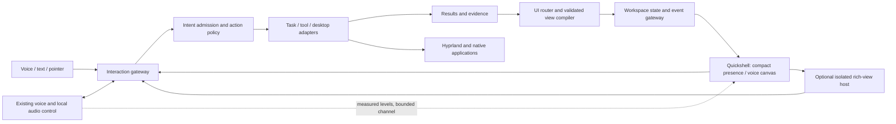
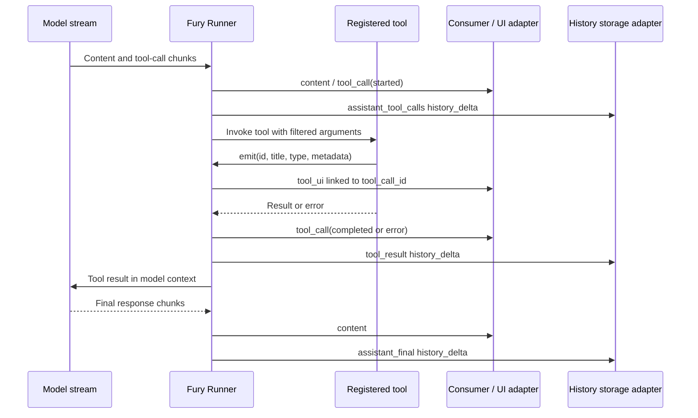

# JARVIS OS — Complete Voice GUI Design

Prepared: 2 November 2026 · Status: proposed design for review · Scope: planning and design only.

## Design brief

Build a voice-first interface in which speech creates a useful visual workspace, and follow-up speech or direct interaction reshapes it. The assistant core introduces the conversation and makes room for relevant widgets as work develops. Voice, text, widget interaction and native application handoff share the same context.

**Latest user decision (2026-11-02):** reuse the existing shell and island. JARVIS generates task-specific interactive widgets at runtime, normally floating over the desktop, with an optional nonmodal grouped canvas. There are no Esc/Return-to-desktop buttons or widget-management toolbars. JARVIS handles placement, pinning, updates and dismissal through conversation. No new dock, separate GUI, second island or full-screen assistant workspace is required. This decision supersedes the earlier expanded-workspace navigation proposals retained below.

**Target foundation:** Wayland + Hyprland, with Quickshell/QML for trusted native presentation. Existing JARVIS services remain the authority for audio, tasks, tools and results. Optional rich generated views are a later isolated capability, not untrusted QML inside the main shell.

**Scope boundary:** this document prepares the whole design. It does not install software, launch an overlay, modify a running desktop, change shortcuts or authorize implementation/deployment. All performance budgets are targets; example measurements are synthetic. The product master remains the parent product plan.

## Contents

1. [Product and experience](#part-1)
2. [Visual and motion system](#part-2)
3. [Conversation and widget model](#part-3)
4. [Architecture and UI contract](#part-4)
5. [Delivery and acceptance](#part-5)
6. [Storyboards and mockup brief](#part-6)
7. [Reference research](#part-7)
8. [Fury source analysis and JARVIS design implications](#part-8)

## Decisions at a glance

| Area | Decision |
| --- | --- |
| Primary experience | Speak → act/retrieve → show relevant widgets → refine by speech → hand off when useful |
| Visual identity | Cyan luminous core, dark slate surfaces, readable text, restrained motion |
| Presentation | Compact presence or voice canvas; no dock/helper-sidebar mode |
| Surface tiers | Standard native templates, composed JIT views, normal applications |
| Context | Stable task/widget/entity identity shared by voice, clicks and text |
| Generated views | Validated composition first; separately isolated rich views later |
| Exit | Persistent Return to desktop and keyboard return; preserve work and actual capture state |
| Control semantics | Mute, stop speaking, cancel task, pause automation, standby and shutdown stay distinct |
| Truthfulness | Measured audio/progress, evidence/freshness, acknowledged controls, explicit unknowns |
| Fury | Source reference for tool-emitted UI and per-turn control; not a confirmed Rose GUI implementation |


---

<a id="part-1"></a>

## 01 — Product and experience

Status: proposed, 2 November 2026. Parent: [product master](JARVIS_OS_FINAL_MASTER.md).

### Product promise

JARVIS turns a spoken goal into a visible, useful workspace. The interface chooses when a sentence is enough, when a control or card would help, and when a full application is appropriate. The user can keep speaking while work continues, interrupt the response, manipulate a result with the pointer, and return to the desktop immediately.

Success means finishing a real work session mainly through conversation while understanding the computer's actions. A glowing assistant with disconnected decorative panels does not satisfy this promise.

### Presentation modes

| Mode | Entry | Layout | Focus and background | Exit |
| --- | --- | --- | --- | --- |
| Compact presence | Login, explicit collapse, app handoff | Top-centre pill | No dimming; no keyboard grab; applications remain interactive | Explicit expand |
| Expanded voice canvas | Deliberate island activation, chosen shortcut or “open voice workspace” | Core/conversation header and adaptive cards | Dim only the chosen monitor; keyboard focus only following explicit activation/interaction | Always-visible Return to desktop, Escape or repeat activation shortcut |

Wake phrase activation starts a conversation in the current presentation mode. It does not automatically cover the screen. A user preference may opt into expansion on wake. A spoken request to show a large comparison may open the canvas without grabbing application keyboard focus; clicking or explicitly activating the canvas grants focus. The visible Return button remains operable in either case.

Escape dismisses a local popup first; the persistent Return control always dismisses the entire expanded canvas in one action. A configured emergency return shortcut bypasses popup and widget focus. No shortcut is installed by this design package. Super+H remains the existing dictation shortcut.

Returning to desktop preserves ongoing task IDs, widget identities, scroll, selections and unsaved input. Compact form accurately indicates whether capture remains active. Returning is not a privacy operation; mute or standby is separately available.

### Surface selection

| Need | Default surface | Escalation |
| --- | --- | --- |
| Simple fact or acknowledgement | Brief speech and optional transcript | Source/result card when useful |
| Recurring control or stable data | Standard native widget | Settings/app for detailed adjustment |
| Comparison, research, file search, task-specific explanation | JIT composition from approved components | Expanded table/chart, then application |
| Sustained editing, large documents, development, media production | Native app | Retain voice context in compact presence; reopen canvas on request |
| Special visual interaction absent from approved library | Explain/offer available representation first | Later isolated rich renderer, or native app |

The router considers explicit user choice first, then active app/context, task shape, interaction depth, available components and display room. It selects a meaningful surface rather than scoring “lightness” by appearance alone. A visible action does not gain additional execution permissions. The voice canvas contains only relevant conversation, task widgets and necessary controls. Application launchers, a desktop dock, fixed helper sidebars and unrelated dashboard widgets are excluded.

### The core's role

The core is the conversation's anchor. At rest it fits in the compact island. During a focused exchange it expands into the upper-centre header. When research and tools fill the canvas, it shrinks into a fixed header position while cards receive the space. It does not jump to a different location every time speech starts.

Listening, thinking, executing, verifying and speaking can overlap. The voice core shows the current audio/turn state. Task cards show independent execution state. A “Speaking” core can coexist with a “Researching” task card; the system does not pretend that all work has stopped.

### Always-understandable controls

| Control | Effect | Confirmation shown |
| --- | --- | --- |
| Return to desktop | Hide expanded canvas, preserve work and capture state | Compact presence with accurate privacy label |
| Stop speaking | Flush current playback; invalidate old queued narration | “Speech stopped”; task remains visible |
| Cancel this task | Request cancellation of that task and owned workers | “Cancelling”, then cancelled/partial/failed-to-stop receipt |
| Pause automation | Pause conflicting desktop automation at a safe boundary | “Automation paused”; resume after fresh observation |
| Mute microphone | Stop configured capture/transmission | Wait for acknowledged actual state; recover by pointer/keyboard |
| Standby | End active provider session as configured; keep local wake detection if enabled | “Wake-word only” only when confirmed |
| Stop JARVIS | Stop the defined JARVIS service scope | Explicit service and continuing-task information |

The legacy `listen cancel` command may combine speech interruption and cancellation. It must not back a control labelled only “Stop speaking”. See integration gaps.

### Core journeys

#### Research workspace

“Compare the last three releases using their memory measurements.” JARVIS resolves the project/release scope and shows a stage only when work starts. As verified data arrives, a comparison table and chart appear with units, dates and sources. “Only show idle memory” changes the existing dataset/filter. “Explain the spike in the second release” selects that release, adds evidence and speaks a short explanation. “Open its log” focuses a supported viewer and collapses the canvas after successful handoff.

#### Desktop control

“Set a ten-minute timer.” JARVIS confirms the timer through voice. When the canvas is open, the standard timer card appears there; compact mode can show a brief timer activity indicator. “Add two minutes” updates the same timer if it is the unique salient target. With multiple timers, JARVIS names the candidate timers and asks. The timer continues after its card is dismissed and after the GUI reloads.

#### Visual follow-up

The user selects rows in a comparison, then says “chart just these.” Selection IDs and widget revision identify exactly those rows. A new chart is bound to the selection and evidence. Pointer edits are acknowledged without speaking every click. If the selection changed during processing, the action is revalidated.

#### Native editing

“Open this diff in VS Code.” The broker resolves the retained file/diff identity, current revision, workspace and supported editor capability. It opens/focuses the actual matching window and checks the outcome. On success the canvas collapses. On failure the card stays visible with the error and alternative action.

#### Interruption and correction

“Research these options.” While JARVIS answers: “Wait, only the local options.” Old speech stops; new input retains its opening words. Completed retrieval is reused where relevant. A new request generation updates the research scope without silently repeating completed side effects.

### Supporting surfaces

Activity/history lists tasks, conversations, results and continuing work. Settings holds voice selection, activation preferences, privacy, screen-awareness consent, devices, motion, contrast and detailed system controls. A recovery surface identifies affected features and valid next actions. Technical logs stay in diagnostics rather than occupying ordinary cards.

### First release and later depth

First release: reliable compact/canvas mode switching; real state and privacy; text fallback; transcript; standard timer/media/task/file/source widgets; table/chart JIT composition; voice references; selection feedback; pin/dismiss/restore; verified browser/editor/file-manager handoff; reconnect and local controls.

Later: isolated custom web tools, reviewed reusable templates, complex workflow builders, richer screen-context placement, cross-device canvas continuation and additional languages. Native applications remain available throughout.

All features require support discovery. A requested custom view can fail gracefully into an approved table, report or app. The UI does not advertise capabilities just because a mockup includes them.

---

<a id="part-2"></a>

## 02 — Visual and motion system

Status: proposed design tokens, not measured implementation. Values use logical pixels at 100% display scaling.

### Identity

Dark slate surfaces, a soft cyan assistant core, restrained light, readable typography and generous space. The desktop stays unobstructed in compact mode. The expanded canvas gives work a coherent composition with only relevant widgets. The user-supplied reference images establish the material language; the Rose reels establish the shift from central assistant to content-rich workspace. The design excludes an application dock, launcher rail and persistent helper sidebars.

### Tokens

| Token | Proposed value | Usage |
| --- | --- | --- |
| background | `#0A0C12` | Opaque fallback and canvas base |
| surface | `rgba(22,26,35,0.88)` | Default translucent card |
| surface-light | `rgba(30,36,48,0.92)` | Raised controls |
| backdrop | `rgba(10,12,18,0.45)` | Expanded mode only |
| primary-text | `#F2F5FA` | Main text |
| secondary-text | `#B4BFCE` | Supporting text |
| tertiary-text | `#8E9BAD` | Nonessential metadata; validate contrast on final background |
| accent | `#55DDEA` | Focus, listening and selected controls |
| thinking | `#A6B9FF` | Processing accent |
| success | `#83D8B1` | Verified outcomes |
| attention | `#F0C078` | Muted/standby, pending attention |
| danger | `#F193A0` | Failed actions and destructive controls |
| border | `rgba(235,245,255,0.14)` | One-pixel card boundary |
| focus | 2px cyan + 2px offset | All interactive elements |
| spacing | 4, 8, 12, 16, 24, 32, 48 | Shared rhythm |
| radius | 12 control; 20 card; 24 large; capsule for pill | Shared component geometry |
| card padding/gap | 24 / 16 | Standard desktop cards |
| blur | 16px preferred; 0px fallback | Compositor capability dependent |
| shadow | `0 12px 36px rgba(0,0,0,0.24)` | Floating elevation only |

The earlier 65% card alpha is too dependent on wallpaper for reliable reading. Start at 88% with explicit high-contrast/opaque mode. Blur is optional and requires compositor support; QML transparency alone does not blur arbitrary windows. Battery and capture labels require legibility on both light and dark apps.

Use Geist if available in the existing shell, otherwise a system sans-serif. Use a system monospace for time, numeric columns and paths; avoid making all interface text monospace. Preferred sizes: 32px conversation heading, 24px compact conversation text, 20px card heading, 16px body/data, 13px metadata. Body line height 1.5. Essential controls stay at least 14px text with 44×44px interaction targets. No all-caps paragraphs or sub-12px essential labels.

### Spatial rules

Compact pill: top-centre of selected monitor, 32px visible height, 16px radius, minimum 44px interactive activation region. Width adapts to privacy text/time/battery rather than cropping the privacy state. Initial range 300–420px, with accessibility scaling allowed. Core 12px. Unknown battery uses “Battery unavailable” or a concise unknown marker with accessible description, never an invented percentage.

Expanded layout: monitor safe area inset 32–48px, accounting for existing bars and output scaling. Return control stays top-right inside the safe area, above all card content. It has independent ownership from widget renderers and a full text label. Optional input sits at the bottom, above the on-screen keyboard where present.

Conversation anchor: centred on the usable width. Core centre around 144px from safe-area top; first transcript baseline below the core around 230px. These are reference values, not fixed physical coordinates. Keep transcript width at most 720px. Scale down header height when work cards appear.

Workspace anchor: core 40–56px inside the same top header region; task title and short response beside/below it. The transition is triggered by meaningful content entering the workspace, not every audio-state change. A core can speak at its compact workspace size without forcing cards downward.

| Usable width | Canvas arrangement | Limits |
| --- | --- | --- |
| 1600px+ | Up to 3 card columns; a chart may span 2 | Content width capped near 1680px |
| 1100–1599px | 2 columns; detail view may span both | Keep each data card ≥320px |
| 720–1099px | 1 column; compact header | Page/section navigation for comparisons |
| Below 720px or large text | 1 column, minimal core, scrollable content | No forced multi-column tables |

Wide tables scroll within a labelled region or expand to a dedicated detail view. Never shrink data text to fit. First viewport shows 3–6 meaningful cards; additional results appear behind “More results” or a scrollable continuation. Existing cards stay spatially stable during live updates.

### Native windows and canvas placement

Use active output geometry and reserved areas to keep the compact presence and expanded canvas inside the selected monitor's usable area. Task widgets belong inside the voice canvas. A native application handoff returns to compact presence; no helper card is automatically attached to the app and the app is not resized silently.

Window bounds do not reveal every text field or critical target. Avoid claims of perfect screen awareness. Permitted accessibility/screen context can ground a spoken reference, while the user controls opening the canvas. Re-evaluate targets after monitor, scale, focus, layout or user changes.

Expanded canvas appears on one chosen monitor. Other monitors remain usable. A monitor disconnect moves the canvas into the surviving output's safe area, preserving content and exit access. Screen lock hides sensitive content and suppresses spoken private output according to policy. Unlock does not automatically resume speech or pending side effects.

### Motion vocabulary

| State | Geometry/motion | Data source | Reduced-motion form |
| --- | --- | --- | --- |
| Compact/idle | Still 12px core, no endless pulse | Readiness/privacy status | Identical still form |
| Listening | 80–96px soft core; gentle envelope expansion | Fresh measured microphone amplitude | Static ring + labelled input meter |
| Thinking | 64–72px compact flowing shape | Accepted turn + processing stage | Static shape + stage text |
| Executing/verifying | 48–56px restrained core; card stage changes | Task/action events | Static core + text |
| Speaking | Subtle outward envelope/ripples | Measured actual playback | Static ring + labelled playback meter |
| Muted/standby | Subdued still core and explicit label | Acknowledged capture/wake state | Identical |
| Offline/error | Motion settles, recovery text | Connection freshness/error | Identical |

Thinking motion is symbolic activity and is never labelled an audio waveform. If output measurements are unavailable, show “Speaking” with restrained symbolic activity or remain still; do not fabricate measured motion. Use RMS initially; FFT requires a measured feed and a product benefit. A filler ripple follows actual playback and does not claim a completed action.

| Transition | Duration target | Curve |
| --- | --- | --- |
| Hover/focus | 100–140ms | Ease-out |
| State colour/shape | 180–240ms | Ease-in-out |
| Card enter/update | 180–260ms, 8–12px translation | Ease-out; no bouncing data |
| Compact ↔ conversation | 280–360ms | Critically damped feel; no overshoot |
| Conversation ↔ workspace | 240–320ms | Coordinated core/header/card motion |
| Exit | Immediately release input, visual fade ≤180ms | Ease-out |
| Audio envelope | Attack 40–70ms; release 120–180ms | Interpolate newest fresh sample |

Never delay the control operation until an animation ends. Layout animation pauses during selection, drag or editing. Audio continues independently when rendering stalls. Drop intermediate visual samples and catch up to the newest timestamp; never queue old waveform frames.

Skeletons reserve stable space only while a view is being prepared. They use low-contrast blocks with a slow optional opacity sweep, not flashy scanning lights. After about 8 seconds, replace indefinite shimmer with current stage, elapsed time, cancellation where supported and a recovery option. Exact deadlines come from task policy.

### Accessibility and input

Visible focus, Tab/Shift+Tab navigation, Enter/Space activation, labelled buttons and keyboard-operable card menus are required. Announce meaningful state changes once, not every audio sample. Support 200% text scaling, high contrast, reduced transparency and reduced motion. Text/shape accompanies every colour distinction.

No auto-expiration while a user is reading, hovering, selecting text, scrolling, navigating by keyboard or editing a card. Preserve scroll and selections during data refresh by stable entity IDs. Screen-reader support must be checked on the actual Qt/Wayland stack; do not claim it solely from accessibility labels.

The Return control remains legible above all content and never participates in a card's fade/expiry. A failed shader falls back to a simple ring. A rich renderer crash falls back to the native card frame with recovery controls.

---

<a id="part-3"></a>

## 03 — Conversation and widget model

Status: proposed interaction contract. Related: [architecture](#part-4).

### Independent state dimensions

Represent presentation (`compact`, `canvas`), connection (`offline`, `connecting`, `ready`, `degraded`), capture (`active`, `software_muted`, `hardware_muted`, `standby`, `stopped`), turn (`listening`, `processing`, `speaking`, `interrupted`, `waiting_clarification`) and each task's lifecycle separately. Approval is attached to a concrete action. A single state string may provide a display summary but cannot own these dimensions.

Priority for visible attention: lock/privacy restrictions; hardware capture fault; required approval/clarification; user-facing error; foreground turn; background activity. Priority chooses the label, not an implied cancellation of lower-priority work.

### Conversational reference grounding

Each surface has stable `widget_id`, `request_id`, optional `task_id`, data entity IDs, revision and user-readable title. Context may include selected entity IDs, focused card, explicitly referenced item, current app and recent card interactions. Resolve speech in this order:

1. Explicit title/entity (“the memory chart for release B”).
2. Current explicit selection (“these rows”).
3. Focused or recently interacted relevant card (“this chart”).
4. A single recent compatible result (“open that report”).
5. Ask a short clarification when multiple material targets remain.

Hover alone is weak context; a spoken destructive action cannot rely on hover. Pointers, display coordinates and titles are observations with timestamps. The user saying “second one” binds to the displayed order and revision, not the newest reordered dataset.

| Speech | Result |
| --- | --- |
| “Expand this chart” | Open detail view for resolved chart; preserve dataset and selection |
| “Compare these” | Compose a comparison from selected compatible entities |
| “Show sources” | Reveal evidence for current claim/card |
| “Only the local ones” | Apply filter to current research scope; report if “local” is ambiguous |
| “Remove that chart” | Dismiss view; retain task/evidence |
| “Cancel that research” | Cancel resolved research task, not merely its card |
| “Keep this” | Pin instance and context |
| “Save this layout for next time” | Create a reusable-template draft for validation |
| “Go back” | Navigate previous canvas view; desktop return is explicit |
| “Return to desktop” | Dismiss expanded canvas and preserve task/capture state |

Click, voice and text produce the same typed intents. Pointer selection updates conversational context; the UI does not inject whole screen contents or credentials into the model. References to source text remain data, even if the source contains commands.

### Widget anatomy

A standard card has: human-readable title; short state/stage; main data; provenance/freshness; relevant primary action; overflow menu. Task cards add elapsed time and cancellation state. Approval cards show action, exact target, relevant effect, expiry and choices. Empty states explain whether there is no data, no permission, a disconnected provider or a load failure.

Common actions: expand, select, pin/unpin, dismiss, show sources, refresh (where safe), and supported open-in-app. Dismiss never deletes evidence or cancels a task. “Open in app” appears only with a supported resource/capability. Keep primary actions sparse; metadata and diagnostics expand on demand.

### Component catalogue

| Component | Primary content | Interaction/evidence requirements |
| --- | --- | --- |
| TextBlock / KeyValueGrid / StatRow | Brief explanation, structured fields, metrics | Plain text by default; units and unknowns explicit |
| Table / Comparison | Labelled columns and stable row IDs | Sort/filter/select without reordering under a reference |
| Chart | Series, axes, units, observation time | Accessible data table; source IDs; comparable sampling intervals |
| SourceList | Titles, origin, retrieved time, claim links | Safe browser open, blocked/unreadable distinction |
| ImageGrid | Relevant images with captions/source | Approved asset references; accessible descriptions; expand |
| FileResults / DiffBlock | Paths, match snippets or revision-bound diff | Stable file identity; app handoff; truncation labelled |
| Timer / Media | Current native service state | Controls wait for actual acknowledgement |
| TaskProgress | Stage, elapsed, steps, receipts | Numeric progress only with denominator; cancellation separate |
| ChoiceList / Form | Clarification or structured input | Preserve unsaved state; validation; explicit submit |
| Approval | Held action and its scope | Bound to action digest/revision, identity, expiry, single-use decision |
| Recovery | Affected feature and next valid step | Retry only with idempotency/outcome check |
| DeviceStatus / PermissionStatus | Real health and access | Unknown/degraded visible; no invented health score |
| RichViewHost (later) | Isolated specialised interaction | Bounded data/action bridge, independent crash recovery |

Volume and brightness controls may exist in detailed system settings/standard OS control panels. Preserve their removal from the expanded assistant conversation surface. Voice commands remain available.

### Lifecycle

`requested → preparing → visible → updated → retained or eligible_for_expiry → dismissed/expired → archived`

An update preserves the identity of a card unless its purpose changes. A result replacement can reuse a slot with a new ID and explicit transition. Source-backed claims remain linked to the evidence version that produced them.

| Category | Policy |
| --- | --- |
| Brief informational chip | Eligible after 15 seconds idle; pause expiry during interaction; retained in recent activity |
| System control feedback | 5–8 seconds after acknowledged result; errors remain accessible |
| Research/chart/file result | Retain for conversation; archive after conversation ends, unless pinned/active |
| Active task | Persist until terminal outcome; dismissed view stays recoverable through activity |
| Approval or clarification | Persist until resolution/explicit expiry; expired approval becomes non-actionable |
| Unsaved form or local edits | No auto-expiry; warn on explicit discard |
| Pinned card | Survive canvas dismissal and restart within retention policy; freshness still enforced |

Interaction restarts eligible inactivity timers. Pinning does not freeze a live dataset silently: offer “Keep live” versus “Save snapshot” when that distinction matters. A snapshot stores its observation time. An offline/restored live card clearly marks its last-known data.

End-of-conversation cleanup archives eligible transient views. It never erases unsaved input, pending actions, task receipts or pinned evidence. Conversation and widget retention settings are reviewable and support deletion/export. Do not retain raw microphone audio by default.

### Ownership

| State | Owner | Restart behaviour |
| --- | --- | --- |
| Task lifecycle and effects | Task/action service | Durable recovery; never replay effects because a view reopens |
| Evidence, source records | Result/evidence store | Restore references and freshness |
| Capture and playback | Voice/audio service | Re-query actual state; never infer from old UI |
| Card specification and revision | GUI gateway/workspace store | Rebuild from validated snapshot |
| Selection, scroll and draft input | Per-widget view state | Preserve locally; persist eligible drafts under retention policy |
| Placement and pinning | Workspace manager | Restore within available monitor bounds |
| Reusable template definition | Versioned template registry | Review compatibility/capabilities before reuse |

Widgets are declarative but not literally stateless: view state must survive useful interaction. A form needs local draft state. The renderer cannot become a second owner of execution or task completion.

### Standard, composed and rich preparation

Standard widgets use known templates and actual service data. Composed JIT views select bounded components and bind them to retrieved data. The model proposes composition; the gateway validates types, assets, capabilities and size before rendering. Unsupported blocks produce a useful native fallback rather than crashing the scene.

Rich code generation is a later path. Show “Preparing custom view” only when actual preparation is running. Keep prior results visible while the new view stages. A generated component passing syntax validation is not proof of safety or correctness. Untrusted QML does not enter the main shell.

“Pin” stores the instance. “Save as reusable widget” creates a versioned draft containing schema, bindings, allowed actions, compatible data types, preview and provenance. Validate it before registration. Reuse never carries an old approval or silently grants new capabilities.

### Failure and concurrency behaviour

Network loss: local mute, exit and available task controls remain functional; provider-dependent controls identify the limitation. Duplicate events: deduplicate by event ID. Out-of-order events: revision checks and resnapshot. GUI reload: restore without replaying tool effects. Rich-renderer crash: keep native chrome and recovery control. Unsupported chart data: display a table and explanation.

The user may keep talking while tools run. Background results land in their owning task group without stealing focus or interrupting a newer request. User keyboard/pointer intervention pauses conflicting desktop automation and requires fresh observation before continuing. A valid completed result remains visible after speech interruption.

---

<a id="part-4"></a>

## 04 — Architecture and UI contract

Status: proposed v1 contract. Examples are design fixtures, not implemented endpoints. All timestamps and measurement values below are synthetic.

### Proposed system boundaries



Audio capture, echo handling and playback remain owned by the audio service. The UI observes status and measured envelopes; it does not open a second microphone. A renderer stall cannot block capture/playback. Keep audio samples and large images out of the durable intent log. Process-priority changes or an audio-engine rewrite are not prerequisites for designing the GUI and require separate measured justification.

The existing core/router/task infrastructure remains the execution authority. A GUI gateway provides validated presentation and bidirectional interaction. It must integrate the existing logical intent bus rather than establish a competing command system. UI payloads describe views; action policy governs actual effects.

### Repository integration map

Read-only inspection on 2 November 2026; the working tree contains pre-existing edits, so paths identify candidates, not release guarantees.

| Existing location | Observed support | Proposed integration/gap |
| --- | --- | --- |
| `quickshell/shell.qml`, `Notch.qml`, `ShellState.qml` | Native panels and panel IPC | Voice canvas and shared view state are new work |
| `quickshell/Theme.qml`, components | Existing typography/palette/control patterns | Add voice tokens without breaking current panels |
| `quickshell/launch.sh` | Wayland launcher and local imports | Later validate imports/singletons against installed Quickshell; previous experimental launch had undefined bindings |
| `voice_layer/config.py` | Private runtime paths `jarvis/control.sock`, `state.json`; `LEVEL_FILE` declared | Select runtime path through one adapter; declaration alone does not establish a live level feed |
| `voice_layer/daemon.py` `status()` | State, capture flags, mic RMS, tools, model, errors, latency | Need timestamped heartbeat, revisions, transcript deltas, playback-level availability, durable task/widget references |
| `voice_layer/ipc.py` | JSON status/mute/interrupt/standby/wake; text command handling | Command receipts and semantic separation; no assumed durable subscription |
| `bin/jarvis-voice`, `voice_layer/__main__.py` | CLI bridge | Avoid invoking Python every visual frame; robust response framing/error handling required |
| `ui/omarchy-jarvis-island/AgentBridge.qml` | Legacy live status/control bridge | Hardcoded older checkout paths and placeholder agent/approval content need replacement before reuse |
| `plugins/voice.orb`, `voice.indicator` | Earlier status/level readers | Legacy `omarchy-voice` path differs from current `jarvis` runtime; no direct drop-in assumption |
| `jarvis_control`, `skills`, `orchestration` | Desktop/tool/task capabilities | Reuse typed adapters and receipts; bridge capability discovery |

The inspected status method exposes microphone RMS, not a documented timestamped playback-envelope stream. Add measured output telemetry only after identifying its actual audio write/playback timing. The UI must show unavailable/stale measurements truthfully.

Do not wire “Stop speaking” to legacy `listen cancel`: that path can also invoke task cancellation. Prefer a distinct acknowledged interrupt command and a separately scoped task cancellation endpoint. Similarly, do not use mute/unmute as a way to change presentation mode.

### Transport and authority

Proposed gateway uses protected user-session IPC, with peer identity and per-action authorization. Versioned snapshots establish state; a bounded event stream delivers deltas. The final socket path is chosen alongside the existing intent bus implementation. This package does not create it.

Every connection begins with protocol/version and capability discovery, then a current snapshot plus sequence cursor. Snapshot and cursor must describe one consistent point. Reconnection resumes bounded retained events when possible; otherwise fetch a fresh snapshot. Rendering a recovered task never reissues its action.

Reliable control/events and lossy high-rate telemetry are separate channels. Proposed heartbeat every 2 seconds; show stale after 6 seconds without a valid heartbeat, subject to tuning. A state transition without a heartbeat cannot establish indefinite liveness. A retained file alone does not prove the daemon is alive.

Critical controls must bypass a saturated view-generation queue. Coalesce telemetry and superseded view patches, bound image/array/text sizes and avoid a per-frame process. Initial validation limits: 64KiB control/view envelopes; 32 cards per workspace; 128 blocks per card; 8 nesting levels; tables page at 100 visible rows; charts downsample to 1000 visible points per series. These are tunable starting limits, with explicit pagination/artifact references for larger results.

### Envelope

| Field | Rule |
| --- | --- |
| `schema_version` | Integer major protocol version; reject unsupported majors |
| `event_id` | Unique ID for deduplication |
| `producer_id`, `producer_epoch` | Identity and new epoch on producer restart |
| `sequence` | Monotonic within producer epoch; gaps trigger recovery |
| `occurred_at`, `expires_at` | UTC timestamps; expiry optional by event kind |
| `session_id`, `request_id` | Owning session and admitted request |
| `task_id` | Optional durable work identity |
| `generation` | Turn/cancellation generation fence |
| `type` | Allowlisted event kind |
| `payload` | Kind-specific validated object |

Ordering across multiple producers is resolved by the gateway's workspace revision, not by comparing unrelated producer sequences. Monotonic clocks are suitable for local intervals; UTC is for provenance/display. Authentication context is supplied by the trusted gateway, never accepted from a model field.

Proposed kinds: `session.snapshot`, `voice.state`, `transcript.delta`, `task.updated`, `evidence.available`, `widget.upsert`, `widget.patch`, `widget.dismissed`, `selection.changed`, `action.requested`, `action.acknowledged`, `action.completed`, `approval.required`, `approval.resolved`, `app.handoff.updated`, `connection.heartbeat`.

Example widget event:

```json
{
  "schema_version": 1,
  "event_id": "evt-demo-101",
  "producer_id": "gui-gateway",
  "producer_epoch": "demo-epoch-a",
  "sequence": 101,
  "occurred_at": "2026-11-02T14:30:00Z",
  "session_id": "session-demo",
  "request_id": "request-demo-7",
  "task_id": "task-demo-releases",
  "generation": 3,
  "type": "widget.upsert",
  "payload": {
    "widget_id": "widget-demo-memory",
    "revision": 1,
    "surface": "composed",
    "title": "Release memory comparison",
    "state": "ready",
    "layout": {"preferred_span": 2, "min_width": 320},
    "retention": {"policy": "conversation", "pinned": false},
    "blocks": [
      {
        "id": "memory-table",
        "type": "table",
        "columns": [
          {"key": "release", "label": "Release", "format": "text"},
          {"key": "memory", "label": "Idle memory", "format": "number", "unit": "MiB"}
        ],
        "rows": [
          {"id": "release-a", "release": "Release A", "memory": 418},
          {"id": "release-b", "release": "Release B", "memory": 462},
          {"id": "release-c", "release": "Release C", "memory": 431}
        ],
        "selection": "multiple"
      }
    ],
    "evidence_refs": ["evidence-demo-benchmark"],
    "actions": [
      {"id": "chart-selection", "label": "Chart selected", "capability": "view.compose", "target_ref": "memory-table"}
    ]
  }
}
```

`layout` is a preference; the placement engine has final authority. `surface` is a validated router output, not a permission. Data displayed as measurements must resolve to evidence; these example values are fixtures. A chart needs axis/unit/series IDs and accessible table data. Text uses plain text or sanitised approved markup, never arbitrary HTML/QML expressions.

### Action and selection flow

Example user interaction proposal:

```json
{
  "schema_version": 1,
  "interaction_id": "interaction-demo-12",
  "session_id": "session-demo",
  "request_id": "request-demo-8",
  "generation": 4,
  "source": "pointer",
  "widget_id": "widget-demo-memory",
  "expected_revision": 1,
  "action_id": "chart-selection",
  "parameters": {"selected_ids": ["release-a", "release-c"]},
  "idempotency_key": "session-demo:interaction-demo-12"
}
```

Gateway checks identity, current selection/revision, capability, target scope and permissions. Allowed parameters are schema-bound. Raw shell commands and filesystem paths are not executed just because they appear in widget data. Evidence/source content cannot become an instruction. A schema validation success does not establish user authorization.

Receipts distinguish `accepted`, `running`, `completed`, `failed`, `cancelled`, `partial`, `unknown`. An optimistic selected/pressed appearance may indicate local interaction; it cannot claim a completed system effect. Unknown outcome after disconnection requires readback before retry. Persist idempotency keys where side effects need durable deduplication.

Voice “chart these” and clicking the chart action resolve to the same operation. Selected entity IDs enter bounded context with card title and revision. Context records selected data and source trust; it never silently upgrades source text to user instructions. Local view changes and task-data revisions are separate so a scroll event does not invalidate an action unnecessarily.

### Patches and transcript

Widget patches carry `widget_id`, `base_revision`, `revision` and allowlisted field updates. Reject stale/base-mismatched updates; fetch a snapshot. No arbitrary expression evaluation or unrestricted patch paths. Preserve local draft/selection unless the referenced entities disappear; then explain and reconcile.

Transcript events carry turn ID, segment ID, revision, text, final flag and speaker. Replace partial text by segment rather than concatenating repeated hypotheses. Show final and partial tokens distinctly. Do not expose hidden reasoning streams as stage labels. Assistant text should distinguish generated text from text known to have been spoken if playback is interrupted.

### Measured audio channel

Proposed frame: `{stream_id, generation, sequence, sampled_monotonic_ms, input_rms, output_envelope, input_available, output_available}`. Normalise 0–1 with documented metering; enforce finite values. A 20–30Hz UI envelope feed is enough initially. Stop publishing irrelevant samples when capture/playback stops. Consider a sample stale after roughly 250ms; decay to zero and mark unavailable. UI freshness cannot be inferred from an unchanged nonzero file.

Audio measurements do not control permissions. Mute state is acknowledged by the voice service, not inferred from zero amplitude. Output envelopes should account for actual queued/written audio and be cleared at interruption so old speech does not keep animating.

### Rich views

Qt assumes application-provided QML is trusted; running untrusted QML is unsupported. A Loader does not create separate authority or privacy domains. [Qt security model](https://doc.qt.io/qt-6/shared-security-model.html), [handling untrusted data](https://doc.qt.io/qt-6/untrusteddata.html).

Therefore v1 composes only approved native components. Later rich HTML/JS runs in a separate renderer process with independently verified OS/browser confinement, restricted navigation/network, resource limits, no inherited credentials, no general filesystem/desktop/IPC access, and a narrow typed action bridge. Merely choosing a WebView/Tauri/Electron does not prove these properties. Default to no network; use brokered approved assets and data. The native shell owns approval/exit chrome outside the generated view. If confinement cannot be established, use a native app or approved representation.

### Hyprland handoff

Resolve resource → choose supported application adapter → capture current workspace/focus → launch/focus using structured safe arguments → observe actual matching window → deliver resource → verify supported outcome → collapse expanded canvas. Unique window identity is preferable to a broad title regex. User changes invalidate stale placement/focus assumptions.

Layer surfaces are distinct from normal tiled app windows. The proposed canvas is a deliberate overlay, not an app dock or tiled helper panel. Do not assume a layer panel is an ordinary `focuswindow` target. Native applications keep their existing layout when the canvas is dismissed.

Quickshell provides edge-anchored panel windows and explicit layer/focus controls. [PanelWindow](https://quickshell.org/docs/v0.3.0/types/Quickshell/PanelWindow/), [WlrLayershell](https://quickshell.org/docs/v0.2.0/types/Quickshell.Wayland/WlrLayershell/).

Compositor dispatch syntax is version-sensitive: current Hyprland documentation differs from older hyprlang configurations. Inventory the installed version before writing bindings or adapter commands; this design deliberately specifies behaviour rather than a copy-paste configuration. [Hyprland dispatchers](https://wiki.hypr.land/Configuring/Basics/Dispatchers/).

---

<a id="part-5"></a>

## 05 — Delivery and acceptance

Status: future implementation plan. No implementation or activation is authorized by preparing this package. No dates or completion percentages are asserted.

### Build packets

| Packet | Deliverable | Completion gate |
| --- | --- | --- |
| 0. Baseline and recovery | Identify active shell, voice owner, installed versions, current bindings, source/release and existing edits | Known-good normal desktop and voice; exact stop/restore path; no competing microphone owner |
| 1. Design validation | Review storyboards, scale, contrast, state copy, compact/canvas rules and exit | User can identify how to return from every scene; selected appearance documented |
| 2. Isolated presentation prototype | Synthetic-data viewer for modes, core and cards; no real tools/audio capture | Focus, multi-monitor, reduced-motion and exit work; mock data labelled |
| 3. Read-only real state | Gateway snapshot/stream, heartbeat, transcript, task/evidence data, measured envelopes | Offline/stale distinctions truthful; no fabricated telemetry; reload does not repeat actions |
| 4. Standard widgets and local controls | Timer/media/tasks/files/sources, real mute/interrupt/standby, typed fallback | Each operation has acknowledged state, matching receipt and clear failure behaviour |
| 5. Composed JIT and shared references | Tables, charts, comparisons, selection, voice edits, pin/restore | End-to-end comparison journey works; malformed/stale payloads rejected |
| 6. Native application integration | Browser/editor/file-manager handoff, compact return, conflicting automation pause | Correct resource/window verified; app focus restored; failed handoff retains card |
| 7. Recovery and release readiness | Restart, suspend, network loss, retention, resource budgets, package/version compatibility | Acceptance matrix passes on supported hardware; release activated with rollback |
| 8. Rich custom views (optional later) | Separate isolated web renderer and reviewed reusable-template registry | Confinement, crash containment, capabilities and resource limits proven before real data/tools |

Each packet includes a short evidence record with source revision, installed versions, hardware, data fixtures, measurements, failures and remaining limits. Existing master-plan voice/release blockers remain release gates; a polished GUI cannot waive them.

### First implementation boundaries

Start in a separate launchable preview using synthetic data. Keep desktop config, system services, bindings and production audio untouched until the relevant implementation scope is authorized. Any later desktop activation must have a named instance and a direct local return route, so stopping the preview never stops the normal shell.

Before activation, document the exact installed launcher, instance identifier, activation shortcut and rollback command based on the machine's actual versions. Avoid broad “kill all Quickshell” recovery. Never bind a fullscreen overlay with no independently reachable exit. The earlier accidental preview in this chat is the reason exit/recovery is a first-class acceptance gate.

### Acceptance matrix

| ID | Scenario | Pass condition |
| --- | --- | --- |
| A01 | Expand and return | Explicit activation opens chosen output; Return immediately restores desktop usability |
| A02 | Escape and focused widget | Escape closes local popup then canvas; Return remains one-step; emergency shortcut works independently |
| A03 | Wake while editing | Capture state changes visibly without unwanted fullscreen or keyboard grab |
| A04 | Compact identity | Time/battery/privacy readable; unknown battery honest; no weather/mic button |
| A05 | Mute and hardware mute | Actual acknowledged state shown; pointer/keyboard recovery exists; spoken unmute not required |
| A06 | Stop speaking versus cancel | Stop clears old audio only; Cancel stops only the identified task/owned workers with receipt |
| A07 | Spoken interruption | Opening words retained; old generation fenced; completed effects not repeated |
| A08 | Simple timer | Voice creates timer; follow-up updates right timer; dismissal/reload preserves timer |
| A09 | Research canvas | Progressive source/table/chart views use verified data, units and source dates |
| A10 | Deictic follow-up | “These rows” binds actual selected IDs/revision; ambiguous “that” asks a focused question |
| A11 | Live updates while reading | Selection, draft and scroll stay stable; cards do not expire or reorder under interaction |
| A12 | Widget lifecycle | Informational feedback expires appropriately; approval/task/pinned/draft remains recoverable |
| A13 | Pin versus template | Pin retains instance; reusable draft validation is separate; no permissions carried over |
| A14 | Native handoff | Correct resource in correct app verified; collapse follows success; failure keeps useful context |
| A15 | User takes over | Conflicting automation pauses; fresh observation required before resume |
| A16 | Network/provider failure | Local exit/mute remain available; independent local work continues; no blind side-effect replay |
| A17 | Stale state/telemetry | Dead service detected by heartbeat; old nonzero meter decays and becomes unavailable |
| A18 | Reconnect/restart | Snapshot/cursor consistent; duplicates/out-of-order rejected; views restored without actions replaying |
| A19 | Approval freshness | Approval names target/effect; expired or changed action cannot execute under old approval |
| A20 | Malformed/hostile payload | Invalid component/action/asset/size rejected; trusted native frame and exit survive |
| A21 | Accessibility | Keyboard operation, 200% text, reduced motion/transparency, contrast and actual assistive stack checked |
| A22 | Multiple outputs | Mixed scaling, negative coordinates, output unplug and focus changes keep content/exit reachable |
| A23 | Lock/suspend | Sensitive canvas hidden; no spoken private result on lock; no automatic side-effect replay on resume |
| A24 | Heavy load | Audio quality preserved while visual frames drop; renderer recovers to current state |
| A25 | Rich renderer fault | Later renderer crash/hang/resource violation cannot take audio/control/exit down |
| A26 | Retention/deletion | Saved views/drafts and provenance follow retention policy; forgetting removes eligible retained data |
| A27 | Focused voice-only composition | No app dock, launcher rail, persistent helper panel or unrelated dashboard content; only task-relevant widgets appear |

### Proposed performance budgets

Targets measured on the supported machine, not promises or claims about existing code. Report p50/p95 and the tested workload.

| Measurement | Initial target / evaluation |
| --- | --- |
| Local exit input → input release | p95 ≤100ms; fade may finish later |
| Admitted known payload → first meaningful standard/composed frame | p95 ≤100ms; ≤50ms stretch target for small warm native views |
| Live audio sample age at presentation | p95 ≤150ms; visibly stale/decay around 250ms |
| Control request → acknowledged presentation | p95 ≤250ms for available local service; show pending on slow response |
| Heartbeat loss → stale indication | Around 6 seconds with 2-second heartbeat; tune under suspend/load |
| Active animation | Aim for display refresh; validate 60Hz workload and graceful fallback |
| Background/idle visual activity | No continuous decorative loop; stop hidden audio/render polling |
| Large-result handling | 100 visible table rows/page, chart decimation, bounded payloads and assets |
| Audio impact | Compare underruns/dropouts and interruption latency against voice-only baseline under equivalent load |
| Memory/CPU/GPU/power | Measure cold/warm/idle/6-card/rich-view scenarios; set release ceilings after baseline, record hardware |

End-of-speech to answer time includes provider/tool work and is measured separately. Never present a <50ms rendering budget as total voice-request latency. Distinguish accepted interruption, audible stop and provider acknowledgement.

### Measurement method

Timestamp input, admission, task start, payload-ready, first frame, action acknowledgement, verified outcome and audio boundaries. Correlate with request/generation IDs. Keep measurements local and redact transcript/path content from ordinary performance logs. Use repeatable synthetic fixtures plus actual microphone/speaker and desktop workflows. Software tests cannot prove acoustic interruption or readable multi-monitor placement.

### Release checklist

All applicable acceptance cases pass with evidence. No startup binding errors in the active presentation path. Capture/permission labels match real state. System shortcuts remain available. Local exit works with provider disconnected and rich view hung. Release/version/schema compatibility and rollback are checked without rolling back newer user data. Production changes are separately authorized and scoped.

### Decisions for later implementation

The broad stack and appearance are settled as proposals. Version-check the deployed Quickshell/Qt/Hyprland before selecting APIs. Choose the isolated rich-renderer technology only when its need and confinement are demonstrated. Pick an activation shortcut after inspecting existing bindings; keep Super+H. Choose data retention defaults through the existing JARVIS privacy settings. Set hardware-specific resource ceilings from measured baselines.

---

<a id="part-6"></a>

## 06 — Storyboards and mockup brief

Status: reviewable design scenes. All measurements, results and durations in illustrations are synthetic examples.

### Central visual rule

The assistant opens the conversation; the content takes over the workspace. The core stays in the header's spatial family as it shrinks. A new spoken turn does not clear the canvas or relocate every existing result. There is no application dock, launcher rail or docked helper mode. A small task is answered through voice/compact activity until the user opens the canvas.

### Five-state board

1. **Compact:** Recognisable app windows and wallpaper. Top-centre frosted pill: cyan 12px core, “Wake-word only”, time, real/fixture-labelled battery. No full-screen overlay or dimming.
2. **Listening:** Explicitly expanded canvas on one monitor. Cyan 96px soft core in upper-centre, transcript below: “Compare the last three releases.” Streaming words differentiated. Return pill top-right. No new task cards until useful content exists; earlier retained cards may remain.
3. **Thinking:** Same canvas/header anchor. Core gathers into a 72px slow flowing shape; final transcript reduces prominence. Stage says “Reading benchmark reports” only if that operation is underway. Prior content remains. No fake percentage.
4. **Executing:** Header compacts, 48px core. Cards show a comparison table, labelled memory chart and source list. One progress card shows “Reading report 2 of 3” only with measured report count. Content has room and consistent alignment.
5. **Speaking:** Same multi-card layout and small workspace core with playback-linked activity. Short response: “Release B used the most idle memory in these measurements.” Stop speaking nearby. Sources, selections and scroll stay intact. Do not enlarge the core enough to move all cards.

This deliberately improves the earlier reference image where core locations drift across states and the table becomes too small to read.

### Main workspace composition

```text
┌─────────────────────────────────────────────────────────────────────┐
│ JARVIS   ◉ Speaking       Research: release memory    Return / Esc  │
│ Brief response with a visible source affordance    Stop speaking    │
├─────────────────────────────────────────────────────────────────────┤
│ ┌──────────────────────────────┐ ┌────────────────────────────────┐ │
│ │ Idle memory comparison       │ │ Evidence                       │ │
│ │ readable chart + units       │ │ Report A · observation time     │ │
│ │ selectable release series    │ │ Report B · observation time     │ │
│ │ illustrative data label      │ │ Report C · observation time     │ │
│ └──────────────────────────────┘ └────────────────────────────────┘ │
│ ┌──────────────────────────────┐ ┌────────────────────────────────┐ │
│ │ Release table                │ │ Selected release B             │ │
│ │ A / B / C; measured values   │ │ relevant result + explanation  │ │
│ │ Chart selected · Expand      │ │ Open report · Pin              │ │
│ └──────────────────────────────┘ └────────────────────────────────┘ │
│ Ask a follow-up…                                            Send   │
└─────────────────────────────────────────────────────────────────────┘
```

The canvas is grouped by request/task, not by an arbitrary permanent dashboard. A new request can add a second group while keeping the first resumable. Background completions do not become the foreground group without user intent.

### Three-tier board

| Scene | Composition | What reviewer should understand |
| --- | --- | --- |
| Standard widget | Voice canvas with a relevant timer card and compact conversation header | Routine controls use the same voice canvas without unrelated UI |
| Composed JIT | Expanded canvas with chart/table/source cards; one stable preparing-view slot | Custom arrangement from current request; progressive results |
| Native handoff | Editor/browser now foreground; same report/diff open; compact island only | Work context crosses the boundary; voice remains available |

Preparing-view state precedes the ready state in the storyboard; do not show a skeleton as proof that code is compiling. Stage text identifies whether data retrieval, view composition or isolated rendering is actually underway.

### End-to-end scenario

| Step | User | JARVIS and canvas |
| --- | --- | --- |
| 1 | “Compare memory use across my last three releases.” | Resolve project/release scope; acknowledge; start real retrieval |
| 2 | Waits | Task stage and elapsed; first sources appear progressively |
| 3 | Receives result | Chart + table + evidence, core shrinks; short spoken summary |
| 4 | Selects A and C, says “chart only these” | Selection IDs bind existing chart filter; preserve source links |
| 5 | “Add the frame-drop data.” | Add a second labelled plot with its own units; avoid misleading dual-axis scales |
| 6 | “Why was B worse?” | Resolve B from retained full dataset, reveal source-backed detail; distinguish correlation from cause |
| 7 | “Keep this comparison.” | Pin instance, choose live versus snapshot if relevant |
| 8 | “Open B's report in the browser.” | Resolve report; verify actual page/window; collapse canvas on success |
| 9 | “Show the comparison again.” | Restore pinned group, position, selection and freshness |

### Additional required scenes

- Muted, hardware-muted, standby, connecting, offline and stale privacy/readiness labels.
- Clarification between two matching cards or projects.
- Approval with exact action/target/effect and expired state.
- Task cancellation with partial completion evidence.
- Rich-view failure with native recovery frame and usable Return button.
- Native app in use: compact status only until the user deliberately opens the voice canvas.
- High contrast, reduced motion and 200% text layout.
- Monitor unplug and locked-session restoration.

### Mockup generation brief

Use-case: high-fidelity UI mockup, not a photograph of a monitor. JARVIS spelling exact. Cyan accent, slate glass, clear white/muted typography, consistent 20px cards, restrained core. Reference display is 16:9; maintain believable desktop proportions. Include a clearly visible Return to desktop / Esc control in expanded views. No application dock, launcher rail, permanent sidebar, attached helper cards or unrelated dashboard widgets. Avoid decorative code, indecipherable tiny tables, invented telemetry, floating approval popups unrelated to the request, or a giant orb that crowds out results.

Generated raster artwork illustrates composition and materials. Exact interaction, accessibility and contract rules come from this package. It is not a running desktop or proof of implementation.

---

<a id="part-7"></a>

## 07 — Reference research

Checked 2 November 2026. Reference scope: design and architecture preparation only; no repository was cloned, installed or executed.

### User-selected visual references

The two supplied JARVIS boards establish cyan core, dark glass cards, state storyboard, compact privacy labels and persistent desktop exit. The requested improvements are stable core placement, larger readable data, purposeful card actions and dynamic composition rather than fixed dashboard furniture.

The user identified Huw Prosser's Rose reels as the intended interaction reference:

- [Initial Rose demo](https://www.instagram.com/reel/DfGOQ5pIZqy/)
- [Rose research demo](https://www.instagram.com/reel/DfIDY9mo5Bn/)
- [Creator's repositories](https://github.com/huwprosser?tab=repositories)

Browser playback frames observed during this conversation showed a dark central Rose core and, in the research demo, a canvas with charts, text and images with a smaller corner assistant. Audio was not transcribed, exact complete timing was not measured, and the videos do not establish whether panels are generated code, composed templates or prebuilt widgets. Treat voice-driven reshaping and deep integration as the user's desired JARVIS requirements, not verified internals of Rose.

### Relevant public repositories

| Reference | Verified from public documentation | Use for JARVIS |
| --- | --- | --- |
| [jarvis-mlx README](https://github.com/huwprosser/jarvis-mlx/blob/main/README.md) | README warns that the project is outdated; describes an Apple Silicon/MLX voice stack | Historical context only; not the current Rose GUI or a Linux replacement |
| [fury-sdk README](https://github.com/huwprosser/fury-sdk/blob/main/README.md) | Python agent library with streaming, interruption, tools, and tool-emitted UI events separate from transcript deltas | Study event separation; no need to replace existing JARVIS orchestration merely to adopt the pattern |
| [fury-sdk session documentation](https://github.com/huwprosser/fury-sdk/blob/main/docs/sessions.md) | Optional session persistence separates durable messages from UI output and calls out recovery limits | Reinforces separate workspace persistence; ephemeral UI events alone cannot restore a canvas |
| [fury-sdk-js README](https://github.com/huwprosser/fury-sdk-js/blob/main/README.md) | JS/TS counterpart exposes streaming tool UI and transcript events | Optional reference for future renderer bridge; not evidence of Rose's frontend stack |

The inspected profile/listing and documents did not establish a public current Rose GUI repository. A GitHub repository search for `user:huwprosser rose` also returned no matches during this review. This is a limited finding, not a claim that none exists under another name or account. Do not label Fury as Rose's confirmed backend without direct creator documentation. Source reuse needs license verification for the exact files/revision; public visibility alone is not a reuse license. This package reuses concepts, not upstream code.

### Transferable pattern

Fury documents a tool-side emission callback with a dedicated UI event field and separate history deltas. The relevant inference for JARVIS is that tools can publish structured progress/presentation events while durable tool outcomes remain authoritative. This does not imply that the UI stream itself is permissioned, replayable, crash-safe or sufficient for generated-widget isolation. JARVIS needs its own admission, revision, evidence, persistence and capability contract.

### Official platform references

- [Quickshell PanelWindow](https://quickshell.org/docs/v0.3.0/types/Quickshell/PanelWindow/): panel anchors, focus and reserved space. Bind exact APIs to the installed version.
- [Quickshell WlrLayershell](https://quickshell.org/docs/v0.2.0/types/Quickshell.Wayland/WlrLayershell/): layer/focus identity; cited version may differ from installed runtime.
- [Qt shared security model](https://doc.qt.io/qt-6/shared-security-model.html): untrusted QML is outside the trusted application-code assumption.
- [Qt handling untrusted data](https://doc.qt.io/qt-6/untrusteddata.html): generated/network data requires validation; QML does not create separate privacy domains.
- [Hyprland dispatchers](https://wiki.hypr.land/Configuring/Basics/Dispatchers/): compositor operations are version-dependent; current docs must not be copied over an older installation untested.

### Evidence gaps to resolve during implementation

Actual deployed shell/version/config and supported assistive stack; measured playback envelope source; stream/snapshot atomicity; safe standalone preview and return path; task IDs/receipts available from existing services; native app resource readback; compositor blur/placement support; reviewed rich-renderer confinement; hardware performance budgets.

The repository's older island bridge contains checkout-specific paths and placeholder approval/agent content. Existing audio state files and legacy overlay paths differ. None should be presented as production-ready GUI integration without verification.

---

<a id="part-8"></a>

## 08 — Fury source analysis and JARVIS design implications

Reviewed: 2 November 2026. Scope: public source/documentation and selected tests on `huwprosser/fury-sdk` main. The user referred to the project as Fury; the publicly accessible source inspected is [fury-sdk](https://github.com/huwprosser/fury-sdk). This is a static analysis, not an executed benchmark or a claim about the private/current Rose implementation.

### Finding

Fury is an agent runtime with streaming tool/UI events and optional conversation persistence. It supplies useful patterns for driving a voice canvas, but the inspected package does not itself provide the complete Rose-style GUI, widget composition/layout manager, microphone/AEC/TTS pipeline, Hyprland integration or OS authorization boundary. The public code does not establish that Rose uses Fury internally.

The inspected [pyproject](https://github.com/huwprosser/fury-sdk/blob/main/pyproject.toml) identifies package version 0.3.2 and Python ≥3.10 with an OpenAI-compatible client dependency. This identifies the inspected package; it is not a recommendation to change JARVIS's voice provider or runtime.

### Source map

| Source | Observed responsibility | Relevance |
| --- | --- | --- |
| [agent.py](https://github.com/huwprosser/fury-sdk/blob/main/src/fury/agent.py) | Agent config, tool registry/executor, OpenAI-compatible client, per-turn Runner | Keep per-turn control separate from long-lived configuration |
| [runtime.py](https://github.com/huwprosser/fury-sdk/blob/main/src/fury/runtime.py) | Stream parsing, generation/tool loop, stop control, provider errors and retry | Feed text/tool events incrementally; handle generation boundaries |
| [types.py](https://github.com/huwprosser/fury-sdk/blob/main/src/fury/types.py) | Separate content, reasoning, tool_call, tool_ui and history_delta event fields | Do not conflate presentation, model transcript and actual execution |
| [tools.py](https://github.com/huwprosser/fury-sdk/blob/main/src/fury/tools.py) | Tool registration, top-level argument filtering, tool invocation, runtime emit callback, optional parallel wrapper | Tool work can publish structured UI updates before completing |
| [sessions.py](https://github.com/huwprosser/fury-sdk/blob/main/src/fury/sessions.py) | Optional append-only message/custom-event persistence and context reconstruction | Conversation and workspace storage need deliberate ownership |
| [interruption docs](https://github.com/huwprosser/fury-sdk/blob/main/docs/interruption.md) | Interrupt retains partial assistant text; cancel discards it | Specify partial-turn treatment explicitly |

### Actual event flow



The `emit` callback is injected at invocation when the callable supports it; it is not a user/model-supplied tool parameter. Synchronous tools run through `asyncio.to_thread`; asynchronous tools are awaited. A queue forwards emitted events into the stream. This supports progressive UI while the tool is working, without waiting for the final answer.

`ToolUiEvent` contains an ID, title, type (`tool_call` or `other`), optional tool-call ID and arbitrary metadata. This is a small event wrapper, not a complete typed layout schema for tables/charts/actions. JARVIS still needs its proposed widget contract, entity identity, validation and workspace revision.

### What to carry into the JARVIS design

1. **Dedicated UI emission:** Tools publish structured progress and data-ready events tied to action/task IDs. The canvas updates while voice and tools continue.
2. **Distinct channels:** Transcript messages remain suitable for future model turns. View layout, playback telemetry, execution receipts and UI interaction records have their own roles and retention.
3. **Per-turn control:** Explicit generation objects make interruption scope visible. Preserve completed evidence when old narration stops.
4. **Incremental rendering:** A source card can appear before the chart is ready; final speech incorporates actual returned results.
5. **Recorded tool outcomes:** Retain model-visible tool calls/results so a follow-up does not lose the reason a card exists.
6. **Visible errors:** Failed tools produce actionable task state rather than an endlessly animated core.

These patterns can be implemented through existing JARVIS services. Adopting the entire library is a separate dependency/architecture decision, not required by this design.

### Limits that matter for an operating-system GUI

| Observed mechanism | Limit / implication for JARVIS |
| --- | --- |
| `filter_args` drops unknown top-level keys | This is not complete JSON Schema validation of nested values, required keys, types, enums, sizes or authorization. JARVIS needs explicit validation and policy. |
| Normal execution loops over model tool calls; optional wrapper uses `asyncio.gather` | Do not describe every tool call as automatically parallel. JARVIS needs bounded work/concurrency with task ownership. |
| Per-tool UI queue uses `asyncio.Queue()` without a maximum | A slow consumer or noisy emitter can accumulate events; proposed gateway adds bounds, coalescing and backpressure. |
| Runner stop requests cancel the current asyncio task and close the model stream | That is not proof an external process, synchronous thread, already committed operation or child worker has stopped. OS task cancellation needs scoped control and receipts. |
| `interrupt()` preserves partial response; `cancel()` discards partial text | Both concern generation. Neither is the same as “stop audible playback only” or undoing completed effects. |
| UI metadata is unconstrained `Any` in the event dataclass | Do not execute it or treat it as a safe widget definition without JARVIS's admission/compiler boundary. |
| Optional output schema can be emitted through a reasoning event | Map structured output into an explicit validated data event; do not expose reasoning streams or parse arbitrary reasoning text as GUI authority. |
| XML-style textual tool-call healing is enabled by default in Agent config | JARVIS must still admit and authorize every action. Parsing a suggested call cannot bypass policy or freshness. |
| Provider 429 handling retries with fixed delays and a finite attempt count | UI should report a real retry stage, preserve cancellation responsiveness and avoid treating a stalled call as complete. |
| Session adapter records history deltas, not all UI output | Reconstructable canvas state needs separate snapshots/revisions and retained widget specifications. |
| JSONL storage flushes writes without fsync and documents single-writer/recovery limits | Do not call it power-loss transactional or sufficient for exactly-once OS effects. Durable actions require an appropriate store/outbox design. |

The cancellation/thread limitation is an inference from the observed use of `asyncio.to_thread` and task cancellation, not a result from a live cancellation test. Security and persistence requirements above are JARVIS design requirements, not an assertion that Fury promises to solve them.

### Tests inspected, not executed

[Agent tests](https://github.com/huwprosser/fury-sdk/blob/main/tests/test_agent_features.py) include sync/async emitted UI, interruption, argument filtering, tool errors, parallel-wrapper events and multimodal follow-up. [Transcript tests](https://github.com/huwprosser/fury-sdk/blob/main/tests/test_transcript_persistence.py) assert ordered history deltas and event collection. [Stream error tests](https://github.com/huwprosser/fury-sdk/blob/main/tests/test_stream_errors.py) cover explicit provider stream failures. [Retry tests](https://github.com/huwprosser/fury-sdk/blob/main/tests/test_rate_limit_retry.py) cover bounded 429 retries.

The inspected error-handling test that loops through tool rounds demonstrates one invocation per supplied round; by itself it does not prove that a model will never repeat an unsuccessful tool across rounds. These tests do not establish microphone/speaker quality, current Rose behaviour, a generated widget renderer, Hyprland integration or production readiness.

### Design conclusion

Use Fury as a concrete source reference for tool-driven UI events, per-turn generation control and separation of presentation from transcript persistence. Keep the JARVIS voice canvas focused: compact presence, relevant JIT/native widgets inside the canvas, and verified native app handoff. Build the missing layout, references, policy, data lifecycle and OS integration through JARVIS's own shared contract. No dock or permanent unrelated dashboard is part of this design.

---

## Review status and next step

This is the consolidated design baseline, incorporating the user's no-dock correction and a static source analysis of Fury. Generated concept artwork is illustrative and must follow this document's latest scope; earlier dock-containing artwork is superseded.

### Implementation direction approved on 2026-11-02

The user subsequently authorized building inside the existing Quickshell GUI,
retaining the existing island. The separate GUI prototype was removed. The first
integrated extension supplies a task canvas, contextual floating cards, QR cards,
local silent media PiP and a text input bar. The user's subsequent correction
removes Escape/Return navigation and delegates widget management to JARVIS.
Task-specific floating cards are permitted; they do not introduce a permanent
dock. No second presence indicator or standalone GUI is part of this change.

The current renderer generates nested native layouts with controls, local state,
arithmetic bindings and drawn diagrams from validated structured descriptions.
Widget action buttons pass chosen values into the existing voice session.
Generating
arbitrary UI code, persistent reusable templates, advanced app handoff and the
complete event/lifecycle architecture above remain design targets. See
[the integrated widget implementation](../ui/jarvis_widgets/README.md) for
current capabilities, controls, installation and verification limits.

