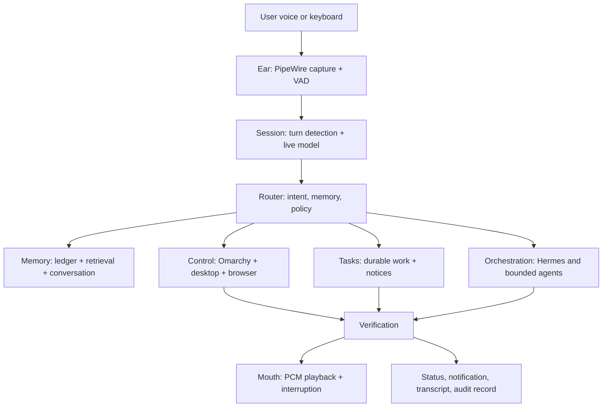

# JARVIS OS Master Document

Status: Product architecture, transformation plan, and release contract  
Updated: 2 November 2026  
Implementation root: the repository containing this folder

## 1. Executive definition

JARVIS OS transforms an Omarchy Linux desktop from a primarily visual,
keyboard-driven environment into a voice-first personal AI operating system.
The desktop remains local and inspectable; voice becomes the primary interaction
surface; AI coordinates capabilities but does not bypass operating-system policy.

The product is inspired by the conversational usefulness of fictional assistants
such as JARVIS and FRIDAY, while remaining grounded in explicit permissions,
observable actions, recoverable state, and honest reporting.

## 2. Product promise

The user should be able to speak naturally and receive one of four outcomes:

1. an immediate answer grounded in current local or public information;
2. a verified desktop action;
3. a durable task with a trackable result; or
4. a concise explanation of what is unavailable, unsafe, or needs clarification.

JARVIS must never claim that an action happened merely because a model produced
text. State-changing operations require tool execution and verification.

## 3. Design principles

- Voice-first, not voice-only: visual status, keyboard controls, and CLI recovery
  remain available.
- Local by default: capture, policy, state, and memory stay on the machine when
  the feature allows it; cloud models are explicit providers, not hidden magic.
- Observable agency: every action has an owner, policy decision, result, and
  evidence trail.
- Reversible by default: prefer preview, undo, cancellation, and backups.
- Persistent but user-controlled memory: remember useful context, expose it,
  correct it, and delete it on request.
- Graceful degradation: voice, tools, memory, network, and orchestration can
  fail independently without corrupting one another.
- Short spoken UX: acknowledge quickly, narrate progress only when useful, and
  hand off long results to a screen, file, or notification.

## 4. System architecture



### Voice core

`jarvis_voice` handles microphone capture, local VAD, Gemini Live transport,
turn gating, barge-in, playback buffering, recovery, and a protected Unix
control socket. Audio capture and playback are supervised independently from
control work so a slow tool does not block the audio loop.

### Memory engine

`jarvis_memory` provides a SQLite WAL knowledge ledger, conversation history,
optional embeddings, hybrid lexical/semantic retrieval, fact capture, Obsidian
synchronization, and an MCP interface. Memory is context, not authority: a
current system query wins over an old remembered state.

### Control and retrieval

`jarvis_control` exposes typed desktop actuators, Omarchy discovery, browser
retrieval, managed terminals, vision, diagnostics, and policy gates. Control
results distinguish success, failure, confirmation-required, dry-run, and
not-run states.

### Durable work and orchestration

Native tasks are independently supervised and persist their records. Hermes can
coordinate bounded agent assignments through an authenticated local bridge.
Agent discovery is not the same as functional authorization; each provider must
be checked separately. Recursive self-delegation is prohibited.

## 5. Voice-first user experience

### Conversation states

1. Standby: local wake-word or explicit shortcut, with no cloud session when
   configured for local standby.
2. Listening: capture and endpoint detection show clear activity status.
3. Thinking: a short local filler may bridge provider latency.
4. Acting: the assistant names the action only when it helps the user.
5. Verifying: the system checks observed state.
6. Replying: playback can be interrupted by the user's new speech.
7. Waiting: durable work produces a notification or a later spoken notice.

### Conversation rules

- Prefer one clear request per turn but accept natural multi-step requests.
- Ask one focused question when the target is ambiguous.
- Do not expose raw tool arguments in normal speech.
- Keep confirmations explicit and tied to the current action.
- If a provider, device, or network fails, say what failed and what remains true.

## 6. Security and trust model

The AI model is an untrusted planner operating inside a trusted, reviewable
execution boundary. The boundary enforces:

- protected local sockets and private runtime directories;
- deny rules and confirmation words;
- shell disabled by default;
- dry-run mode for inspection;
- credential redaction and no cookie copying;
- private-network rejection for direct public-page fetches;
- tool-call deduplication and generation fencing;
- bounded task budgets, cancellation, and restart recovery; and
- immutable or append-only evidence where practical.

The policy layer must be tested independently of model phrasing. Prompt text is
not a security control.

## 7. Data and memory contract

The default state path is under the user's XDG state directory. The memory
system stores only what its configured capture rules permit. The user can:

- inspect facts, sessions, and retrieval results;
- correct or remove a fact;
- disable automatic capture;
- choose local or provider-backed embeddings; and
- synchronize selected knowledge with an Obsidian vault.

Conversation history, durable task records, orchestration ledgers, and provider
logs have different retention and ownership. They must not be silently merged.

## 8. Transformation roadmap

### Phase 0 — Foundation and inventory

Lock down repository structure, configuration, attribution, Omarchy provenance,
service units, diagnostics, and a repeatable readiness check.

### Phase 1 — Reliable voice loop

Deliver capture, endpointing, live transport, fast first audio, interruption,
recovery, standby, mute, status, and real microphone/speaker validation.

### Phase 2 — Personal memory

Deliver conversation persistence, explicit fact capture, search, correction and
deletion, Obsidian sync, and transparent memory controls.

### Phase 3 — Safe desktop agency

Deliver Omarchy discovery, typed actions, verification, policy gates, dry-run,
undo where available, browser retrieval, and durable task status.

### Phase 4 — Personal operating system surface

Add a coherent voice command vocabulary, contextual notifications, routines,
workspace and application workflows, system health narration, and a visual
status surface that mirrors spoken state.

### Phase 5 — Orchestration and ecosystem

Unify durable goal ownership, parent/child cancellation, worker completion
events, controlled history archival, and bounded delegation across installed
agents. Do not expand autonomy until evidence and recovery are complete.

## 9. Release gates

### Gate A: voice readiness

All automated voice tests pass; `jarvis-voice --check` is clean; startup,
barge-in, interruption, reconnect, mute, and speaker clarity are checked on the
target machine.

### Gate B: control readiness

Read-only discovery and low-risk actions are verified. Held actions require a
new confirmation. Duplicate calls do not repeat effects. Failed actions do not
silently continue dependent work.

### Gate C: memory readiness

Facts are attributable, searchable, correctable, deletable, and durable across
restart. Weak semantic matches are rejected rather than presented as certainty.

### Gate D: task readiness

Tasks have stable request keys, bounded budgets, cancellation, restart behavior,
and user-visible results. Unknown execution state blocks unsafe replay.

### Gate E: product readiness

A new user can install, configure, speak a supported request, see or hear the
result, recover from failure, and understand what JARVIS did without reading the
source code.

## 10. Operational commands

```sh
jarvis doctor --json
jarvis-voice --check
jarvis-voice status --json
jarvis-memory stats
jarvis-memory search "what I prefer"
jarvis task list
jarvis task status TASK_ID
```

The canonical configuration is the JARVIS voice configuration file under
`$XDG_CONFIG_HOME/jarvis-voice/config.toml`. Root feature switches take
precedence over duplicated control settings.

## 11. Current non-goals

JARVIS OS is not an unattended root administrator, a replacement for Linux
permissions, a promise of perfect speech recognition, or a claim that every
installed agent can execute successfully. Camera inference, paid external
tasks, authenticated web content, and network-dependent providers remain
explicitly optional capabilities.

## 12. Definition of done

The Omarchy-to-JARVIS transformation is complete when voice is the most useful
entry point for everyday desktop work, all state-changing actions are typed and
verified, personal memory is transparent and user-controlled, durable work can
be inspected and cancelled, failures are honestly reported, and the complete
system can be upgraded without overwriting user state or Omarchy's packaged
files.

## 13. Related implementation documents

- [OpenVoiceOS architecture reference and proposed integration](../../../../OPENVOICEOS-REFERENCE.md)
- [Repository overview](../../../../../README.md)
- [JARVIS OMA master document](../JARVIS%20OMA/MASTER-DOCUMENT.md)
- [Voice foundation](../../implementation/docs/voice-foundation.md)
- [Omarchy integration](../../implementation/docs/omarchy-integration.md)
- [System control](../../implementation/docs/system-control.md)
- [Omarchy voice port](../../implementation/docs/omarchy-voice-port.md)
- [Hermes implementation](../../research/docs/research/hermes-orchestrator/IMPLEMENTATION.md)
