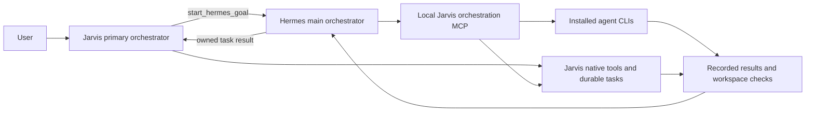

# Hermes–Jarvis implementation status

Updated: 1 November 2026. This records the running integration, separate from the broader architecture blueprint.

## Operating model

**Hermes is the main orchestrator. Jarvis is also a primary orchestrator.**

Jarvis can execute its own tools and native tasks independently. Broad goals can be sent to Hermes through the authenticated local gateway. Hermes can execute its own tools or delegate bounded assignments through the local `jarvis_orchestrator` MCP server.

## Connected operations

Jarvis exposes `get_hermes_status`, `start_hermes_goal`, `create_task_agent`, `task_agent_status`, `list_task_agents`, `followup_task_agent`, and `cancel_task_agent`. Goal submission returns promptly with an ID. Completion notices remain pending in task journals until the voice or desktop delivery path accepts them.

Hermes receives these MCP tools:

- `jarvis_capabilities`: real installed-agent discovery and both orchestrator roles.
- `jarvis_delegate`: submit a bounded assignment with a stable request key.
- `jarvis_job_status`, `jarvis_job_wait`, `jarvis_job_list`, `jarvis_job_cancel`: inspect or stop bridge-owned CLI assignments.
- `jarvis_task_submit`, `jarvis_task_list`, `jarvis_task_status`, `jarvis_task_read`, `jarvis_task_cancel`, `jarvis_task_resume`: use Jarvis's existing independently supervised native task service.

CLI adapters discover the installed Codex, Claude Code, OpenCode, Gemini, OMP, Pi and Crush binaries. Discovery establishes executable presence; authentication and functional execution must be verified separately for each provider. Hermes is deliberately excluded from its own worker list to prevent recursive delegation. Antigravity has no automated adapter in this implementation.

Background services use installed binary paths and the installed Node runtime without invoking launchers that run package-manager updates. No new agent packages were installed.

## Fresh Hermes start

The former Hermes state was moved into a private backup:

`/home/g0pi/.hermes/backups/jarvis-fresh-20261101T053642861248Z`

The backup includes its original configuration and identity plus memory, conversation databases and transcripts, board/scheduler data, pending work, hooks and historical caches/logs present in the reset scope. The exact moved entries are recorded in `reset-receipt.json` inside that directory. The gateway was stopped first, and the reset refused to proceed if the gateway or database holders remained active.

Hermes now starts with empty built-in memory and user-memory files, a fresh conversation database, and a new orchestration identity in `SOUL.md`. The previous `universal` and `cognee` memory connections are disabled; their external stores were not deleted. Existing credentials, model selection, installed skills/plugins and unrelated connections were preserved. Jarvis memory was not reset. New verification and user tasks naturally create new history after this fresh start. This is a backed-up reset, not secure erasure.

Do not restore old state over a running gateway. A rollback requires stopping Hermes, backing up the new state, restoring the desired original files from the backup, and then restarting it. Restoring the old configuration also removes this MCP connection and restores the old memory connections.

## State and verification

- Hermes-owned goal journals and scratch worktrees: `.jarvis-learning/task-agents/` in the Jarvis checkout.
- MCP worker request ledger and scratch directories: `.jarvis-orchestration/` in the Jarvis checkout.
- Native durable work: the existing Jarvis task service's configured state directory.
- Runtime directories are private and excluded from Git.

A stable MCP request key deduplicates a logical assignment across reconnects. Changing the assignment while reusing its key is rejected. A competing bridge cannot own the same state. Restarted incomplete CLI work is marked interrupted/unknown and is not replayed automatically. New dispatch is blocked while a previous execution is unknown, pending operator inspection.

Workspace checks record stable file hashes and safe structural syntax checks without executing worker-authored tests. Functional acceptance still requires meaningful task-specific checks. A returned answer, clean syntax, or exit code zero is never presented as proof of arbitrary real-world effects.

## Current limits

Hermes goals currently use the existing Jarvis client-owned task manager: at most three active goals, a 10–600 second goal budget, and 50 retained goal records. Those records survive restart, but a running planning process is not transparently resumed after Jarvis stops. Same-client follow-up reuses only a session created by that client.

CLI assignments are supervised by the long-lived MCP process. Their request/result records persist, but disconnecting that server cancels its active CLI workers. Native Jarvis tasks retain independent systemd supervision. Cancelling a Hermes turn does not currently cascade to independently submitted MCP assignments; inspect and cancel those workers with their own job IDs. A future milestone should unify durable goal ownership, parent/child cancellation, worker completion events, atomic Hermes/Jarvis handoffs and controlled history archival. These features are not claimed by this first integration.

Hermes's role instructions preserve the user's authorized scope; they do not create an OS security boundary around its existing tools. A named agent's own permissions and authentication still apply.

## Validation

The combined regression run passed **123 tests** covering restored verification helpers, authenticated gateway correlation, task bounds/cancellation/recovery, duplicate requests, process ownership, installed-agent discovery, voice startup/routing and completion delivery. The existing voice test emitted an ONNX provider warning and passed using the available runtime.

A live Jarvis → Hermes → `jarvis_capabilities` → Jarvis request completed successfully through the running gateway. This confirmed actual MCP invocation and the dual-primary roles. A second live request exercised **Jarvis → Hermes → Jarvis MCP → Codex**. Worker `d433bde79b9a4786b380932469758198` exited with code 0. Its `hello.txt` was independently read and matched the exact expected bytes `JARVIS_HERMES_CODEX_OK\n`. The worker ledger also recorded passing workspace checks. This verifies the Codex delegation path; the other installed agents have discovery coverage, not equivalent live execution coverage.

The Hermes final reply on that second request exceeded its 240-second test deadline. The original configured model was retained. The verification session was reconciled and its interrupt was acknowledged; no unknown setup job or active worker remained. This exposed and led to a fix for canonical gateway cancellation: interrupt requests now carry the current execution generation obtained from a read-only session mount. Deadline handling leaves time for that bounded cleanup. The default main-goal budget is 600 seconds; a successful worker result does not imply a final Hermes reply will always fit that budget.

## Relevant source files

- `orchestration/hermes_bridge.py` and `_hermes_gateway_worker.py`: bounded authenticated Hermes transport.
- `orchestration/task_agents.py`: owned goal/task lifecycle and result journals.
- `orchestration/mcp_server.py`: local worker delegation and request ledger.
- `orchestration/executables.py`: installed-agent discovery without package-manager mutation.
- `orchestration/hermes_setup.py`: backed-up offline reset and configuration.
- `orchestration/routing.py`: Hermes-main, dual-primary routing instructions.
- `proactive/verification.py`: restored bounded workspace verification.
- `skill_manifests/personal-agents.json` and its packaged mirror: declared Jarvis tools.
- `jarvis_control/skills.py` and `jarvis_voice/daemon.py`: voice attachment and acknowledged notices.

The active Hermes configuration uses the absolute `scripts/hermes-jarvis-mcp.py` entry point. No network listener was added for this connection.

## Native Hermes features through Jarvis

Jarvis now has `get_hermes_features` and `run_hermes_command`. These call Hermes's live `tools.list`, `commands.catalog` and `command.dispatch` over the existing authenticated gateway. Native command policies and data stores remain Hermes-owned. `start_hermes_goal` prefers Hermes's prebuilt tools and skills for natural-language actions. No replacement board, cron scheduler or feature backend was built.

The live inventory returned 27 enabled groups and 310 command entries. Direct board and cron listing both succeeded against the running Hermes installation. These checks did not create schedules or alter board cards. The combined regression run passed 130 tests. See [the native-feature voice guide](HERMES-NATIVE-FEATURES.md) for usage, delivery caveats and the enabled feature snapshot. Optional and provider-backed features still need their own configuration and readiness checks.
