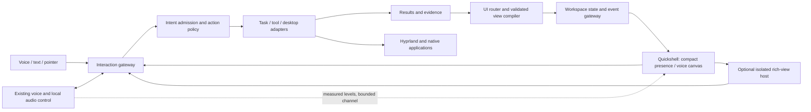

# 04 — Architecture and UI contract

Status: proposed v1 contract. Examples are design fixtures, not implemented endpoints. All timestamps and measurement values below are synthetic.

## Proposed system boundaries



Audio capture, echo handling and playback remain owned by the audio service. The UI observes status and measured envelopes; it does not open a second microphone. A renderer stall cannot block capture/playback. Keep audio samples and large images out of the durable intent log. Process-priority changes or an audio-engine rewrite are not prerequisites for designing the GUI and require separate measured justification.

The existing core/router/task infrastructure remains the execution authority. A GUI gateway provides validated presentation and bidirectional interaction. It must integrate the existing logical intent bus rather than establish a competing command system. UI payloads describe views; action policy governs actual effects.

## Repository integration map

Read-only inspection on 2 November 2026; the working tree contains pre-existing edits, so paths identify candidates, not release guarantees.

| Existing location | Observed support | Proposed integration/gap |
| --- | --- | --- |
| `quickshell/shell.qml`, `Notch.qml`, `ShellState.qml` | Native panels and panel IPC | Voice canvas and shared view state are new work |
| `quickshell/Theme.qml`, components | Existing typography/palette/control patterns | Add voice tokens without breaking current panels |
| `quickshell/launch.sh` | Wayland launcher and local imports | Later validate imports/singletons against installed Quickshell; previous experimental launch had undefined bindings |
| `voice_layer/config.py` | Private runtime paths `jarvis/control.sock`, `state.json`; `LEVEL_FILE` declared | Select runtime path through one adapter; declaration alone does not establish a live level feed |
| `voice_layer/daemon.py` `status()` | State, capture flags, mic RMS, tools, model, errors, latency | Need timestamped heartbeat, revisions, transcript deltas, playback-level availability, durable task/widget references |
| `voice_layer/ipc.py` | JSON status/mute/interrupt/standby/wake; text command handling | Command receipts and semantic separation; no assumed durable subscription |
| `bin/jarvis-voice`, `voice_layer/__main__.py` | CLI bridge | Avoid invoking Python every visual frame; robust response framing/error handling required |
| `ui/omarchy-jarvis-island/AgentBridge.qml` | Legacy live status/control bridge | Hardcoded older checkout paths and placeholder agent/approval content need replacement before reuse |
| `plugins/voice.orb`, `voice.indicator` | Earlier status/level readers | Legacy `omarchy-voice` path differs from current `jarvis` runtime; no direct drop-in assumption |
| `jarvis_control`, `skills`, `orchestration` | Desktop/tool/task capabilities | Reuse typed adapters and receipts; bridge capability discovery |

The inspected status method exposes microphone RMS, not a documented timestamped playback-envelope stream. Add measured output telemetry only after identifying its actual audio write/playback timing. The UI must show unavailable/stale measurements truthfully.

Do not wire “Stop speaking” to legacy `listen cancel`: that path can also invoke task cancellation. Prefer a distinct acknowledged interrupt command and a separately scoped task cancellation endpoint. Similarly, do not use mute/unmute as a way to change presentation mode.

## Transport and authority

Proposed gateway uses protected user-session IPC, with peer identity and per-action authorization. Versioned snapshots establish state; a bounded event stream delivers deltas. The final socket path is chosen alongside the existing intent bus implementation. This package does not create it.

Every connection begins with protocol/version and capability discovery, then a current snapshot plus sequence cursor. Snapshot and cursor must describe one consistent point. Reconnection resumes bounded retained events when possible; otherwise fetch a fresh snapshot. Rendering a recovered task never reissues its action.

Reliable control/events and lossy high-rate telemetry are separate channels. Proposed heartbeat every 2 seconds; show stale after 6 seconds without a valid heartbeat, subject to tuning. A state transition without a heartbeat cannot establish indefinite liveness. A retained file alone does not prove the daemon is alive.

Critical controls must bypass a saturated view-generation queue. Coalesce telemetry and superseded view patches, bound image/array/text sizes and avoid a per-frame process. Initial validation limits: 64KiB control/view envelopes; 32 cards per workspace; 128 blocks per card; 8 nesting levels; tables page at 100 visible rows; charts downsample to 1000 visible points per series. These are tunable starting limits, with explicit pagination/artifact references for larger results.

## Envelope

| Field | Rule |
| --- | --- |
| `schema_version` | Integer major protocol version; reject unsupported majors |
| `event_id` | Unique ID for deduplication |
| `producer_id`, `producer_epoch` | Identity and new epoch on producer restart |
| `sequence` | Monotonic within producer epoch; gaps trigger recovery |
| `occurred_at`, `expires_at` | UTC timestamps; expiry optional by event kind |
| `session_id`, `request_id` | Owning session and admitted request |
| `task_id` | Optional durable work identity |
| `generation` | Turn/cancellation generation fence |
| `type` | Allowlisted event kind |
| `payload` | Kind-specific validated object |

Ordering across multiple producers is resolved by the gateway's workspace revision, not by comparing unrelated producer sequences. Monotonic clocks are suitable for local intervals; UTC is for provenance/display. Authentication context is supplied by the trusted gateway, never accepted from a model field.

Proposed kinds: `session.snapshot`, `voice.state`, `transcript.delta`, `task.updated`, `evidence.available`, `widget.upsert`, `widget.patch`, `widget.dismissed`, `selection.changed`, `action.requested`, `action.acknowledged`, `action.completed`, `approval.required`, `approval.resolved`, `app.handoff.updated`, `connection.heartbeat`.

Example widget event:

```json
{
  "schema_version": 1,
  "event_id": "evt-demo-101",
  "producer_id": "gui-gateway",
  "producer_epoch": "demo-epoch-a",
  "sequence": 101,
  "occurred_at": "2026-11-02T14:30:00Z",
  "session_id": "session-demo",
  "request_id": "request-demo-7",
  "task_id": "task-demo-releases",
  "generation": 3,
  "type": "widget.upsert",
  "payload": {
    "widget_id": "widget-demo-memory",
    "revision": 1,
    "surface": "composed",
    "title": "Release memory comparison",
    "state": "ready",
    "layout": {"preferred_span": 2, "min_width": 320},
    "retention": {"policy": "conversation", "pinned": false},
    "blocks": [
      {
        "id": "memory-table",
        "type": "table",
        "columns": [
          {"key": "release", "label": "Release", "format": "text"},
          {"key": "memory", "label": "Idle memory", "format": "number", "unit": "MiB"}
        ],
        "rows": [
          {"id": "release-a", "release": "Release A", "memory": 418},
          {"id": "release-b", "release": "Release B", "memory": 462},
          {"id": "release-c", "release": "Release C", "memory": 431}
        ],
        "selection": "multiple"
      }
    ],
    "evidence_refs": ["evidence-demo-benchmark"],
    "actions": [
      {"id": "chart-selection", "label": "Chart selected", "capability": "view.compose", "target_ref": "memory-table"}
    ]
  }
}
```

`layout` is a preference; the placement engine has final authority. `surface` is a validated router output, not a permission. Data displayed as measurements must resolve to evidence; these example values are fixtures. A chart needs axis/unit/series IDs and accessible table data. Text uses plain text or sanitised approved markup, never arbitrary HTML/QML expressions.

## Action and selection flow

Example user interaction proposal:

```json
{
  "schema_version": 1,
  "interaction_id": "interaction-demo-12",
  "session_id": "session-demo",
  "request_id": "request-demo-8",
  "generation": 4,
  "source": "pointer",
  "widget_id": "widget-demo-memory",
  "expected_revision": 1,
  "action_id": "chart-selection",
  "parameters": {"selected_ids": ["release-a", "release-c"]},
  "idempotency_key": "session-demo:interaction-demo-12"
}
```

Gateway checks identity, current selection/revision, capability, target scope and permissions. Allowed parameters are schema-bound. Raw shell commands and filesystem paths are not executed just because they appear in widget data. Evidence/source content cannot become an instruction. A schema validation success does not establish user authorization.

Receipts distinguish `accepted`, `running`, `completed`, `failed`, `cancelled`, `partial`, `unknown`. An optimistic selected/pressed appearance may indicate local interaction; it cannot claim a completed system effect. Unknown outcome after disconnection requires readback before retry. Persist idempotency keys where side effects need durable deduplication.

Voice “chart these” and clicking the chart action resolve to the same operation. Selected entity IDs enter bounded context with card title and revision. Context records selected data and source trust; it never silently upgrades source text to user instructions. Local view changes and task-data revisions are separate so a scroll event does not invalidate an action unnecessarily.

## Patches and transcript

Widget patches carry `widget_id`, `base_revision`, `revision` and allowlisted field updates. Reject stale/base-mismatched updates; fetch a snapshot. No arbitrary expression evaluation or unrestricted patch paths. Preserve local draft/selection unless the referenced entities disappear; then explain and reconcile.

Transcript events carry turn ID, segment ID, revision, text, final flag and speaker. Replace partial text by segment rather than concatenating repeated hypotheses. Show final and partial tokens distinctly. Do not expose hidden reasoning streams as stage labels. Assistant text should distinguish generated text from text known to have been spoken if playback is interrupted.

## Measured audio channel

Proposed frame: `{stream_id, generation, sequence, sampled_monotonic_ms, input_rms, output_envelope, input_available, output_available}`. Normalise 0–1 with documented metering; enforce finite values. A 20–30Hz UI envelope feed is enough initially. Stop publishing irrelevant samples when capture/playback stops. Consider a sample stale after roughly 250ms; decay to zero and mark unavailable. UI freshness cannot be inferred from an unchanged nonzero file.

Audio measurements do not control permissions. Mute state is acknowledged by the voice service, not inferred from zero amplitude. Output envelopes should account for actual queued/written audio and be cleared at interruption so old speech does not keep animating.

## Rich views

Qt assumes application-provided QML is trusted; running untrusted QML is unsupported. A Loader does not create separate authority or privacy domains. [Qt security model](https://doc.qt.io/qt-6/shared-security-model.html), [handling untrusted data](https://doc.qt.io/qt-6/untrusteddata.html).

Therefore v1 composes only approved native components. Later rich HTML/JS runs in a separate renderer process with independently verified OS/browser confinement, restricted navigation/network, resource limits, no inherited credentials, no general filesystem/desktop/IPC access, and a narrow typed action bridge. Merely choosing a WebView/Tauri/Electron does not prove these properties. Default to no network; use brokered approved assets and data. The native shell owns approval/exit chrome outside the generated view. If confinement cannot be established, use a native app or approved representation.

## Hyprland handoff

Resolve resource → choose supported application adapter → capture current workspace/focus → launch/focus using structured safe arguments → observe actual matching window → deliver resource → verify supported outcome → collapse expanded canvas. Unique window identity is preferable to a broad title regex. User changes invalidate stale placement/focus assumptions.

Layer surfaces are distinct from normal tiled app windows. The proposed canvas is a deliberate overlay, not an app dock or tiled helper panel. Do not assume a layer panel is an ordinary `focuswindow` target. Native applications keep their existing layout when the canvas is dismissed.

Quickshell provides edge-anchored panel windows and explicit layer/focus controls. [PanelWindow](https://quickshell.org/docs/v0.3.0/types/Quickshell/PanelWindow/), [WlrLayershell](https://quickshell.org/docs/v0.2.0/types/Quickshell.Wayland/WlrLayershell/).

Compositor dispatch syntax is version-sensitive: current Hyprland documentation differs from older hyprlang configurations. Inventory the installed version before writing bindings or adapter commands; this design deliberately specifies behaviour rather than a copy-paste configuration. [Hyprland dispatchers](https://wiki.hypr.land/Configuring/Basics/Dispatchers/).
