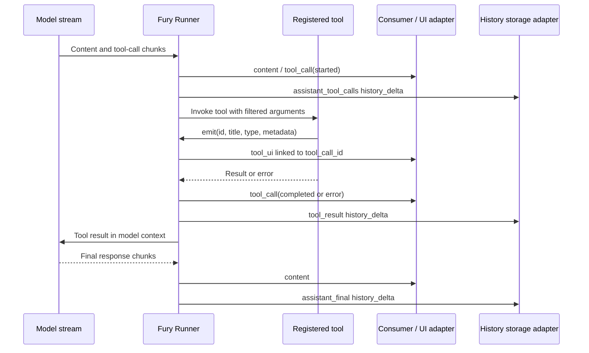

# 08 — Fury source analysis and JARVIS design implications

Reviewed: 2 November 2026. Scope: public source/documentation and selected tests on `huwprosser/fury-sdk` main. The user referred to the project as Fury; the publicly accessible source inspected is [fury-sdk](https://github.com/huwprosser/fury-sdk). This is a static analysis, not an executed benchmark or a claim about the private/current Rose implementation.

## Finding

Fury is an agent runtime with streaming tool/UI events and optional conversation persistence. It supplies useful patterns for driving a voice canvas, but the inspected package does not itself provide the complete Rose-style GUI, widget composition/layout manager, microphone/AEC/TTS pipeline, Hyprland integration or OS authorization boundary. The public code does not establish that Rose uses Fury internally.

The inspected [pyproject](https://github.com/huwprosser/fury-sdk/blob/main/pyproject.toml) identifies package version 0.3.2 and Python ≥3.10 with an OpenAI-compatible client dependency. This identifies the inspected package; it is not a recommendation to change JARVIS's voice provider or runtime.

## Source map

| Source | Observed responsibility | Relevance |
| --- | --- | --- |
| [agent.py](https://github.com/huwprosser/fury-sdk/blob/main/src/fury/agent.py) | Agent config, tool registry/executor, OpenAI-compatible client, per-turn Runner | Keep per-turn control separate from long-lived configuration |
| [runtime.py](https://github.com/huwprosser/fury-sdk/blob/main/src/fury/runtime.py) | Stream parsing, generation/tool loop, stop control, provider errors and retry | Feed text/tool events incrementally; handle generation boundaries |
| [types.py](https://github.com/huwprosser/fury-sdk/blob/main/src/fury/types.py) | Separate content, reasoning, tool_call, tool_ui and history_delta event fields | Do not conflate presentation, model transcript and actual execution |
| [tools.py](https://github.com/huwprosser/fury-sdk/blob/main/src/fury/tools.py) | Tool registration, top-level argument filtering, tool invocation, runtime emit callback, optional parallel wrapper | Tool work can publish structured UI updates before completing |
| [sessions.py](https://github.com/huwprosser/fury-sdk/blob/main/src/fury/sessions.py) | Optional append-only message/custom-event persistence and context reconstruction | Conversation and workspace storage need deliberate ownership |
| [interruption docs](https://github.com/huwprosser/fury-sdk/blob/main/docs/interruption.md) | Interrupt retains partial assistant text; cancel discards it | Specify partial-turn treatment explicitly |

## Actual event flow

The `emit` callback is injected at invocation when the callable supports it; it is not a user/model-supplied tool parameter. Synchronous tools run through `asyncio.to_thread`; asynchronous tools are awaited. A queue forwards emitted events into the stream. This supports progressive UI while the tool is working, without waiting for the final answer.

`ToolUiEvent` contains an ID, title, type (`tool_call` or `other`), optional tool-call ID and arbitrary metadata. This is a small event wrapper, not a complete typed layout schema for tables/charts/actions. JARVIS still needs its proposed widget contract, entity identity, validation and workspace revision.

## What to carry into the JARVIS design

1. **Dedicated UI emission:** Tools publish structured progress and data-ready events tied to action/task IDs. The canvas updates while voice and tools continue.
2. **Distinct channels:** Transcript messages remain suitable for future model turns. View layout, playback telemetry, execution receipts and UI interaction records have their own roles and retention.
3. **Per-turn control:** Explicit generation objects make interruption scope visible. Preserve completed evidence when old narration stops.
4. **Incremental rendering:** A source card can appear before the chart is ready; final speech incorporates actual returned results.
5. **Recorded tool outcomes:** Retain model-visible tool calls/results so a follow-up does not lose the reason a card exists.
6. **Visible errors:** Failed tools produce actionable task state rather than an endlessly animated core.

These patterns can be implemented through existing JARVIS services. Adopting the entire library is a separate dependency/architecture decision, not required by this design.

## Limits that matter for an operating-system GUI

| Observed mechanism | Limit / implication for JARVIS |
| --- | --- |
| `filter_args` drops unknown top-level keys | This is not complete JSON Schema validation of nested values, required keys, types, enums, sizes or authorization. JARVIS needs explicit validation and policy. |
| Normal execution loops over model tool calls; optional wrapper uses `asyncio.gather` | Do not describe every tool call as automatically parallel. JARVIS needs bounded work/concurrency with task ownership. |
| Per-tool UI queue uses `asyncio.Queue()` without a maximum | A slow consumer or noisy emitter can accumulate events; proposed gateway adds bounds, coalescing and backpressure. |
| Runner stop requests cancel the current asyncio task and close the model stream | That is not proof an external process, synchronous thread, already committed operation or child worker has stopped. OS task cancellation needs scoped control and receipts. |
| `interrupt()` preserves partial response; `cancel()` discards partial text | Both concern generation. Neither is the same as “stop audible playback only” or undoing completed effects. |
| UI metadata is unconstrained `Any` in the event dataclass | Do not execute it or treat it as a safe widget definition without JARVIS's admission/compiler boundary. |
| Optional output schema can be emitted through a reasoning event | Map structured output into an explicit validated data event; do not expose reasoning streams or parse arbitrary reasoning text as GUI authority. |
| XML-style textual tool-call healing is enabled by default in Agent config | JARVIS must still admit and authorize every action. Parsing a suggested call cannot bypass policy or freshness. |
| Provider 429 handling retries with fixed delays and a finite attempt count | UI should report a real retry stage, preserve cancellation responsiveness and avoid treating a stalled call as complete. |
| Session adapter records history deltas, not all UI output | Reconstructable canvas state needs separate snapshots/revisions and retained widget specifications. |
| JSONL storage flushes writes without fsync and documents single-writer/recovery limits | Do not call it power-loss transactional or sufficient for exactly-once OS effects. Durable actions require an appropriate store/outbox design. |

The cancellation/thread limitation is an inference from the observed use of `asyncio.to_thread` and task cancellation, not a result from a live cancellation test. Security and persistence requirements above are JARVIS design requirements, not an assertion that Fury promises to solve them.

## Tests inspected, not executed

[Agent tests](https://github.com/huwprosser/fury-sdk/blob/main/tests/test_agent_features.py) include sync/async emitted UI, interruption, argument filtering, tool errors, parallel-wrapper events and multimodal follow-up. [Transcript tests](https://github.com/huwprosser/fury-sdk/blob/main/tests/test_transcript_persistence.py) assert ordered history deltas and event collection. [Stream error tests](https://github.com/huwprosser/fury-sdk/blob/main/tests/test_stream_errors.py) cover explicit provider stream failures. [Retry tests](https://github.com/huwprosser/fury-sdk/blob/main/tests/test_rate_limit_retry.py) cover bounded 429 retries.

The inspected error-handling test that loops through tool rounds demonstrates one invocation per supplied round; by itself it does not prove that a model will never repeat an unsuccessful tool across rounds. These tests do not establish microphone/speaker quality, current Rose behaviour, a generated widget renderer, Hyprland integration or production readiness.

## Design conclusion

Use Fury as a concrete source reference for tool-driven UI events, per-turn generation control and separation of presentation from transcript persistence. Keep the JARVIS voice canvas focused: compact presence, relevant JIT/native widgets inside the canvas, and verified native app handoff. Build the missing layout, references, policy, data lifecycle and OS integration through JARVIS's own shared contract. No dock or permanent unrelated dashboard is part of this design.
