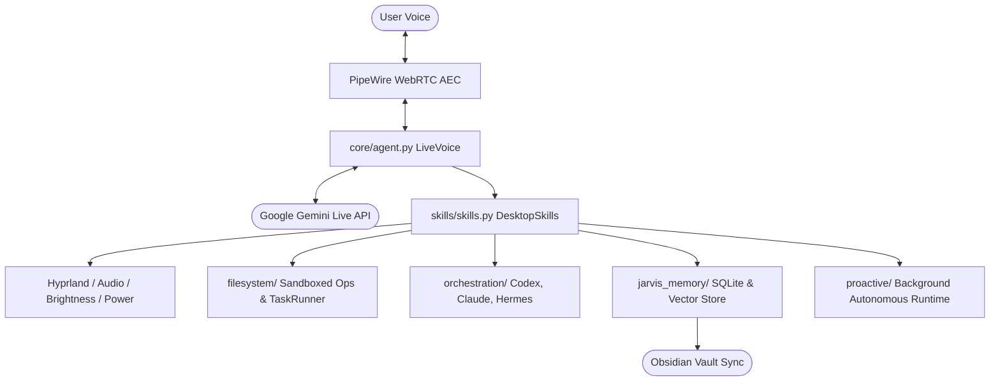

# JARVIS-OMA System Architecture

JARVIS-OMA is a fully autonomous, full-duplex conversational voice agent engineered for Omarchy and Arch Linux desktops. It connects Gemini Live directly to native desktop controls, PipeWire audio nodes, persistent memory stores, and local coding agents.

## Subsystems

1. **Core Runtime (`core/`)**:
   - `core/agent.py`: Asynchronous WebSocket pipeline communicating with Gemini Live. Manages concurrent audio capture, playback, event processing, and instant interruption.
   - `core/config.py`: Flexible configuration hierarchy supporting TOML, JSON, environment variables, and CLI overrides.

2. **Audio Pipeline (`audio/`)**:
   - `audio/echo_cancel.py`: Session-owned PipeWire WebRTC AEC module. Guarantees echo-free full-duplex conversation by routing playback through a reference sink and capture through an echo-cancelled source.

3. **Skills Engine (`skills/`)**:
   - Declarative JSON manifests (`skills/manifests/`) validated with strict schemas.
   - Self-declaring dependency checks (`ADAPTER_COMMANDS`) providing graceful degradation.
   - Zero-latency multimodal input bar (`skills/input_bar.py`) for live typing and file attachments.

4. **Filesystem Autonomy (`filesystem/`)**:
   - `filesystem/filesystem.py`: Sandboxed file exploration, editing, and content grep with safety guards protecting system roots.
   - `filesystem/task_runner.py`: Asynchronous execution of validated multi-step filesystem plans.

5. **Multi-Agent Orchestration (`orchestration/`)**:
   - `orchestration/agent_orchestrator.py`: Discovers and delegates tasks to background coding agents (Codex, Claude, Hermes, OMP) with workspace isolation and strict timeout enforcement.

6. **Memory Subsystem (`jarvis_memory/`)**:
   - SQLite knowledge ledger for structured user facts, profiles, and continuous session history.
   - Hybrid lexical + semantic ranking with private local vector caching.
   - Automated Obsidian vault synchronization.

7. **Proactive Autonomy (`proactive/`)**:
   - Background activity and idle monitoring, event-driven ledger, and bounded task planning.
