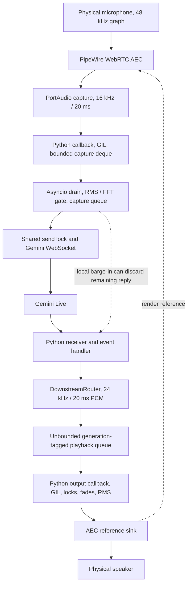

# Building browser-smooth JARVIS audio

Research and engineering proposal — 21 October 2026, Asia/Kolkata

Status: research only. No audio configuration, runtime, service, or protected voice file was changed during this investigation. Performance targets below are proposed acceptance criteria, not achieved results.

## 1. Decision

JARVIS should use a dedicated audio runtime with device-paced native capture/rendering, verified echo-reference routing, bounded timestamped buffers, and explicit interruption ownership. Python should coordinate the model, tools, memory, and conversation policy outside the device callback deadline.

Do not begin by reserving CPUs, increasing thread counts, forcing a smaller quantum, or adding another large playback cushion. The investigation found actual errors in the current PipeWire AEC graph, confirmed destructive interruption behavior, and gaps in callback and queue design. These deserve attention before hardware tuning.

Recommended sequence:

1. Instrument and compare the working browser and current service under matched conditions.
2. Explain and eliminate the increasing AEC graph errors; measure local false interruptions separately.
3. Establish a versioned audio-backend boundary in orchestration.
4. Prototype a separate native PipeWire audio companion, leaving the existing protected engine intact as the legacy backend, with integration that respects the prohibition on overriding core voice functions.
5. Promote the candidate only after it matches the measured browser baseline under load and passes recovery tests.

The fast alternative is a browser audio frontend connected to the existing Python backend. This should be evaluated as a serious candidate because the user already reports a working browser experience. It still needs explicit buffer, session, and deployment design.

Confidence is high about source-level behavior and the observed graph counters; medium about which mechanism dominates the user's audible cuts. No synchronized recording of an actual cut or instrumented browser call was available.

## 2. What the investigation actually established

### Live system observations

Read-only inspection found:

| Observation | Evidence and implication |
| --- | --- |
| JARVIS is a systemd user service | Main PID 49072, active, zero automatic restarts in its current invocation. This does not identify earlier externally requested restarts. |
| Python uses the GIL | CPython 3.13.15 reports `sys._is_gil_enabled() == True`. |
| Service has no CPU pinning or RT policy | CPUAffinity empty, scheduling policy 0, priority 0, nice 0. |
| Visible JARVIS audio threads use normal scheduling | `pw-PortAudio` and `alsa-pipewire` threads reported class TS, nice 0. |
| Visible Chromium AudioWorklet threads also use normal scheduling | Two `Realtime AudioW` threads reported TS, nice 0. They were not tied to the user's exact test call; this is not a full browser scheduler trace. |
| Hardware graph is 48 kHz | Current graph metadata rate 48000; driver quantum observed at 1024 samples, about 21.33 ms. |
| Current JARVIS is muted and idle | Status: muted true, vision off, zero active jobs. This was not a speaking benchmark. |
| JARVIS counters report no callback problems | Underflows, callback errors, capture drops, and local barge-ins all zero in the sampled invocation. These counters do not cover every PipeWire graph failure. |
| Active AEC nodes show increasing errors | In consecutive valid `pw-top` snapshots, node 92 (private cleaned source) and node 120 (AEC playback) each rose from 35361 to 35386: +25 errors each. |
| Application streams report zero errors in those snapshots | Capture node 126 and playback node 107 stayed at zero; hardware microphone remained at 473. AEC graph errors need independent monitoring. |
| Actual links exist in both directions | `pw-dump` showed active links 92 → 126, 107 → 127, microphone 62 → AEC capture 115, and AEC playback 120 → speaker 60; see the identity map below. |
| Another private AEC pair remains suspended | A second pair with different generated names was visible. Its ownership and origin were not established. Do not delete it based on its name alone. |

`pw-top` defines ERR as combined xruns and errors; its WAIT and BUSY values describe different parts of graph execution. Increasing ERR is evidence of an unhealthy graph, but does not by itself identify the failing algorithm, prove a CPU shortage, or establish how much audible distortion occurred. The 480-sample suggestions on AEC followers versus the 1024-sample driver are clues to investigate, not proof of an invalid configuration. [PipeWire pw-top documentation](https://docs.pipewire.org/page_man_pw-top_1.html)

The two +25 deltas may represent the same propagated graph failures; they are not evidence of 50 independent audible dropouts. These IDs are transient snapshot identities:

| ID | Node identity | Role |
| --- | --- | --- |
| 62 | `alsa_input...HiFi__Mic1__source` | Physical microphone |
| 60 | `alsa_output...HiFi__Speaker__sink` | Physical speakers |
| 115 | `echo-cancel-capture`, active pair | AEC physical input |
| 92 | `omachy_aec_97ab7cec596a_source` | Cleaned microphone source |
| 127 | `omachy_aec_97ab7cec596a_sink` | Speaker reference sink |
| 120 | `echo-cancel-playback`, active pair | AEC physical output |
| 126 | `alsa_capture.python3.13` | Application capture |
| 107 | `alsa_playback.python3.13` | Application playback |

This snapshot maps graph directions and node names. It does not establish durable ownership solely from the generic Python node names; production verification must additionally correlate client/process identity.

The active graph readback also corrects an earlier claim: setting `PIPEWIRE_NODE` to the source is suspicious, but does not prove that the final playback link is wrong. At this observation, the final capture and playback links were correctly connected to the intended AEC endpoints. Echo rejection quality and deadline health were still unverified.

### Limits of the browser comparison

The user reports smooth, lower-latency browser voice on this machine. That is valuable evidence that a good experience is achievable. However, the repository does not contain the tested browser voice implementation, and the exact site, transport, model parameters, AEC settings, and device latency have not been measured. The new `ui/` files concern JARVIS's orbit/status UI; their existence does not establish that they implement the tested browser audio path.

A browser-versus-service difference can include client audio handling, model settings, backend routing, region, prompt length, VAD, or tool behavior. The report does not attribute all differences to threads.

## 3. What browsers provide, and what remains the application's job

### 3.1 Native device handling and process boundaries

Chromium normally runs its Audio Service in a separate utility process on Linux. Control uses Mojo; sample transport uses shared memory and an AudioDeviceThread notification path. Capture pushes data; playback pulls samples when the device needs them. Its platform layer also handles conversion and stream reuse. Chromium warns audio callbacks against allocation, blocking, synchronous I/O, and contended locks. [Chromium audio architecture](https://github.com/chromium/chromium/blob/main/media/audio/README.md)

The transferable principle is bounded device work separated from unrelated application work. Copying Chromium's process count is unnecessary. A systemd-managed native audio process can implement the same principle.

### 3.2 AudioWorklet is separate from ordinary page work

AudioWorklet processing runs on the context's audio rendering thread. Chrome's published design uses a worker and shared-memory ring buffers when heavier processing must sit outside the rendering callback. The callback must not wait for that worker. Ring buffers adapt block sizes; they do not grant extra processing time. Allocation and garbage-collection pressure still matter. [Chrome AudioWorklet design patterns](https://developer.chrome.com/blog/audio-worklet-design-pattern)

Many implementations process 128-frame render blocks: 2.67 ms at 48 kHz. This is an audio-graph quantum, not conversational response latency. Web Audio's newer specification includes configurable render-size concepts; installed implementation support must be checked. `latencyHint` expresses a preference, whereas `baseLatency`, `outputLatency`, and output timestamps expose different measurements. [Web Audio specification](https://webaudio.github.io/web-audio-api/)

### 3.3 Browser microphone processing is configurable

Media capture exposes echo cancellation, noise suppression, and automatic gain control. Requested constraints are not sufficient evidence of actual settings: capture `MediaStreamTrack.getSettings()` during the call. Do not assume all browsers enable identical processing or honor every requested parameter. [Media Capture and Streams](https://w3c.github.io/mediacapture-main/)

WebRTC's Audio Processing Module provides AEC, NS, and gain-control components and supports standalone use. JARVIS can reuse these algorithms without replacing its Gemini transport. [WebRTC APM overview](https://webrtc.googlesource.com/src/+/main/modules/audio_processing/g3doc/audio_processing_module.md)

AEC needs both microphone audio and a time-aligned render reference representing the actual speaker output. PipeWire's AEC module expresses this as four streams: physical capture, cleaned source, reference sink, and physical playback. Correct links are necessary but do not prove good cancellation. [PipeWire echo-cancellation topology](https://docs.pipewire.org/page_module_echo_cancel.html)

### 3.4 WebRTC jitter handling is conditional

NetEq is WebRTC's RTP jitter-buffer and packet-concealment component. It measures arrivals, adapts buffering, and produces paced output with concealment and timing adjustment. These properties belong to the WebRTC receive path. A browser playing Gemini PCM received over WebSocket does not automatically use NetEq. It still needs application playback scheduling and buffering. [WebRTC NetEq documentation](https://webrtc.googlesource.com/src/+/refs/heads/main/modules/audio_coding/neteq/g3doc/index.md)

Direct Gemini Live uses a stateful WebSocket connection. A browser client can use that same API; third-party integrations may introduce WebRTC bridges. A bridge changes the transport, operational dependencies, and potentially latency. Browser smoothness alone cannot establish which transport the user tested. [Gemini Live WebSocket reference](https://ai.google.dev/api/live)

### 3.5 Scheduling is a mechanism, not a guarantee

Thread names containing “realtime” do not prove SCHED_FIFO or SCHED_RR. This machine's snapshot demonstrates that point. PipeWire can request suitable processing-thread priority through limits, the realtime portal, or RTKit. Investigate actual thread policy and denied requests before changing permissions. Avoid giving all model/tool work real-time policy. [PipeWire RT module](https://docs.pipewire.org/page_module_rt.html)

`CPUAffinity=0 1 2 3` restricts where a process can run. It does not reserve those CPUs exclusively, eliminate the GIL, or guarantee deadlines. The earlier description of that setting as a reservation was incorrect. [systemd execution and scheduling](https://www.freedesktop.org/software/systemd/man/latest/systemd.exec.html)

## 4. JARVIS's actual capture-to-playback path



Source anchors: [AEC creation](/home/g0pi/Projects/JARVIS-OMA/audio/echo_cancel.py:59), [capture callback](/home/g0pi/Projects/JARVIS-OMA/audio/engine.py:309), [capture drain](/home/g0pi/Projects/JARVIS-OMA/audio/engine.py:337), [microphone sender](/home/g0pi/Projects/JARVIS-OMA/core/agent.py:630), [downstream frame accumulator](/home/g0pi/Projects/JARVIS-OMA/audio/downstream.py:28), [playback callback](/home/g0pi/Projects/JARVIS-OMA/audio/engine.py:449).

### Confirmed findings and confidence

| Finding | Evidence | Effect and confidence |
| --- | --- | --- |
| Device callbacks execute Python under the GIL | [engine header](/home/g0pi/Projects/JARVIS-OMA/audio/engine.py:1), live GIL check | Confirmed architecture; actual callback overruns need measurement. |
| Output callback allocates, locks, scans queues, computes fades/RMS and wakes the loop | [output callback](/home/g0pi/Projects/JARVIS-OMA/audio/engine.py:449) | Confirmed deadline variability risk; low average CPU does not establish safety. |
| Local voice gate can cut the whole remaining response | [gate](/home/g0pi/Projects/JARVIS-OMA/audio/engine.py:415), [local handler](/home/g0pi/Projects/JARVIS-OMA/core/agent.py:259), [incoming audio condition](/home/g0pi/Projects/JARVIS-OMA/core/agent.py:1075) | After a qualifying trigger, audio is discarded until provider interruption or turn completion. Mechanism confirmed; false-trigger incidence unknown. |
| AEC binder selects by first matching client name | [binder](/home/g0pi/Projects/JARVIS-OMA/audio/engine.py:749) | Ownership defect: another ALSA client can be selected. Playback move return code is ignored and success is logged regardless. |
| AEC lookup can fall back despite usable PipeWire nodes | [lookup](/home/g0pi/Projects/JARVIS-OMA/audio/engine.py:710) | PortAudio enumeration and PipeWire graph inventory differ; warning alone cannot prove node-readiness race. |
| Playback has no enforced backlog limit | [queue construction](/home/g0pi/Projects/JARVIS-OMA/audio/engine.py:147), [enqueue](/home/g0pi/Projects/JARVIS-OMA/audio/engine.py:680) | SimpleQueue is unbounded. `queue_max_seconds` is not wired into this path. Existing README claims of a ten-second bound are inaccurate. |
| Capture latency setting is not applied | [input stream construction](/home/g0pi/Projects/JARVIS-OMA/audio/engine.py:820), [config](/home/g0pi/Projects/JARVIS-OMA/core/config.py:44) | Changing `capture_latency_ms` cannot tune this InputStream today. |
| Hardware callback timestamps are unused | [input callback](/home/g0pi/Projects/JARVIS-OMA/audio/engine.py:309), [output callback](/home/g0pi/Projects/JARVIS-OMA/audio/engine.py:449) | Sample counters are not an ADC/DAC clock mapping. Host/PipeWire may resample, but JARVIS does not measure physical timing. |
| Microphone shares transmission lock with image/tool traffic | [mic](/home/g0pi/Projects/JARVIS-OMA/core/agent.py:643), [image send](/home/g0pi/Projects/JARVIS-OMA/core/agent.py:773) | A blocked image send can delay outgoing mic frames. Current snapshot had vision off, so this does not explain that sample. |
| Reconnect always clears received playback | [connection cleanup](/home/g0pi/Projects/JARVIS-OMA/core/agent.py:1722) | Even planned GoAway renewal invokes barge-in cleanup. Context resumption does not preserve local queued speech. |
| Reconnect can retain up to four seconds of capture | [capture age policy](/home/g0pi/Projects/JARVIS-OMA/audio/engine.py:256) | Replaying delayed speech can undermine conversational timing. Current normal limit is one second. |
| Extension output helper has incompatible queue format | [extension helper](/home/g0pi/Projects/JARVIS-OMA/audio/extension.py:216), [tuple consumer](/home/g0pi/Projects/JARVIS-OMA/audio/engine.py:536) | Raw bytes are written where `(generation, bytes)` is expected. Not currently the active path; must be fixed before using this adapter. |

PortAudio and sounddevice both require callback work to finish within strict timing constraints. Sounddevice also notes that fixed block sizes can add buffering on some host APIs. Moving the existing Python engine to another process reduces interference from tools but retains its internal callback risks. [PortAudio callback rules](https://portaudio.com/docs/v19-doxydocs/writing_a_callback.html), [sounddevice stream API](https://python-sounddevice.readthedocs.io/en/latest/api/streams.html)

The shared asyncio loop is a separate scheduling boundary: a task that does synchronous work delays the other tasks on that loop. Some JARVIS memory and file work is already offloaded; it would be inaccurate to say all background work blocks the loop. Capture-side RMS/FFT and other synchronous paths still need profiling. [Python asyncio development guidance](https://docs.python.org/3.13/library/asyncio-dev.html)

## 5. Distinguish latency, speech cuts, and crashes

### Latency accounting

Measure these intervals separately:

Record the final voiced microphone sample's capture and send timestamps, the estimated end-of-speech/endpoint event, first response PCM receipt, playback priming, and first sound at the speaker. Microphone streaming continues through silence and model playback; there is no universal “last input sent” event before the model replies. Endpoint detection and transmission are overlapping activities, not a strictly sequential chain.

Current configured components are 800 ms VAD silence duration, 320 ms initial playback cushion, and a requested 100 ms output-device latency. They are different stages. Do not simply add them and claim an exact measured total; packet bursts, overlapping work, provider behavior, and actual negotiated latency affect the result. [Current configuration](/home/g0pi/Projects/JARVIS-OMA/config.toml:1)

The cushion grows by 80 ms after certain starvation events, caps at 600 ms, and resets after a burst. This is a useful existing heuristic, but is not a measured packet-arrival jitter controller. [Rebuffer logic](/home/g0pi/Projects/JARVIS-OMA/audio/engine.py:543)

Gemini recommends small microphone chunks and immediate handling of confirmed server interruptions. JARVIS's 20 ms transmission framing is already appropriate; reducing it blindly is not the priority. [Gemini streaming guidance](https://ai.google.dev/gemini-api/docs/live-api/best-practices)

### Each audible symptom needs a different diagnosis

| Audible symptom | Candidate event | Evidence needed |
| --- | --- | --- |
| Reply ends abruptly and never resumes | Local/server interruption, explicit stop, generation discard, session failure | Interruption reason, turn/generation IDs, discarded samples, close code |
| Reply pauses then continues | PCM starvation, event-loop stall, graph xrun | Packet receipt timeline, queue occupancy, graph ERR delta, callback deadlines |
| Click/crackle with otherwise continuous speech | Waveform discontinuity, sample loss, device/graph deadline failure | PCM continuity and hardware timing trace |
| Every reply starts slowly | VAD endpointing, model first-packet delay, priming cushion, device buffer | Per-stage latency percentiles |
| Voice and service disappear | Signal, explicit stop, unhandled exception, OOM, native crash | systemd invocation/exit status, kernel logs, coredump if one exists |

Historical logs in this chat showed DNS outages and an APIError; they also showed controlled service stop/start requests. Those do not establish a segfault. An old “last packet 1916 ms ago” warning measures time since application enqueue; it cannot alone distinguish provider silence from network delivery delay or delayed event handling. Earlier attribution of that interval entirely to Gemini/network was too strong.

Likewise, the recent increase in cuts cannot be attributed causally to the prior buffer change without an A/B comparison. The forced service quantum and AEC errors make graph configuration a high-priority experiment, not a confirmed regression cause.

## 6. Candidate architectures

| Candidate | What it improves | What it retains/costs | Recommendation |
| --- | --- | --- | --- |
| Tune current process | Fast diagnostics, barge-in A/B, endpointing and routing visibility | Python callbacks, GIL, internal locks and legacy binder remain | Required diagnostic stage, not a complete target architecture |
| Existing engine in a separate Python process | Isolates tools/main-loop workload and process GIL | Callback work and engine limitations remain; PCM IPC still needs bounds | Useful diagnostic or transitional option |
| Browser audio frontend + Python service | Reuses Chromium device/APM/render infrastructure | Permissions, autoplay/user gesture, desktop-session lifecycle, browser updates and memory; PCM WS buffering remains application work | Best rapid parity prototype if browser use is acceptable |
| Native PipeWire audio companion + Python service | Deterministic device path, no Python device callbacks, explicit targets and metrics | New native component, integration and regression-test effort | Preferred Linux service target |
| WebRTC media bridge | Adds a genuine RTP media path and its jitter/concealment facilities | Extra media service/network hop, operational complexity, provider bridge needed | Consider only if measurements justify the additional transport |

Native PipeWire exposes inactive stream creation, stream timing, mapped buffers, and RT processing callbacks. RT callback code must satisfy its constraints; a Rust implementation is not automatically allocation-free or real-time safe. C/C++ with a small reviewed surface is also viable. [PipeWire stream API](https://docs.pipewire.org/group__pw__stream.html)

### Proposed native companion responsibilities

```text
systemd user supervisor
 ├─ jarvis-audio: native device streams, audio control loop, preallocated rings
 │   ├─ capture/render callbacks: bounded copy, silence fill, atomic counters
 │   └─ non-RT worker: resampling, framing, graph/device monitoring, metrics
 └─ jarvis-conversation: Python Gemini session, outbound scheduling, tool bridge
     └─ tools/memory workers: bounded work outside audio deadlines

Data: versioned local PCM transport with timestamped bounded rings
Control: local Unix socket; START, STOP, FLUSH, DEVICE_CHANGE, METRICS
```

Keep one producer and one consumer per single-producer/single-consumer ring. Aggregate competing event sources on a non-RT owner rather than turning the ring into an undocumented multi-producer queue. Device callbacks must never wait for the Python side. Stream creation, connection, recovery, logs, disk/network access, and telemetry formatting occur outside callbacks.

A Python or native network owner may write future playout samples into a separate staging buffer; a dedicated producer transfers them to the render ring. A blocked cloud client must not freeze device rendering. For Linux, begin with a local Unix socket for framed PCM if it meets measured deadlines; use shared memory/rings for stronger timing isolation where needed. Avoid designing complicated IPC before a measured requirement exists.

### Audio contract

Every PCM block carries `session_epoch`, `turn_id`, `generation`, `sequence`, sample rate/channels/format, sample count, and a monotonic receipt/capture timestamp. Capture and playback clocks remain distinct; do not compare ADC sample counts directly with cloud timestamps.

Use the negotiated device/graph format and let a mature resampler adapt it. Send Gemini microphone PCM at 16 kHz mono PCM16; receive 24 kHz PCM16 and adapt to the device rate. These are confirmed provider formats. [Gemini audio format documentation](https://ai.google.dev/gemini-api/docs/live-api/capabilities)

Do not use Python sleeps to pace the speaker. The device clock consumes samples. Upstream packetization can aggregate 10 ms processing blocks into 20 ms provider messages without coupling the device callback size to network frames. PipeWire's adapters can handle hardware rate differences and clock drift; measure the actual negotiated path. [PipeWire audio properties](https://docs.pipewire.org/page_man_pipewire-props_7.html)

### AEC ownership and readiness

Choose one processing owner:

- Initially, verified PipeWire WebRTC AEC, with the native client independently targeting its cleaned source and reference sink.
- If measurements show this graph cannot meet the target, evaluate native APM in the companion with explicit render/capture delay tracking.
- For the browser candidate, select actual microphone settings and avoid accidental stacked browser-plus-PipeWire AEC.

Proposed readiness sequence: discover endpoints → create streams inactive where supported → establish links → read back stream ownership and links → verify negotiated formats and running graph health → activate capture/render → begin the provider session. Watch graph changes continuously. A device disconnect is an explicit state transition, not a reason to bind arbitrary defaults.

Generated node names are insufficient ownership proof. Use process identity/client association and node serials; tolerate IDs changing after recreation. Never move the first unrelated ALSA stream. Remove only modules/streams demonstrably owned by the current runtime.

### Buffer policy

Separate three budgets: device period, network priming cushion, and maximum backlog.

- Capture: short age limit during an established call, initially target p95 below 100 ms. On outage, either drop expired capture and notify, or explicitly offer replay; silently replaying four seconds of old speech is undesirable.
- Playback priming: begin experimentation around 60–120 ms, compare against the current 320 ms. This is a proposed tuning range, not a promised safe value.
- Jitter adaptation: estimate underrun risk from playable samples versus consumption, burst/interarrival statistics, and actual callback timing. Model output may arrive faster than realtime; packet interval alone is not sufficient.
- Backlog: bounded by an explicit memory/time budget. Provider bursts can legitimately contain substantial future speech, so blindly imposing a tiny ring or dropping arbitrary middle samples corrupts answers. Keep a bounded non-RT staging buffer and a small render ring; on hard overflow, cancel/mark the affected turn explicitly and report the reason.
- Starvation: controlled fade to silence, track exact inserted silence, then resume with a smooth edge. Brief continuity repair can mask small discontinuities; it cannot reconstruct a multi-second absent sentence.

### Interruption policy

Use one turn-state owner. Separate speech detection from irreversible cancellation. An initial diagnostic configuration should rely on server-confirmed interruptions while measuring local candidates. If local responsiveness is needed, use reversible ducking first, then promote only validated sustained user speech. Tag and fence old audio generations on confirmed cancellation.

Do not simply resume discarded old audio after a cancellation; that can speak stale content over a new turn. Record who requested every flush: user command, local VAD, provider interruption, device recovery, planned renewal, or transport failure.

### Network and session ownership

Use an audio-first outbound scheduler with bounded low-priority image/tool messages. Only one owner writes each session transport; a priority queue cannot preempt an already in-flight large WebSocket send. Cap/defer vision traffic and measure send-lock occupancy.

Distinguish generation finished, provider turn complete, and device playout drained. During planned renewal, consider draining already valid received audio independently of transport lifetime. During a true interruption, flush promptly. Do not promise gapless mid-generation resume: provider resumption has limits, particularly during generation/tool execution. [Gemini session management](https://ai.google.dev/gemini-api/docs/live-api/session-management)

The prior retry fixes improve availability. They do not remove graph xruns, false interruption, playback starvation, or endpointing delay.

## 7. Implementation roadmap and voice-lock constraints

### Phase 0 — reproducible evidence, no audio behavior changes

Deliver metadata-only telemetry and a matched browser/service baseline. No transcript or raw microphone recording is required by default. Record turn/session/generation IDs, queue age and occupancy, PCM arrival and device timestamps, callback duration/wake delay, loop lag, graph errors, interruption causes, and systemd exit reason. Export off the callback thread.

The working browser test must capture browser/site/version, actual mic settings, AudioContext rate/latencies, output device, transport identity, and provider/VAD setup. For RTP calls only, use jitter-buffer and concealed-sample statistics; these fields are inappropriate for a WebSocket-only path. [WebRTC statistics specification](https://www.w3.org/TR/webrtc-stats/)

### Phase 1 — isolate the current regression

Run one-variable-at-a-time comparisons: speakers versus headphones; local barge-in enabled versus disabled; current forced quantum versus negotiated settings; tools disabled versus enabled; vision off versus on. Inspect AEC ERR deltas throughout. Discover the owner of repeated service stop/start requests using invocation IDs and request/audit evidence; ordinary service logs alone may not expose the requester.

The service currently supplies both `PIPEWIRE_QUANTUM` and `PIPEWIRE_LATENCY`. The former forces a stream/filter rate and buffer size; the latter is a latency suggestion. Remove/alter forcing only in a reversible test and measure the resulting graph. No universal 128-, 480-, or 1024-sample setting can be declared correct for all devices. [PipeWire environment controls](https://docs.pipewire.org/page_man_pipewire_1.html)

### Phase 2 — backend contract and proof of concept

Introduce a backend interface in non-protected orchestration, with real queue/frame/generation semantics, capability reporting, and a feature flag. Fix the extension helper's raw-bytes/tuple mismatch before relying on it. Existing tests of the legacy path stay intact. Prototype native and, if useful, browser-fronted audio using the same Gemini session policy.

### Phase 3 — native implementation and failure containment

Implement the graph readiness state machine, bounded PCM transport, device-paced output, timestamp mappings, interruption state, graph monitoring, and device recovery. Use normal scheduling for Python and request elevated priority only for safe native processing threads, verifying that it was actually obtained. Load shedding should reduce vision/tool activity before sacrificing capture/render deadlines.

### Phase 4 — acceptance and rollout

Keep legacy and candidate selectable. Roll back on unexplained truncations, increasing AEC errors, queue growth, or worse p95 latency. A successful launch is not evidence of a smooth conversation.

The repository says “DO NOT MODIFY, DELETE, OR RENAME ANY LOCKED VOICE FILE” and “DO NOT MONKEYPATCH OR OVERRIDE CORE VOICE FUNCTIONS AT RUNTIME.” This report does not authorize those operations. A new diagnostic plugin can observe exposed events, but cannot remove the engine's internal GIL callbacks or locks. A separate native backend is technically feasible without editing the locked files. AGENTS explicitly permits new isolated modules, and does not expressly ban every alternate backend; the question of whether a particular orchestration integration overrides protected functions is an integration-governance interpretation, not an additional quoted rule. Resolve that boundary before integration rather than silently bypassing it. [Project invariants](/home/g0pi/Projects/JARVIS-OMA/AGENTS.md)

## 8. Acceptance criteria

These are proposed engineering targets. First obtain browser p50/p95 baselines under identical conditions.

| Test | Proposed pass condition |
| --- | --- |
| Controlled long conversation | 60 minutes, zero unexplained sentence truncations or automatic service restarts |
| Browser parity | Median and p95 first-audible-response latency no worse than matched browser by more than 100 ms; compare at least 50 turns and report confidence/variance |
| Local playback overhead | With a controlled trace supplying enough PCM to meet the selected priming target, first-PCM-arrival to first audible output p95 below 150 ms; measure live supply-limited startup waits separately |
| Device deadlines | Zero new graph/device xruns attributable to the candidate in clean controlled tests; callback processing p99 below 25% of its actual period and no missed deadlines |
| AEC continuity | Correct links before provider capture begins, no unexplained ERR growth, stable speaker-only echo test and intelligible double-talk |
| False interruptions | Zero discarded replies during speaker-only test; at least 30 deliberate user interruptions correctly stop the prior generation |
| Queue health | Bounded memory/backlog, explicit overflow policy, normal capture age p95 below 100 ms; no silent stale-audio replay after outage |
| Workload isolation | Repeat with CPU load, memory/file tools, and vision traffic; publish deadline and latency deltas |
| Recovery | Wi-Fi loss, DNS failure, provider 429/5xx, GoAway, device removal/reconnect, suspend/resume: explicit state transitions and eventual recovery without restart storms |
| Acoustic latency validation | Loopback or synchronized recordings confirm timestamp-based measurements; software counters alone are insufficient |

For an acoustic AEC test, separately measure echo attenuation during speaker-only playback and microphone speech preservation during double-talk. An attractive attenuation number is not a pass if user speech is suppressed. Keep volumes, room geometry, and devices fixed across candidates.

Use offline recorded PCM traces to reproduce burst arrivals, delayed delivery, underruns, generation changes and overflow deterministically; then validate with live audio. Unit tests must cover sequence/epoch fencing, final partial frames, failed routing/readback, callback fill-on-starvation, device recreation, and cancellation during reconnect. Existing passing tests do not replace acoustic or graph validation.

## 9. Thread and CPU sizing

There is no evidence that voice requires four exclusive logical CPUs on this laptop. A sensible design has one native audio process, the necessary device processing thread(s), a non-RT control/DSP worker as required, and a separate conversation process. Exact count follows the backend and measured load.

Start with OS scheduling and verified PipeWire processing priority. If traces show scheduler contention, evaluate placement of the native audio runtime on a performance core and keep heavy workers elsewhere. Reserving or isolating cores is a system-wide policy affecting other workloads; affinity alone does not accomplish it. A shared physical core's two SMT threads are not two independent physical cores.

The durable goal is predictable completion of every audio deadline, not maximum CPU utilization or the largest thread count.

## 10. Research method and remaining uncertainty

Three parallel investigations covered Chromium/WebRTC internals, JARVIS source, and Linux audio. Primary sources consulted include Chromium, WebRTC, W3C, PipeWire, PortAudio, sounddevice, Python and Gemini documentation, with inline links throughout. The documented mechanisms were checked against local source and live read-only snapshots; older architecture prose was not accepted when it contradicted current code. Documentation was accessed on 21 October 2026; draft browser APIs and moving source branches must be checked again at implementation time.

Not established: exact tested browser/site implementation; matched model/prompt/region; browser call timing; current AEC error root cause; actual false-barge-in rate; p95 callback duration under speech; identity of service restart requester; whether the prior quantum change caused the reported increase. The current muted snapshot cannot answer these questions. They are the first experiments, not excuses to assume a cause.

Practical conclusion: build around verified graph health, native bounded device work, measured buffering, and explicit interruption/session state. Browser-like smoothness is achievable as an engineering target; it is not guaranteed by CPU affinity or by adding a browser library name to the service.
