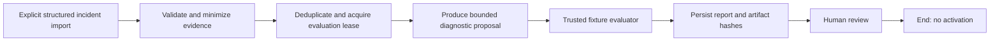

# Harness² for the whole Omarchy desktop

Status: Phase 1 documentation baseline established following the user instruction to proceed with the six-phase integration sequence on 2026-11-04. This workspace document supersedes the reviewed Antigravity map for this build. Production behavior remains unchanged. The Phase 1 validation foundation and Phase 2 read-only metadata importer are implemented; later evaluation/execution and deployment acceptance are pending. See phase1-build.md and phase2-build.md. Evidence: consolidated_review_report.md. The original Antigravity artifact is retained unchanged.

Attribution: CSE-OS by CSE-OS Contributors, adapted from Founder OS by Adam M. Adamek (Impact Brussels ASBL). Content CC-BY-4.0; code Apache-2.0.

## Problem and scope

The destination is an Omarchy desktop whose failures and user outcomes can inform tested improvements across desktop tools, monitoring, diagnostics and healer playbooks. The current research refinement adapter is a useful foundation, but does not implement this whole-OS workflow.

The first milestone in the approved phase ordering is one complete local path: a failed user-service incident produces a bounded diagnostic proposal, independently checked against fixtures, and a review report. It performs no host repair, deployment or cloud call. This milestone validates contracts and plumbing; it does not prove that a model improves diagnosis or that a real service can be repaired safely.

Non-goals for this milestone: new voice implementation, new supervisor, replacing monitors/healer, arbitrary agent code execution, raw coredump ingestion, unattended changes, cloud inference, service restarts and database migrations. Existing services keep their behavior.

## Existing evidence and planned coverage

“Source verified” means inspected code, not live operational acceptance.

| Component | Current evidence | Proposed first-milestone access |
|---|---|---|
| Research refinement | Source verified in learning/refinement.py; only AGENTS.md instruction proposals | Reuse budget/provenance patterns; retain research-only scope |
| Research bundles/trials | Source verified in learning/bundles.py and trials.py; selection applies next startup | No activation; OS candidates use a distinct contract |
| JARVIS supervision | Adapter explicitly leaves supervisor authoritative | One admitted diagnostic evaluation task, no competing supervisor |
| Crash watcher | Installed script offers click-to-diagnose notification | Explicitly imported structured incident, no watcher change |
| Healer | External source implements probes, safety gate and click-to-improve notifications | Selected incident exported read-only; no playbook execution |
| Monitor | Config/source inspected; battery-only voice rule exists | No change |
| PC and standalone voice | Both baseline checks pass | Read-only compatibility/lock checks only |
| Desktop UI/API agent | Map names them; complete caller/auth/result chain not verified here | Excluded from first milestone |
| Agent telemetry and transcripts | Names/paths in original map; not proof of coordination | Not required; telemetry does not grant a task lease |
| OS release mechanism | Existing ReleaseManager targets JARVIS services including voice | Not invoked; later non-voice activation needs separate reviewed scope |

Runtime paths must resolve from the current session environment and validated configuration. UID1000, wayland-1, model IDs, polling rates and installed agent names are machine observations to verify, not portable constants.

## Authority and protected boundaries

Harness² evaluates proposals; the existing supervisor owns tasks. Findings, transcripts, lesson records and model output are untrusted data, never permission to execute actions or alter policies/evaluators.

Both voice lock manifests, all protected source/assets/tests/packaging and recorded additional paths are immutable exclusions. No proposal may edit, regenerate, substitute or bypass either voice copy. No service restart, settings change or audio operation is permitted by this milestone. Shared-code changes must preserve voice interfaces and be reviewed for indirect effects. Lock success is evidence, not authorization.

Repair risk classes belong to healer's actual catalog and safety gate; architectural layer numbers confer no repair authority. Do not reclassify existing actions or change max-tier settings through Harness².

## Proposed data flow

These arrows are proposed integration. Existing crash/healer notification clicks launch their current agents; they do not already feed this new pipeline.

## Incident contract version1

Input is a bounded UTF-8 JSON object, maximum 64 KiB. Reject unknown fields, wrong types, duplicate JSON keys and malformed encodings. Required fields: schema_version=1; producer (approved producer identity); source_incident_id (bounded opaque identifier); observed_at (UTC timestamp); component (approved component identifier); kind=failed_user_service; state (failed or unknown); baseline_sha256 (current trusted source/config identity); evidence (structured diagnostic observations, maximum 32 entries).

Evidence entries contain only an approved observation name, bounded scalar value and observation timestamp. No command strings, arbitrary file paths, free-form logs, audio, screenshots, core files, environment dumps, credentials or transcript excerpts. Validate service identifiers as data against an approved fixture/component list; do not interpolate them into a shell. Severity and desired outcome come from the trusted domain policy, not caller authority.

Derive incident_key from producer plus source_incident_id. Hash canonical validated evidence separately for provenance. Reuse a run only when the full incident revision, evaluator and fixture identities also match, as specified below. A new incident revision links to the prior run and never overwrites it. Freshness and clock skew are checked against an explicit run clock; stale input is reported without automatic retry.

Phase 1 validation remains fixture-only by default. Phase 2 adds an explicitly enabled healer-metadata profile: unidentified-user-service component, unknown state and empty evidence. The tested importer maps only real source metadata; it does not admit service observations or diagnosis claims. See phase2-build.md for the distinct admission boundary. Copy only approved fields from a consistent read-only DB snapshot; never mutate the healer database.

## Proposal and evaluation contract version1

Proposal is data only: schema_version; incident_key; incident_revision; baseline_sha256; diagnosis_code from the domain enum; supporting_observation_ids; recommended_action_code from a fixed advisory enum; limitations. No executable source, shell command or tool grant is accepted.

The trusted evaluator compares the proposal with fixture outcomes and checks forbidden effects separately from diagnostic accuracy. Candidate input cannot change the evaluator, test fixtures or acceptance policy. Evaluator identity and fixture manifest hashes are recorded. Synthetic deterministic evaluation establishes plumbing and rule conformance, not model quality; a later model-backed experiment needs separately held-out cases and baseline comparison.

Report records run_id, incident/evidence hashes, baseline, candidate hash, evaluator/fixture hashes, per-case outcomes, elapsed time, resource-limit results, cancellation/failure state, unverified claims and disposition=advisory_only. Missing or corrupt artifacts fail closed. No deployable/approved verdict is emitted.

## Ownership, restart and limits

One evaluation writer per state directory; use the existing lease pattern with a durable job record. Keep the lease across the full evaluation/artifact transaction. No lease stealing based only on timestamps. After unexpected exit, mark an incomplete run unknown_needs_inspection; do not auto-replay it. Persist intent before work and commit report via atomic replacement. Cancellation stops the owned worker and records incomplete evidence.

Initial implementation limits for the advisory milestone (policy targets, not yet enforced): one worker, zero cloud calls, zero network access, 30-second overall job deadline, 5-second fixture case deadline, 64 KiB input, 1 MiB report, 100 retained completed runs or 100 MiB total state, whichever is reached first. At capacity reject new admission with an actionable error; do not silently delete evidence. Explicit deletion must retain a small audit tombstone without evidence contents. State directory 0700 and files 0600. Do not start workers until these limits can be enforced; changing budgets is a visible policy change.

## Runtime isolation and later execution

Git worktrees separate source versions only. First milestone never executes candidate code. Trusted evaluator tests must use temporary fixture state and mocked OS interfaces, with no real service operations.

Before any candidate code/playbook is executed, require a disposable OS guest: no host home/credential mounts, no host session/runtime sockets, no host D-Bus/systemd, no production DBs, no shared writable checkout and no network by default. Transfer only validated input and hash-checked output. CPU, memory, disk and wall time must be bounded. VM disk/image identity and guest setup become test provenance. Networked dependency preparation must be separate from evaluation.

Containment acceptance includes denied host-canary write/read attempts, denied host socket and service access, enforced resource exhaustion/cancellation, and guest disposal. A container or user namespace could later be considered for narrower tasks, but is not an assumed replacement for full desktop/session testing. Guest operation does not establish real hardware/audio behavior.

## Deployment and recovery contract — future, disabled

Deployment is not part of first milestone. Later eligibility requires immutable candidate and baseline hashes, evaluator identity/results, allowed non-voice file/component scope and a separately reviewed effect/data migration plan. A human approval binds all those identities; changing any invalidates approval. No candidate can edit the verifier or approve itself.

One release owner serializes activation. Record prior source/config identity and affected service active/stopped/enabled state plus necessary compatible data snapshots. Preserve an initially stopped service. Limit activation to the approved component; never call the current JARVIS-wide restart path unchanged. Health checks must verify intended behavior, not merely active service status, within a component-specific deadline chosen and tested before activation.

Failure triggers return to recorded prior code/config/service state; data rollback is permitted only where the approved migration/backup contract proves compatibility. Unknown external effects stop automation for human inspection. A recovery failure is a distinct blocking state; do not announce success or loop restarts. Evidence/tests reduce risk and never guarantee OS stability.

## Alternatives and staged decision

| Approach | Mechanism | Trade-off and failure boundary |
|---|---|---|
| Advisory first, then guest trials | Structured incidents, data-only proposals and reports; add mutation later | Smaller useful first milestone; cannot prove actual repair until guest tests exist |
| Guest repair trials immediately | Build image, containment and recovery infrastructure before proposals | Earlier evidence of service effects; setup/maintenance larger and guest does not prove real desktop hardware behavior |
| Immediate controlled host promotion | Approval gate around real host changes | Faster access to real behavior; approval cannot substitute for unproven isolation/recovery; conflicts with current readiness gaps |

Proceeding through the six phases establishes advisory work before guest trials and controlled deployment. Guest trials are deferred to Phase 4 rather than rejected. Immediate host promotion is deferred until Phase 5 acceptance is demonstrated. The exact guest image, launcher and release adapter are not selected by this document; their later design must establish enforceable boundaries before execution.

## Acceptance and build dependencies

Phase 1 establishes the first-milestone boundary and test obligations. Implementation must satisfy contract validation/protected boundaries; fixture evaluator; durable single-owner jobs/reporting; optional read-only real-incident exporter. Only afterward design guest execution; only after containment and recovery evidence design production activation.

Required fixture cases: valid diagnosis; no evidence; malformed/unknown input; duplicate JSON keys; duplicate/revised incident; stale baseline/time; permission denied; wrong service identity; protected target; proposed executable content; timeout; cancellation; interrupted write; corrupt artifact; stale lease inspection; state quota; synthetic secret leakage. Every forbidden effect fails independently of diagnostic score. Unchanged baseline and an intentionally bad proposal establish evaluator sensitivity.

Fresh-install acceptance restores one optional pinned Harness² dependency declaration matching the reviewed upstream revision 1cfe254e8d25b15f37048c3730134686abe60335 and source hashes. Derive its actual package origin from trusted installation metadata before writing a dependency URL; do not invent it. In a disposable environment run the upstream integration tests without optional-dependency skips, record installed revision and artifacts, and retain a documented offline-fixture mode. Passing tests in the existing venv is not this acceptance.

## Closure evidence

F1–F10 now have written boundaries in this document; none is marked implemented or operationally closed. Each implementation must attach tests/evidence before changing that status. The original 62 passing tests remain evidence only for the existing research subsystem. Both voice locks must pass before/after development; real audio and service behavior remain separate acceptance work.

## Voice inspection and findings

The user explicitly permits inspection of voice and reporting of problems while preserving both voice systems. A voice finding records observed symptom, source/evidence, confidence, suspected cause, proposed repair and any missing acoustic test. Suspicions are not verified causes. No finding grants repair authority. Keep code, assets, manifests, tests, packaging, settings and running behavior unchanged without a later explicit repair instruction. Non-voice improvements may proceed within their phase boundary; check for indirect effects on shared services such as PipeWire.

## Contract details needed by the first implementation

The incident/proposal constraints below are implemented by learning/os_contracts.py. Durable ownership, workers, quotas and operational acceptance remain requirements for later phases; see phase1-build.md for the exact implemented boundary.

| Field | Exact first-version requirement |
|---|---|
| schema_version | JSON integer 1; reject booleans |
| producer | `fixture` initially; real producer identities remain disabled until Phase 2 mapping tests pass |
| source_incident_id | ASCII `[A-Za-z0-9_-]{1,128}`; opaque, not a path |
| observed_at | RFC3339 UTC ending Z; compare with an injected UTC clock |
| component | `fixture-user-service` initially; no arbitrary host unit names |
| kind | `failed_user_service` |
| state | `failed` or `unknown`; must agree with active_state evidence if present |
| baseline_sha256 | 64 lowercase hex characters; compare with the independently supplied trusted baseline, never trust input alone |
| evidence | 0–32 entries; each has unique id `[a-z0-9_-]{1,64}`, approved name, typed value and observed_at |

Allowed evidence names and values: `load_state` is loaded/not-found/error/unknown; `active_state` is active/inactive/failed/unknown; `sub_state` is running/dead/failed/unknown; `result` is success/exit-code/signal/timeout/unknown. No other strings or observation names are accepted. Unsupported real values map to unknown only in an explicitly tested exporter; an imported fixture must use the contract verbatim. No numeric precision or free-text conversion is permitted. Distinguish missing evidence from an observed unknown.

Freshness: accept observations at most 24 hours old and at most 5 minutes in the future relative to admission clock; reject inconsistent evidence timestamps beyond the same bounds. Capture the clock in the report. Historical replay must be a separately labeled fixture evaluation, never production admission. Bound each evidence value by its enum and count input bytes before parsing.

Canonical hashes use UTF-8 JSON with sorted object keys, compact separators, no NaN/infinity and preserved list order. Incident identity hashes the canonical producer/source_incident_id pair. Revision hashes the entire validated incident, including baseline and timestamps, so an evidence-equivalent event with a changed baseline cannot reuse an old verdict. Idempotency is scoped to incident identity plus revision plus evaluator/fixture identity. Same identity with a new revision creates a linked record; old records remain immutable.

Proposal diagnosis codes: `unit_unavailable`, `unit_failed`, `insufficient_evidence`. Advisory action codes: `inspect_unit_configuration`, `inspect_failure_context`, `gather_evidence`. Diagnosis requires supporting evidence: not-found/error load state supports unit_unavailable; failed active state supports unit_failed; absent/unknown/conflicting evidence requires insufficient_evidence. No root-cause claim is inferred from service failure alone. If incompatible observations exist, emit gather_evidence and mark the conflict. Limitations is an array of fixed codes (`synthetic_only`, `no_root_cause_verified`, `evidence_missing`, `evidence_conflicting`), not free text. No action code authorizes executing its human-readable suggestion.

Candidate supporting IDs must exist in the same incident revision. Proposal fields are exact, unknown fields rejected. Incident revision and baseline must match admission. A trusted renderer maps codes to readable wording; model-generated text is not persisted as authoritative diagnosis in this first contract.

Job states: admitted → evaluating → completed_advisory; admitted/evaluating may become failed or cancelled. Unexpected exit produces unknown_needs_inspection. Rejected input does not become a runnable job. Completion means report/artifacts were committed and independently checked; it does not mean repair success. Failures must identify validation, baseline, ownership, timeout, quota, persistence or evaluation reason without echoing raw input. Explicit owner inspection is required before rerunning an interrupted revision.

All filesystem output remains under a dedicated private state root, with symlink/path escape rejection and no caller-supplied output paths. Check quotas before admission and enforce bounded writes during a job. Persisted report overhead is included in quota; reserve space for failure/interruption records. Never delete another job's evidence to make space. Failure to persist completion must not return completed_advisory.

## Phase 2 source mapping discovery

Read-only source evidence: external healer models.py defines SymptomEvent.id from a probe/fingerprint digest. memory.py incidents.id is an occurrence row key; incidents.incident_id can recur. Never deduplicate solely on SymptomEvent.id/fingerprint. Implemented real source identity includes an operator-assigned stable source-instance identity and occurrence row ID. Database replacement/restore must not silently reuse an identity for a different occurrence; record and check the relevant row timestamp/content fingerprint. Phase 2 requires an explicit retained operator-assigned 32-character hex instance ID, binds it to source path/device/inode, and rejects unexpected replacement or occurrence metadata changes; see phase2-build.md for restore/rotation limits.

The incidents table has domain/status/executed/resolved and trace_json, not direct structured service observations. These fields cannot prove current service state or a particular root cause. No adapter may invent absent metrics or import trace_json, agent_prompt, title or unrestricted fingerprint as evidence. Initial mapping tests must export only structured facts actually available; if the required approved component/observation cannot be established, return insufficient_evidence or reject unsupported input. A separate read-only observation adapter may later collect approved structured state; it needs its own tests and protection checks.

Do not instantiate healer MemoryStore in an exporter: its initialization creates schema/configures journaling. Use a standalone read-only SQLite connection and an explicit read transaction against a user-selected, validated path; missing DB is an error, not a request to create it. Do not use immutable SQLite mode on a live WAL database. Test a consistent read during concurrent writes without mutating source files or schema. Operational privacy handling of a real DB remains unverified until Phase 2 tests pass.

## Six-phase acceptance ledger

| Phase | Deliverable | Required evidence | Current state |
|---|---|---|---|
| 1 | This architecture, contracts and review traceability | Written boundaries, voice clarification, phase ordering, no contradictory promotion arrows | Documentation and executable incident/proposal/path validation implemented; see phase1-build.md and phase1-tests.xml |
| 2 | Validated read-only incident ingestion | Fixture contract tests, correct occurrence identity, missing/unsupported evidence handling, read-only live-WAL simulation | Implemented as explicit local metadata import; 146 learning tests and one live occurrence check pass; no background/voice wiring |
| 3 | Diagnostic proposals and evaluation reports | Independent expected outcomes, bad-proposal sensitivity, baseline/evaluator binding, interruption/quota tests | Not implemented |
| 4 | Disposable guest repair trials | Containment canaries, bounded execution, observable recovery, image provenance | Not implemented |
| 5 | Single-component approved deployment | Artifact-bound approval, stale approval rejection, behavioral health, prior-state/data recovery and failed-rollback handling | Not implemented |
| 6 | Additional domains | Separate scope, evaluator, effects and recovery evidence for each domain | Not implemented |

Phase 1 does not settle the later guest image, systemd deployment mechanism, migration policy or per-domain runtime health thresholds. Those are blocked prerequisites for their respective execution phases, not permission to improvise on the live host.

Phase 2 implementation evidence (2026-11-05): phase2-build.md, phase2-tests.xml and phase2-live-check.json. Historical metadata cannot support a real-service diagnosis; proposal evaluation for real records remains disabled.
