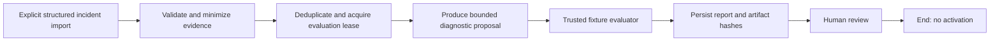

# Harness² for the whole Omarchy desktop

Status: proposed replacement architecture, pending author approval. No implementation or runtime permission is implied. Prepared 2026-11-04 against the working-tree evidence in consolidated_review_report.md.

Attribution: CSE-OS by CSE-OS Contributors, adapted from Founder OS by Adam M. Adamek (Impact Brussels ASBL). Content CC-BY-4.0; code Apache-2.0.

## Problem and scope

The destination is an Omarchy desktop whose failures and user outcomes can inform tested improvements across desktop tools, monitoring, diagnostics and healer playbooks. The current research refinement adapter is a useful foundation, but does not implement this whole-OS workflow.

The proposed first milestone is one complete local path: a failed user-service incident produces a bounded diagnostic proposal, independently checked against fixtures, and a review report. It performs no host repair, deployment or cloud call. This milestone validates contracts and plumbing; it does not prove that a model improves diagnosis or that a real service can be repaired safely.

Non-goals for this milestone: new voice implementation, new supervisor, replacing monitors/healer, arbitrary agent code execution, raw coredump ingestion, unattended changes, cloud inference, service restarts and database migrations. Existing services keep their behavior.

## Existing evidence and proposed coverage

“Source verified” means inspected code, not live operational acceptance.

| Component | Current evidence | Proposed first-milestone access |
|---|---|---|
| Research refinement | Source verified in learning/refinement.py; only AGENTS.md instruction proposals | Reuse budget/provenance patterns; retain research-only scope |
| Research bundles/trials | Source verified in learning/bundles.py and trials.py; selection applies next startup | No activation; OS candidates use a distinct contract |
| JARVIS supervision | Adapter explicitly leaves supervisor authoritative | One admitted diagnostic evaluation task, no competing supervisor |
| Crash watcher | Installed script offers click-to-diagnose notification | Explicitly imported structured incident, no watcher change |
| Healer | External source implements probes, safety gate and click-to-improve notifications | Selected incident exported read-only; no playbook execution |
| Monitor | Config/source inspected; battery-only voice rule exists | No change |
| PC and standalone voice | Both baseline checks pass | Read-only compatibility/lock checks only |
| Desktop UI/API agent | Map names them; complete caller/auth/result chain not verified here | Excluded from first milestone |
| Agent telemetry and transcripts | Names/paths in original map; not proof of coordination | Not required; telemetry does not grant a task lease |
| OS release mechanism | Existing ReleaseManager targets JARVIS services including voice | Not invoked; later non-voice activation needs separate reviewed scope |

Runtime paths must resolve from the current session environment and validated configuration. UID1000, wayland-1, model IDs, polling rates and installed agent names are machine observations to verify, not portable constants.

## Authority and protected boundaries

Harness² evaluates proposals; the existing supervisor owns tasks. Findings, transcripts, lesson records and model output are untrusted data, never permission to execute actions or alter policies/evaluators.

Both voice lock manifests, all protected source/assets/tests/packaging and recorded additional paths are immutable exclusions. No proposal may edit, regenerate, substitute or bypass either voice copy. No service restart, settings change or audio operation is permitted by this milestone. Shared-code changes must preserve voice interfaces and be reviewed for indirect effects. Lock success is evidence, not authorization.

Repair risk classes belong to healer's actual catalog and safety gate; architectural layer numbers confer no repair authority. Do not reclassify existing actions or change max-tier settings through Harness².

## Proposed data flow

These arrows are proposed integration. Existing crash/healer notification clicks launch their current agents; they do not already feed this new pipeline.

## Incident contract version1

Input is a bounded UTF-8 JSON object, maximum64KiB. Reject unknown fields, wrong types, duplicate JSON keys and malformed encodings. Required fields: schema_version=1; producer (approved producer identity); source_incident_id (bounded opaque identifier); observed_at (UTC timestamp); component (approved component identifier); kind=failed_user_service; state (failed or unknown); baseline_sha256 (current trusted source/config identity); evidence (structured diagnostic observations, maximum32 entries).

Evidence entries contain only an approved observation name, bounded scalar value and observation timestamp. No command strings, arbitrary file paths, free-form logs, audio, screenshots, core files, environment dumps, credentials or transcript excerpts. Validate service identifiers as data against an approved fixture/component list; do not interpolate them into a shell. Severity and desired outcome come from the trusted domain policy, not caller authority.

Derive incident_key from producer plus source_incident_id. Hash canonical validated evidence separately. Same key/hash returns the existing run; same key with changed evidence becomes a new revision linked to the prior run, never silently overwrites it. Freshness and clock skew are checked against an explicit run clock; stale input is reported without automatic retry.

First milestone accepts synthetic fixture incidents only. A later read-only healer exporter must map its real schema to this contract and be independently tested before importing production records. Copy only approved fields from a consistent read-only DB snapshot; never mutate the healer database.

## Proposal and evaluation contract version1

Proposal is data only: schema_version; incident_key; incident_revision; baseline_sha256; diagnosis_code from the domain enum; supporting_observation_ids; recommended_action_code from a fixed advisory enum; limitations. No executable source, shell command or tool grant is accepted.

The trusted evaluator compares the proposal with fixture outcomes and checks forbidden effects separately from diagnostic accuracy. Candidate input cannot change the evaluator, test fixtures or acceptance policy. Evaluator identity and fixture manifest hashes are recorded. Synthetic deterministic evaluation establishes plumbing and rule conformance, not model quality; a later model-backed experiment needs separately held-out cases and baseline comparison.

Report records run_id, incident/evidence hashes, baseline, candidate hash, evaluator/fixture hashes, per-case outcomes, elapsed time, resource-limit results, cancellation/failure state, unverified claims and disposition=advisory_only. Missing or corrupt artifacts fail closed. No deployable/approved verdict is emitted.

## Ownership, restart and limits

One evaluation writer per state directory; use the existing lease pattern with a durable job record. Keep the lease across the full evaluation/artifact transaction. No lease stealing based only on timestamps. After unexpected exit, mark an incomplete run unknown_needs_inspection; do not auto-replay it. Persist intent before work and commit report via atomic replacement. Cancellation stops the owned worker and records incomplete evidence.

Proposed conservative defaults, subject to author approval: one worker, zero cloud calls, zero network access, 30-second overall job deadline, 5-second fixture case deadline, 64KiB input, 1MiB report, 100 retained completed runs or100MiB total state, whichever is reached first. At capacity reject new admission with an actionable error; do not silently delete evidence. Explicit deletion must retain a small audit tombstone without evidence contents. State directory0700 and files0600. Do not start workers until these limits can be enforced; changing budgets is a visible policy change.

## Runtime isolation and later execution

Git worktrees separate source versions only. First milestone never executes candidate code. Trusted evaluator tests must use temporary fixture state and mocked OS interfaces, with no real service operations.

Before any candidate code/playbook is executed, require a disposable OS guest: no host home/credential mounts, no host session/runtime sockets, no host D-Bus/systemd, no production DBs, no shared writable checkout and no network by default. Transfer only validated input and hash-checked output. CPU, memory, disk and wall time must be bounded. VM disk/image identity and guest setup become test provenance. Networked dependency preparation must be separate from evaluation.

Containment acceptance includes denied host-canary write/read attempts, denied host socket and service access, enforced resource exhaustion/cancellation, and guest disposal. A container or user namespace could later be considered for narrower tasks, but is not an assumed replacement for full desktop/session testing. Guest operation does not establish real hardware/audio behavior.

## Deployment and recovery contract — future, disabled

Deployment is not part of first milestone. Later eligibility requires immutable candidate and baseline hashes, evaluator identity/results, allowed non-voice file/component scope and a separately reviewed effect/data migration plan. A human approval binds all those identities; changing any invalidates approval. No candidate can edit the verifier or approve itself.

One release owner serializes activation. Record prior source/config identity and affected service active/stopped/enabled state plus necessary compatible data snapshots. Preserve an initially stopped service. Limit activation to the approved component; never call the current JARVIS-wide restart path unchanged. Health checks must verify intended behavior, not merely active service status, within a component-specific deadline chosen and tested before activation.

Failure triggers return to recorded prior code/config/service state; data rollback is permitted only where the approved migration/backup contract proves compatibility. Unknown external effects stop automation for human inspection. A recovery failure is a distinct blocking state; do not announce success or loop restarts. Evidence/tests reduce risk and never guarantee OS stability.

## Alternatives awaiting author decision

| Approach | Mechanism | Trade-off and failure boundary |
|---|---|---|
| Advisory first, then guest trials | Structured incidents, data-only proposals and reports; add mutation later | Smaller useful first milestone; cannot prove actual repair until guest tests exist |
| Guest repair trials immediately | Build image, containment and recovery infrastructure before proposals | Earlier evidence of service effects; setup/maintenance larger and guest does not prove real desktop hardware behavior |
| Immediate controlled host promotion | Approval gate around real host changes | Faster access to real behavior; approval cannot substitute for unproven isolation/recovery; conflicts with current readiness gaps |

The proposed text uses advisory-first as a pending choice, not a recorded author decision. No alternative is recorded as rejected until the author approves the proposal or requests a different boundary.

## Acceptance and build dependencies

Before code: approve first milestone, contracts, defaults and coverage above. Then implement contract validation/protected boundaries; fixture evaluator; durable single-owner jobs/reporting; optional read-only real-incident exporter. Only afterward design guest execution; only after containment and recovery evidence design production activation.

Required fixture cases: valid diagnosis; no evidence; malformed/unknown input; duplicate JSON keys; duplicate/revised incident; stale baseline/time; permission denied; wrong service identity; protected target; proposed executable content; timeout; cancellation; interrupted write; corrupt artifact; stale lease inspection; state quota; synthetic secret leakage. Every forbidden effect fails independently of diagnostic score. Unchanged baseline and an intentionally bad proposal establish evaluator sensitivity.

Fresh-install acceptance restores one optional pinned Harness² dependency declaration matching the reviewed upstream revision1cfe254e8d25b15f37048c3730134686abe60335 and source hashes. Derive its actual package origin from trusted installation metadata before writing a dependency URL; do not invent it. In a disposable environment run the upstream integration tests without optional-dependency skips, record installed revision and artifacts, and retain a documented offline-fixture mode. Passing tests in the existing venv is not this acceptance.

## Closure evidence

F1–F10 now have proposed written boundaries in this document; none is marked implemented or closed. Each implementation must attach tests/evidence before changing that status. The original 62 passing tests remain evidence only for the existing research subsystem. Both voice locks must pass before/after development; real audio and service behavior remain separate acceptance work.

Superseded for ongoing work by [architecture.md](architecture.md) after the user instructed proceeding through Phase 1. Retained as the proposal snapshot.
