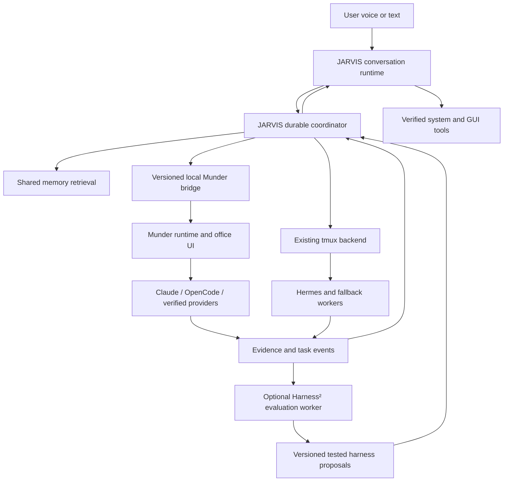

# JARVIS + Munder-Difflin: architecture analysis and implementation blueprint

Prepared: 20 October 2026, Asia/Kolkata.

**Document status: analysis and proposed build specification. No Munder integration, runtime migration, agent launch, or settings change was performed for this document.**

Navigation: [findings](#1-read-this-before-the-next-build) · [JARVIS baseline](#4-what-jarvis-already-does) · [Munder functions](#5-munder-difflin-functional-analysis) · [architecture](#6-proposed-ownership-model) · [bridge contract](#7-local-bridge-concrete-implementation-contract) · [memory](#10-shared-memory-full-retrieval-without-prompt-overload) · [Harness²](#12-real-harness2-integration) · [build phases](#14-implementation-phases-and-acceptance-gates) · [tests](#16-verification-matrix).

## 1. Read this before the next build

The strongest direction is to keep JARVIS as the conversational and system-control authority, and add Munder-Difflin as an optional visible execution backend. Adopt its provider lifecycle bridges, collaboration mechanisms, terminal UI, and operational controls through an explicit local interface. Keep one owner for every task, process, workspace, and memory record.

Do not begin by replacing JARVIS's working voice loop or rewriting the whole project. First establish a truthful capability inventory, reliable job lifecycle, and a read-only connection to the office. Then prove one task end to end before enabling autonomous delegation.

The previous statement that Harness² was fully integrated was incorrect. The current adapter is a custom prompt-and-log scaffold. It never imports or invokes the upstream optimizer. Similarly, the previous comparison of Munder and JARVIS described a possible architecture, not an existing integration.

### Highest-priority findings

| Priority | Finding | Evidence / confidence | Required response |
|---|---|---|---|
| High | Harness² readiness is overstated | `orchestration/harness2_adapter.py` only discovers a binary, appends prompt text, and writes JSONL. No optimizer call. High confidence. | Rename/report it as a scaffold until actual execution is implemented and tested. |
| High | Visible delegation bypasses that scaffold | `DesktopAgentOrchestrator._run` calls the superclass only for background jobs; visible/shared-pane paths build their own commands. High confidence. | Centralize task preparation before selecting a backend. |
| High | Two autonomous schedulers could duplicate work | JARVIS schedules teams; Munder has GOD routing, worker spawning, schedules, and wakeups. Integration risk, not a reproduced incident. | One authoritative task owner and one dispatch decision per attempt. |
| High | Munder's exposed controls are mostly internal APIs | `src/main/index.ts` registers Electron IPC; `src/preload/index.ts` exposes it to the renderer. High confidence. | Build a narrow, authenticated local adapter; Python cannot directly call `window.cth`. |
| High | Native custom-provider support does not establish Hermes lifecycle support | `src/shared/agentProvider.ts` lacks Hermes/OMP presets; custom has no declared inbox support. High confidence. | Implement and verify Hermes as a provider or retain it on JARVIS's backend. |
| High | Source and installed version are not established as equivalent | Installed marker previously read as 0.5.7; reviewed upstream `package.json` says 0.4.6, while README release text references newer versions. High confidence in mismatch, unknown binary provenance. | Identify packaged build/source mapping before patching or deploying. |
| High | GUI and terminal ownership need positive verification | Prior JARVIS scan records focus verification failing open and monitoring failures leaving panes alive. Historical reproduced findings; recheck before implementation. | Fix ownership and cleanup before adding another execution backend. |
| Medium | Munder does not have one universal durable SQLite task database | Reviewed `db.ts` migrates `kv` and `command_history`; hive tasks and messages are files. High confidence. | Do not treat `harness.db` as an integration API or complete task store. |
| Medium | Renderer participation limits a headless assumption | `useHive.ts`, `queueDelivery.ts`, and message-queue documentation participate in delivery to live terminals. High confidence in dependency; headless behavior untested. | Test minimized/reloaded/closed UI separately; move essential dispatch into main if necessary. |
| Medium | Auto mode and cost telemetry do not guarantee cheap execution | JARVIS budget mode has a known OpenCode native-model mismatch; Munder provider accounting varies. High confidence. | Preflight the whole plan, measure actual usage where available, mark unknown billing explicitly. |

### Evidence boundaries

This is a source-based architecture review with a navigation inventory, not a claim that every function has passed a live behavioral audit. Primary integration paths were inspected; ancillary features are mapped for subsequent testing. No fresh full regression run or live paid agent test was needed for this documentation task. Previous test totals are historical and do not certify the proposed architecture.

## 2. Source baseline and reproducibility

| Project | Inspected baseline | Notes |
|---|---|---|
| JARVIS-OMA | HEAD `78c07cb53f4a5f5fdd87a69d415b30848d501667` plus existing working-tree Harness² changes | Primary repository `/home/g0pi/Projects/JARVIS-OMA`. Preserve uncommitted changes. |
| Munder-Difflin | `75869287eb5ab88d382a3711332bdb9918cf1073` | Downloaded read-only for analysis under `/tmp/jarvis-munder-analysis`; temporary checkout is not a deployment dependency. |
| Google Research Harness² | `1cfe254e8d25b15f37048c3730134686abe60335` | Inspected under `/tmp/harness2-upstream`; not imported by current JARVIS adapter. |
| Installed Munder | Previously observed last-run version 0.5.7 | `/home/g0pi/.local/share/munder-difflin`; installed implementation not proven identical to public source. |

Stable source references:

- [Munder source at reviewed revision](https://github.com/HarnessMD/munder-difflin/tree/75869287eb5ab88d382a3711332bdb9918cf1073)
- [Munder architecture](https://github.com/HarnessMD/munder-difflin/blob/75869287eb5ab88d382a3711332bdb9918cf1073/docs/ARCHITECTURE.md)
- [Munder hive design](https://github.com/HarnessMD/munder-difflin/blob/75869287eb5ab88d382a3711332bdb9918cf1073/HIVE.md)
- [Terminal message-queue contract](https://github.com/HarnessMD/munder-difflin/blob/75869287eb5ab88d382a3711332bdb9918cf1073/docs/message-queue.md)
- [Harness² source at reviewed revision](https://github.com/google-research/harness2/tree/1cfe254e8d25b15f37048c3730134686abe60335)
- [JARVIS prior defect scan](project-scan-2026-10-19.md)
- [JARVIS current system controls and information](system-control-and-information.md)
- [Function and module navigation inventory](jarvis-munder-function-inventory.md)

Treat old design documents as intent where source differs. For example, Munder's old SPEC describes an earlier Claude-only MVP; current provider source supports many CLIs. Its architecture document mentions a durable cost ledger in SQLite, but the inspected `db.ts` does not implement that migration. Source wins.

## 3. User requirements carried into the design

1. Speak to JARVIS once; it selects specialists and coordinates the task.
2. JARVIS keeps listening and responding while agent work runs.
3. Native agent interfaces remain visible and recognizable.
4. Hermes researches and plans; Claude develops and performs final review; OpenCode independently tests; Antigravity is a development option once verified.
5. Codex remains disabled as a worker until the user changes that preference.
6. Preserve the existing Claude Autocode proxy setup. Do not replace credentials or endpoint settings.
7. Prefer inexpensive configured models; do not silently escalate to expensive models.
8. Autonomous execution should not require repeated per-agent instructions.
9. Agents should eventually retrieve shared authorized memory. Full access means searchable access, not copying all history into every prompt.
10. System answers must use current observations and expose missing data.
11. Missing capabilities should be developed through a tested extension workflow.
12. Existing tmux preference remains relevant. Munder's PTY ownership is not automatically compatible with existing tmux sessions.

**Decision for planning:** retain tmux as the default/fallback backend initially. Introduce Munder as an explicitly selected backend for a test project. A wholesale move to Munder's terminals needs a later product decision and compatibility proof.

## 4. What JARVIS already does

| Subsystem | Actual entry points | Existing behavior | Integration implication |
|---|---|---|---|
| Conversation | `core/agent.py`: `LiveVoice`, `live_config`, `monitor_agents`, main session supervision | Gemini Live, microphone/playback, optional vision, tool dispatch, job notifications | Keep audio lifecycle independent from office health. |
| Audio | `audio/`, native engine, echo-cancellation helpers | Capture/playback queues, AEC routing, interruption handling and counters | Measure responsiveness under load; a running service alone proves little about latency. |
| Local controls | `core/ipc.py`: `JarvisIPCServer` | Private Unix socket; status, mute, interrupt, vision commands, state subscriptions | Current socket is not a general multi-agent gateway. Add a separate versioned protocol or carefully extend it. |
| Tool registry | `skills/skills.py`: `_load_manifests`, adapter table, argument checks, `_adapter_list_capabilities` | Discovers tool manifests and available dependencies | Reuse this as the registry for voice-visible capabilities. |
| Agent supervisor | `orchestration/agent_orchestrator.py` | Discovers CLIs, validates workspace/model/timeouts, caps active jobs, reserves overlapping workspaces, captures output, cancels process groups | Extract a backend-independent coordinator from process management. |
| Teams | `delegate_team`, `_run_team`, `team_status`, `cancel_team` | Sequential assignments with previous output context; team/job state primarily in memory | Replace fixed sequential scheduling with a validated task graph only after durability is added. |
| Native terminals | `orchestration/desktop_execution.py` | tmux sessions and panes; native/batch command builders; shared-pane completion reports | Preserve inspectable sessions independently of task completion. |
| Roles | `orchestration/personas.py`: `software_assignments` | Hermes → Claude → OpenCode → Claude, visible, native, YOLO requested | Role policy should be independent of provider implementation. |
| Model policy | `orchestration/model_policy.py`: `apply_model_policy` | Configured profile or explicit budget IDs; no billing cap | Validate model support before any stage launches. |
| Proactivity | `proactive/runtime.py`, events, planner, ledger, monitor, control | Persistent event handling, policy decisions, pause/resume/stop, dispatch reconciliation, file verification | Reuse durable control intent and extend verification; do not add a competing periodic scheduler. |
| Capability development | `orchestration/evolution.py`: `EvolutionManager` | Snapshot, staged development, diff/evidence, baseline and final verification | Foundation for building extensions; review its default Codex selection against user policy. |
| Memory | `memory/codes-dev/jarvis_memory/bridge.py`: `MemoryBridge` | Facts, corrections, recall, history, document indexing, bounded context, optional semantic retrieval, Obsidian sync | Do not discard this existing implementation. |
| Memory import path | `jarvis_memory/__init__.py` | Compatibility shim redirects imports into `memory/codes-dev/jarvis_memory` | Edit the actual implementation, not an imagined top-level `bridge.py`. |
| System controls | `skills/system_control.py` | Plugin-backed and native controls with state readback on repaired paths | Expose controlled requests to workers through JARVIS, preserving verification. |
| Live information | `skills/system_information.py` | Timestamped sourced observations for OS, CPU, memory, disks, battery, temperatures, hardware, network, displays, audio, services, processes, packages, overview | Never replace live facts with hive memories. |
| Extensions | `skills/system_extensions.py` | Audio device selection, user services, optional media control | Missing executables remain unavailable, not simulated success. |
| GUI/browser | `skills/gui_control.py`, `connectors/browser.py` | Observation-bound desktop/browser operations through optional drivers | Shared desktop needs one action lease; parallel background work can continue. |
| External services | `connectors/phone.py`, Google Workspace, GitHub, internet search | Separate authenticated adapters | Avoid handing raw credentials or duplicate service ownership to Munder. |
| Task/file tools | `filesystem/`, `task_runner`, manifests | Declared file and task actions | Keep exact path/workspace scope in worker contracts. |

### Current reliability gaps to carry forward

- Team state is not a complete restart-resumable scheduler.
- Successful process exit or an agent-written completion file does not establish acceptance criteria passed.
- Shared-pane monitoring failure and generic setup failure need ownership-safe cleanup and notifications.
- Standalone visible TUI completion is tied to process lifetime.
- Native OpenCode rejects the per-task model override used by the budget profile.
- GUI focus verification needs positive window-level evidence.
- Some legacy synchronous camera, file, and phone paths can block voice scheduling.
- Codex exclusion in `software_assignments` does not establish global exclusion: evolution/capability-development defaults still name Codex.
- Agent memory injection is a bounded snapshot, not full shared retrieval.
- Manifest copies can drift. Select the canonical directory and validate/generate mirrors.

Do not remove existing fixes for optional phone-listener isolation or stop-all admission/cancellation.

## 5. Munder-Difflin functional analysis

Paths below are relative to the reviewed Munder repository's `src/` directory unless explicitly prefixed with `src/`. “Reuse” means integrate through supported code boundaries or a maintained adapter; it does not mean these APIs are already available to JARVIS.

### 5.1 Process execution and provider lifecycle

| Module / functions | Function in the product | Value for JARVIS | Required adaptation |
|---|---|---|---|
| `main/pty.ts`: `PtyManager.spawn/write/resize/redraw/kill/list/killAll`, ownership methods | Real CLI processes and terminal byte streams | Native agent appearance, explicit process ownership | One backend owns each process; cancellation must verify descendants ended. |
| `main/index.ts`: `spawnAgentCore`, `pty:*` IPC handlers | Central launch path and UI integration | Common place for launch, environment, workspace, identity | Add a narrow operator API rather than exporting arbitrary IPC. |
| `shared/agentProvider.ts`: presets, `inferAgentProvider`, `bridgeOf`, `argsWithAutoModeFlag`, `hasAutoModeStance` | Provider flags, models, prompt injection, hooks, resume behavior | More capable provider abstraction than scattered launch flags | Verify installed CLI versions; custom-provider support alone is insufficient. |
| `main/workerLaunch.ts`: `buildWorkerLaunch` | Converts worker request into executable and argv, honoring explicit flags/model | Avoids malformed command-line launches | Feed structured allowlisted provider/model options; test Autocode wrapper behavior. |
| `main/hive.ts`: `ensureAgent`, `recordSession`, `lastSession` | Identity, provider hook installation, recorded sessions | Stable agent identity across turns | Separate persistent agent ID from task/attempt/session IDs. |
| `main/workerWake.ts`: `WorkerWakeWatchdog`, `classifyHook`, `isStalledWorker` | Determines whether a worker is stalled and should be nudged | Recovery from silent idle workers | Do not confuse quiet thinking, user input, compaction, and a dead process. |
| `main/procKill.ts`, `ptyEnv.ts`, `shellEnv.ts`, `cliInstall.ts`, `nodeInstall.ts` | Cleanup, child environments, command resolution and installation support | Operational robustness | Never auto-install or rewrite provider configuration merely to satisfy a dispatch. |

Built-in provider union includes Claude, Codex, Grok, Kimi, Gemini, Antigravity, Qwen, OpenCode, Crush, Pi, Copilot, Cursor, and custom. Hermes and OMP need additional work. Provider flags distinguish model support, initial-prompt delivery, resume behavior, and inbox support. These are not uniform guarantees across all CLIs.

### 5.2 Coordination, messages, and task state

| Module / functions | Behavior | Integration rule |
|---|---|---|
| `HiveManager.send`, `routeOnce`, `startRouter`, `stopRouter` | Filesystem mailbox routing and event logging | Send through the owner; do not write directly into another agent's inbox. |
| `drainForStop`, `settleInbox`, `inbox`, `outbox`, `inboxBacklog` | Lifecycle-driven message consumption and settlement | Use durable message IDs, acknowledgments and bounded retries. |
| `registry`, `board`, `tasks`, `addTask`, `patchTask`, `writeTasks` | Roster, shared plan and task ledger | JARVIS workflow records and Munder task cards require explicit IDs and ownership. |
| `shared/taskLedger.ts`: `mergeTaskLedger`, `patchTaskInLedger` | Preserves unknown task fields during UI edits | Do not replace whole task lists from a partial bridge model. |
| `renderer/.../useHive.ts`, `queueDelivery.ts` | Terminal input scheduling and queued delivery | Prevent collision with user typing; do not drive terminal text from a second bridge writer. |
| `main/roster.ts`, `db.ts` | Roster persistence and SQLite key/value/history storage | Database existence does not prove all task/process state is durable. |
| `main/closingTime.ts` | Graceful save-and-acknowledge shutdown | Model graceful halt separately from force-stop; acknowledgments need deadlines. |

Munder's message semantics distinguish request, inform, propose, query, agree, refuse, and done. Adopt explicit correlation and hop limits. A `done` message is a completion assertion that triggers verification, not a guaranteed successful task.

Terminal delivery has two different queues: the application's pending messages and any provider's internal queue. A successful PTY write only establishes delivery to a terminal. It does not establish task acceptance, execution, or completion.

### 5.3 Controls, accounting, and integrations

| Module / functions | Behavior | Limitation / JARVIS use |
|---|---|---|
| `main/control.ts`: `pause`, `gateTool`, `steer`, `halt`, `resume`, `snapshot` | Per-agent control intent consumed at hook boundaries | Graceful halt may wait for a hook; global emergency stop needs process-level fallback. |
| `main/hooks.ts`: `HookServer.start/health/ensureListening/stop`, transcript/context access | Hook transport, lifecycle observations and control responses | Hook socket is not an operator API; never forge hook events to launch tasks. |
| `main/breaker.ts`: `CircuitBreaker.recordToolUse/recordError/recordUserPrompt/tick` | Detects loops/errors/usage patterns, produces control decisions | Validate provider coverage; do not treat it as a universal financial spending guarantee. |
| `usage.ts`, `pricing.ts`, `transcript.ts`, `telemetry.ts`, `costLifetime.ts` | Usage, transcript and cost observations | Distinguish measured tokens, estimates, subscription usage, unknown proxy pricing. |
| `main/integrationBroker.ts`: `start`, `grant`, `revoke` | Loopback proxy with per-worker tokens and integration allowlists | Useful secret-broker pattern; not an arbitrary application-control endpoint. |
| `main/integrations.ts`, `shared/integrations.ts` | Registered integrations and secret references | Keep credentials with their owner; project memory stores references only. |
| `main/webhook.ts`: `WebhookServer` | Secret-authenticated work ingress and token-based task status | Reviewed `start()` attempts a public tunnel. Do not enable this for local JARVIS integration. |
| `main/slack.ts`, `github.ts`, trigger history and schedules | External task intake, CI observations, scheduled work | Later optional channels; establish explicit user-authorized routing and deduplication. |
| `main/realtimeActions.ts`: action dispatcher and dependency interface | Dispatch, tasks, steer, controls, schedules/settings with confirmation paths | Reuse underlying services, not the mutable conversational confirmation state as a machine API. |

### 5.4 Memory, knowledge, capabilities, and interface

| Module | Role | Recommended use |
|---|---|---|
| `main/memory.ts`: `MemoryManager.available/active/status/env/mineNow/search/wakeUp` | Optional MemPalace CLI, shared index and per-agent wings | Optional retrieval backend; enabled configuration is not proof the CLI/index works. |
| `main/reflect.ts`: `MemoryReflector.reflectNow`, parsing, verification and rebuilding | Condenses agent memory with model assistance | Preserve raw evidence; summaries are derived and need provenance, cost accounting and correction handling. |
| `main/knowledge.ts`, `kg-core.cjs` | Document/knowledge interfaces | Evaluate retrieval and authorization before merging into JARVIS knowledge. |
| `main/skills.ts`, shared tool/MCP catalogs | Local skills, discovery and installation UI | Catalog entries are not installed, authenticated, tested capabilities. |
| `main/hire.ts`, shared role/hire modules | Agent roles and import flows | Convert user roles into versioned profiles; imported roles cannot grant new authority. |
| `main/realtime.ts`, floor/completion watchers | Separate voice-related runtime | Keep JARVIS as the microphone/speaker owner during initial integration. |
| `main/freeflow.ts`, `groq.ts` | Dictation/transcription paths | Optional later; Wayland and audio-device behavior require local tests. |
| `src/preload/index.ts` | Typed Electron bridge | Internal UI boundary, not Python RPC. |
| `renderer/components`, `CommandCenterPanel`, task/memory/message panels | Office, tasks, live terminals, activity and user input | Useful visible execution layer; preserve truthful stale/blocked/error states. |
| `renderer/scene/office`, design assets | Avatars, movement and visual theme | Presentation must follow execution evidence; movement is not proof of progress. |
| `main/updater.ts`, analytics, config, model catalog | Lifecycle, preferences and catalogs | Pin bridge compatibility; catalog/default changes must not silently change user model policy. |

## 6. Proposed ownership model



### Authority table

| Resource | Authoritative owner | Other components |
|---|---|---|
| User goal, scope, current stop/pause policy | JARVIS durable coordinator | Read and obey |
| Agent process and terminal | Exactly one selected backend | Observe or request control |
| Munder-owned mail delivery and terminal writes | Munder runtime | JARVIS submits structured requests |
| Global task dependency graph | JARVIS coordinator | Office displays mapped task cards |
| Munder task-card state | Munder runtime | JARVIS mirrors it as observations |
| Verified outcome | JARVIS acceptance gate | Agents supply artifacts and evidence |
| Shared durable knowledge | JARVIS memory service initially | Munder retains local scratch memory and optional derived search index |
| Live system state | JARVIS system-information adapters | Never infer from stored knowledge |
| Desktop interaction | JARVIS GUI lease owner | Workers request bounded actions |
| Provider secrets | Existing provider configuration / secret broker | No plaintext memory synchronization |
| Optimizer candidates | Harness² evaluation worker | Cannot activate its own proposal |

For JARVIS-owned tasks, Munder's GOD must operate as an execution manager inside a bounded delegated scope. It must not independently reschedule the same task or recursively expand workers outside that scope. Existing user-owned Munder tasks must remain separately identified and untouched.

If the installed Munder runtime cannot enforce that ownership model, keep integration observational until a maintained fork/extension supplies it.

## 7. Local bridge: concrete implementation contract

### Why a bridge is needed

Reviewed Munder has internal `pty:*`, `hive:*`, and `control:*` Electron handlers; a provider hook socket; an integration secret broker; and a public-webhook feature. None establishes a ready-made full local operator API for JARVIS.

**Recommended new implementation:** a small Munder main-process service exposing allowlisted methods over a private Unix socket, plus an asynchronous Python client. Reuse the same validated main-process services as the UI. Put shared behavior into a service layer if currently buried in `index.ts`. Maintain the change as a narrow fork or upstream contribution; do not patch a running `app.asar` as the long-term deployment strategy.

Proposed socket: `$XDG_RUNTIME_DIR/jarvis-munder.sock`, mode 0600, peer UID validation, protocol version handshake. This path and the following methods are design proposals, not existing endpoints.

| Proposed method | Inputs | Expected outcome |
|---|---|---|
| `hello` | supported protocol versions | Selected protocol, build revision, feature flags, instance/floor ID |
| `health` | floor ID | Fresh runtime/hook/router/backend state with observation times |
| `agents.list` | floor ID | IDs, provider, role, current attempt, state, observation age |
| `tasks.submit` | immutable task spec and idempotency key | Stable bridge task ID; queued/blocked/rejected, never “completed” on acceptance |
| `tasks.get` | task ID | Current state, revision, artifacts, control acknowledgment, evidence refs |
| `tasks.steer` | task ID, expected revision, user instruction | Queued/delivered/applied status separately |
| `tasks.cancel` | task ID, cancellation ID | Cancellation requested, then confirmed or unverifiable termination |
| `floor.pause/resume` | managed scope, expected control revision | Admission/delivery policy transition, not fabricated process freeze |
| `floor.stop` | JARVIS-managed scope and stop revision | Stop admission, cancel owned descendants, terminal acknowledgment |
| `events.subscribe` | cursor, floor ID | Ordered replayable events, gap notification when retention exhausted |
| `capabilities.list` | provider/project scope | Declared, installed, authenticated, verified and unavailable states |

Do not expose arbitrary shell commands, unrestricted IPC invocation, direct task database editing, raw secrets, or force-kill-by-user-supplied-PID in this interface.

### Proposed request and event shapes

```json
{
  "protocol_version": 1,
  "request_id": "req-unique",
  "method": "tasks.submit",
  "idempotency_key": "goal-42:task-3:attempt-1",
  "params": {
    "goal_id": "goal-42",
    "task_id": "task-3",
    "attempt": 1,
    "role": "developer",
    "provider": "claude",
    "workspace_id": "checkout-7",
    "objective": "Implement the approved change",
    "acceptance_criteria": ["Named regression passes"],
    "depends_on": ["task-2"],
    "capability_refs": ["repo.read", "repo.edit", "tests.run"],
    "memory_refs": ["project:jarvis"],
    "policy_revision": 12,
    "timeout_seconds": 900,
    "max_attempts": 2
  }
}
```

```json
{
  "protocol_version": 1,
  "event_id": "evt-unique",
  "sequence": 103,
  "instance_id": "office-instance",
  "task_id": "task-3",
  "attempt": 1,
  "type": "task.reported_complete",
  "observed_at": "2026-10-20T09:00:00Z",
  "source": "provider_completion",
  "verification": "unverified",
  "artifact_refs": ["artifact-21"]
}
```

Validate schemas, size limits, canonical project paths, permitted providers, deadline and control revision before dispatch. Store idempotency records before launching. On a timeout after submission, query by request ID; never blindly submit again.

Transport acknowledgment, accepted task, started process, provider task completion, and verified outcome are five different events.

## 8. Durable task scheduling and autonomous routing

### State machine

```text
received -> planned -> ready -> queued -> starting -> running
running -> awaiting_input | blocked | reported_complete | failed | timed_out
reported_complete -> verifying -> succeeded | failed | unverified
any nonterminal -> cancel_requested -> cancelled | cancellation_unconfirmed
restart with uncertain ownership -> reconciling -> running | interrupted | blocked
```

Keep process state, task state and terminal UI state separate. A task can be complete while its inspectable TUI remains open. The workspace remains reserved until the process has stopped editing or the backend positively confirms a safe idle boundary.

### Suggested durable records

- `goals`: user request, scope, policy revision, current state.
- `tasks`: objective, role, dependency IDs, acceptance criteria, backend, revision.
- `attempts`: provider/model, workspace, backend session ID, start/end, outcome, retry count.
- `events`: sequence, correlation IDs, source, payload version, timestamps.
- `leases`: canonical workspace/resource, owner attempt, expiry, fencing generation.
- `artifacts`: path reference, hash, producing attempt, source revision, evidence class.
- `approvals`: concrete action/scope, authority, expiry, consumption state.
- `usage`: measured/estimated/unknown units, provider source and observation time.
- `memory_refs`: record identifiers and selected context provenance.

Extend existing proactive persistence where appropriate; avoid a third unrelated job database. Use migrations, transactions and compare-and-set revisions.

### Scheduling rules

1. Hermes turns a goal into bounded tasks, acceptance criteria and dependencies.
2. Deterministic validation rejects cycles, missing dependencies, unavailable providers, unsupported models and impossible resource requests.
3. Run independent tasks concurrently only when their writable workspaces/resources do not overlap.
4. Use separate worktrees for concurrent edits; never assume all tests are read-only.
5. Merge changes into an integration checkout in a serialized stage; rerun relevant checks.
6. QA consumes an immutable implementation revision or content hash.
7. Final review cannot approve evidence for an earlier revision after editing the code.
8. Retry transient failures within a declared limit; replan semantic failures rather than replaying the same action indefinitely.
9. Only notify the user for meaningful progress, completion, actionable blockers or required choices.

Suggested initial graph: Hermes planning → Claude implementation → OpenCode QA → Claude final verification. Add parallel documentation/research only after the serial path is reliable. Maximum four workers is an initial ceiling, not a target that must always be filled.

### Role/provider policy

| Role | Initial provider | Fallback policy |
|---|---|---|
| Planner/researcher | Hermes through existing JARVIS backend | Explicitly configured alternative; no silent provider change |
| Developer | Claude with existing Autocode environment | Antigravity after tested adapter support |
| Independent QA | OpenCode | Claude QA in a separate attempt/context if policy allows; record loss of provider diversity |
| Final reviewer | Claude | Explicit approved alternative |
| Optional specialists | Gemini, OMP, Pi, Crush or verified Munder provider | Capability and cost preflight required |
| Codex | Disabled globally | Enable only when user changes preference |

Provider policy must apply to direct delegation, team plans, proactive jobs, evolution jobs, retries, optimizer rollouts and Munder GOD spawns.

## 9. Voice responsiveness and truthful conversation

Keep microphone capture, playback, barge-in, session reconnects and quick tool acknowledgments in JARVIS. Dispatch returns a job ID promptly. Background planning and office communication run in bounded workers or separate processes. Slow disk, embeddings, terminal capture, compilation and agent startup never run synchronously on the audio event loop.

Use separate queues for:

- User commands and interruption requests: highest priority.
- Small task-state events: coalesced and bounded.
- Terminal/log streams: separately buffered, never injected wholesale into voice context.
- Memory/index work: deferred with cancellation and capacity limits.

“Stop speaking,” “pause new work,” “cancel this task,” and “stop all managed work” must have distinct meanings. Conversational interruption does not silently cancel every agent.

Proposed performance targets, to measure rather than advertise as achieved:

| Metric | Initial target |
|---|---|
| Local dispatch acknowledgment | p95 under 500 ms excluding model interpretation |
| Event-loop scheduling delay under four workers | p95 under 50 ms in a controlled test |
| Stop admission after local stop request | under 100 ms |
| Task progress reflected in voice/status | within 2 seconds when connected |
| Slow/offline Munder connection | Voice remains available; report degraded office status |
| End-to-end speech response | Measure baseline and regression; model/network latency prevents a zero-lag promise |

Maintain a runtime capability snapshot with evidence ages. Prompt rules should direct current system questions to live tools, but do not guarantee zero hallucination. Add tests for refusal despite available tools, unsupported capability claims, stale observations, partial data, and premature success claims.

## 10. Shared memory: full retrieval without prompt overload

JARVIS already has facts, conversation history, corrections, document search and optional embeddings. Munder provides per-agent memory and optional shared semantic indexing. Begin with federation through one retrieval interface; do not merge their live database files.

Proposed operations:

- `memory.search(query, scopes, limit, cursor)`
- `memory.read(record_id, section_or_range)`
- `memory.propose(record, evidence_refs)`
- `memory.correct(record_id, replacement, reason)`
- `memory.history(record_id)`

Expose these through a local tool adapter/MCP service where supported, and a narrow CLI wrapper for providers without a verified tool channel. Never grant raw credential directories as “full memory.”

Record fields: stable ID, scope, source, author, created/observed timestamps, provenance, confidence, sensitivity, superseded-by, source hash, and evidence references.

Memory classes:

1. User instructions and corrections.
2. Verified project facts and architectural decisions.
3. Task results with tests/artifacts.
4. Raw transcripts and terminal evidence.
5. Agent hypotheses and draft plans.
6. Derived summaries and indexes.
7. Live observations with expiry.

These classes have different authority. Agent guesses do not become facts because they were saved. User corrections supersede conflicting summaries. Current system status requires a new tool observation.

Import historical sibling sessions with source IDs and deduplication. Preserve original stores; index in batches. Give all authorized workers retrieval access to the shared project scopes, then select only relevant excerpts for each prompt. Test multilingual retrieval, corrections, conflicts, citation fidelity and deletion propagation.

Munder markdown remains useful as agent scratch/context. Proposed export into durable JARVIS knowledge is reviewed by a provenance/verification gate. MemPalace may be an optional derived index after retrieval tests; its configuration toggle alone does not prove availability or quality.

## 11. Extending system and external capabilities

Create one capability registry with:

```text
id, schema_version, description, input_schema, output_schema,
owner, dependencies, installed, authenticated, last_verified_at,
supported_actions, effect_class, timeout, limits, evidence_requirements
```

Expose capability discovery to the planner and workers. For each request, distinguish “available now,” “requires authentication,” “dependency missing,” “unsupported,” and “implementation proposed.”

System-control requests should go through JARVIS's existing adapters. Workers can ask for an observation or bounded action; they should not race direct desktop clicks or invent a successful result. A desktop-action lease protects the shared screen. CPU/disk queries and unrelated code tasks can run concurrently.

Preserve system-information response semantics: observation time, source, units, partial/unavailable state and errors. Network interfaces do not prove internet access; CPU load is not CPU utilization; a command accepted by a plugin is not verified state.

New-capability workflow:

1. Capture the requested behavior and supported scope.
2. Discover existing plugins/tools before proposing code.
3. Produce an adapter and strict manifest in an isolated development checkout.
4. Add failure-path and verification tests.
5. Run independent QA and review permission/dependency declarations.
6. Register a versioned candidate capability.
7. Activate after checks and any required user authority; retain rollback.
8. Refresh discovery so JARVIS stops relying on stale capability assumptions.

Google Workspace, GitHub, phone and browser sessions stay with their existing authenticated owners. Munder's integration broker is a useful pattern for scoped handles, but adding it must not silently alter JARVIS connectors or external messaging authority.

## 12. Real Harness2 integration

### What exists now

`Harness2Adapter.status()` checks executable discovery and lists eight component names. `prepare_prompt()` adds fixed guidance and previous generic “lesson” strings. `record_outcome()` writes task/output snippets. These methods do not implement Propose–Probe–Compose or learned harness adoption.

Additional scaffold defects to address:

- Synchronous file IO occurs inside async job paths.
- `_load_guidance` reads the entire file before selecting the last 20 lines.
- Outcomes are not evidence-backed lessons; repeated generic strings add prompt noise.
- No project/domain partitioning, retention policy or real optimization provenance.
- Binary presence does not establish compatible installation, credentials or readiness.
- Background-path coverage does not cover visible/shared-pane execution.

### Upstream interfaces to implement against

Reviewed upstream `harness2/core/spec.py` defines `BenchmarkAdapter` with `spec`, `substrate`, task enumeration/domain/prompt/files, `execute`, `delivered`, `trajectory`, deliverable extraction, `base_harness`, `validate_tree`, and optional judging via `score`.

`harness2/core/schedule.py:run_task` runs reference executions and recursion modes. `core/recursion.py` implements parallel/sequential recursion; `core/proposer.py` proposes edits; `core/tree.py` validates/materializes component trees; `core/library.py` retains adopted experience.

### Proposed implementation

1. Pin upstream revision and isolate dependencies from the voice environment.
2. Run upstream deterministic local demo to confirm actual engine execution.
3. Build a JARVIS task adapter implementing the upstream protocol for a small repeatable development task.
4. Let `execute` route each rollout through the selected backend into a disposable checkout.
5. Capture structured trajectories and artifacts; preserve unique rollout IDs.
6. Bound one recursion step initially. Measure actual rollouts and proposer calls; `k=1` is not a promise of one model call.
7. Limit initial editable surface to task guidance and role/skill instructions. Keep credential routing, global permissions, budget ceilings and stop controls outside the optimizer's authority.
8. Compare outcomes against a baseline, then run JARVIS's own independent acceptance gate before promotion.
9. Version adopted harnesses by task domain/provider/model with evidence links.
10. Allow immediate rollback to the previous known-good harness.

Keep optimization out of routine voice responses and live desktop/phone operations. Replaying a rollout must never repeatedly place calls, send mail, publish code or alter system settings. Use mocks or isolated environments for those effects.

Do not describe this layer as operational until a real upstream run, candidate artifact, trace, adoption record and rollback test exist.

## 13. Cost, autonomy, and failure controls

Cheap execution requires more than changing a model name:

- Resolve the effective model/provider before launch and preserve Autocode settings.
- Validate all role assignments before the planner's first paid rollout.
- Use the configured profile when no verified budget model exists; explicitly report that cheap pricing is not established.
- Bound workers, attempts, wall time, context size, optimizer rollouts and optional reflection calls.
- Cache non-sensitive static discovery; never cache fresh system state as current.
- Avoid periodic model calls when no work needs attention.
- Attribute usage to goal/task/attempt and distinguish estimated cost from billed cost.
- Treat unknown proxy pricing as unknown, never zero.

Use graceful steer → pause admission → halt → terminate-owned-process escalation where appropriate. Controls must carry revision IDs so an old resume cannot undo a newer stop. Global stop includes Munder-owned workers, tmux-owned workers, queued tasks, child spawns and optimizer runs within the JARVIS scope.

Native YOLO/autonomous flags reduce prompts but are not a security boundary. Prompts and hook-based rules alone cannot prevent a broadly privileged CLI from taking unrelated actions. For stronger isolation, use workspaces, process permissions and scoped tool brokers.

Failure handling:

| Failure | Required behavior |
|---|---|
| Bridge disconnect after task acceptance | Reconcile by idempotency key; do not duplicate task |
| UI renderer reload | Delivery state survives or is reconstructed without retyping a consumed message |
| Electron main crash | Preserve task/attempt evidence; report interrupted until processes are reconciled |
| Hook socket loss | Report degraded controls; do not claim hook-level restrictions still hold |
| Provider rate limit | Bounded wait/backoff; no unapproved expensive model switch |
| Monitoring fails while process survives | Keep workspace lease; stop/reconcile process before releasing |
| Memory service unavailable | Use bounded existing context and report degraded recall |
| Completion report malformed | Keep unverified/failed state; never assume success |
| Agent asks for user input | Surface one actionable question; keep other independent tasks running |
| User manually types in terminal | Respect input ownership; automated delivery waits |
| Stop acknowledgment absent | Report cancellation unconfirmed and attempt owned-process termination |

## 14. Implementation phases and acceptance gates

### Phase 0 — Establish the baseline

Deliverables: version mapping, capability inventory, approved execution backend policy, initial test results, recovery backup procedure.

- Resolve installed Munder binary versus source revision.
- Recheck outstanding JARVIS scan findings.
- Correct Harness² status wording and track its missing implementation.
- Audit global Codex exclusion and current model settings without displaying secrets.
- Record tmux/Munder ownership boundaries.

Gate: no unsupported readiness claim; exact binaries/models and a reproducible test baseline recorded.

### Phase 1 — Durable JARVIS coordination

Deliverables: migrated task/attempt/event tables, centralized preparation, workspace leases, verified completion states.

- Refactor launch-specific behavior behind an execution backend interface.
- Keep existing tmux behavior working.
- Persist stop intent before dispatch and recover after restart.
- Separate TUI lifetime from task lifetime.
- Preserve reservations until cleanup/idle proof.

Gate: queued/running/restarting/cancelled tasks reconcile without duplicate launch or orphaned ownership.

### Phase 2 — Read-only office connection

Deliverables: versioned local bridge with health, roster, task status and event subscription.

- No public tunnel.
- Read-only status in JARVIS capability discovery.
- Surface freshness and unsupported features.
- Confirm worker activity remains observable with the UI minimized.

Gate: JARVIS can accurately answer “which agents are working?”; unavailable office does not interrupt voice.

### Phase 3 — One controlled task

Deliverables: submit/get/cancel, idempotency, managed-owner metadata, result artifacts.

- Use a disposable project and an existing configured Claude agent.
- Preserve Autocode endpoint and permissions selected by the user.
- Perform a tiny code change with explicit expected tests.
- Watch terminal behavior and verify final artifacts.
- Repeat cancel and bridge-disconnect cases.

Gate: one request creates one attempt; cancellation ends owned work; success requires evidence.

### Phase 4 — Required team and Hermes support

Deliverables: Hermes adapter, OpenCode preflight, role assignment, sequential handoffs.

- Implement provider-specific readiness, inbox/initial task, completion and cancellation.
- Test each CLI independently before running the four-stage pipeline.
- Ensure every job is visible and every result maps to the correct attempt.

Gate: Hermes → Claude → OpenCode → Claude completes a small task; voice remains responsive; Codex never launches.

### Phase 5 — Parallel work and memory federation

Deliverables: dependency-aware scheduler, worktree leases, memory search/read/propose/correct.

- Parallelize only independent tasks.
- Serialize integration/merge stages.
- Import authorized historical memory incrementally.
- Add deduplication, provenance and retrieval evaluations.

Gate: two independent workers complete concurrently without shared-file corruption; corrections survive reindexing and compaction.

### Phase 6 — Capability growth and operating controls

Deliverables: shared capability registry, bounded extension workflow, cost/breaker reporting, optional schedules.

- Register verified system tool access.
- Implement approval state once and synchronize it.
- Add UI actions for pause, stop, retry and inspect evidence.
- Keep external channels opt-in and explicitly authorized.

Gate: supported actions execute with evidence; unavailable tools are reported honestly; stop-all covers every managed backend.

### Phase 7 — Actual Harness²

Deliverables: pinned engine, task adapter, isolated probes, traces, evaluated candidate and rollback.

Gate: real upstream optimization improves or at least preserves acceptance results under a declared cost budget; no candidate can expand permissions.

### Phase 8 — Soak and rollout

Deliverables: documented operator runbook, compatibility matrix, backup/rollback, measured latency/cost.

- Restart JARVIS, office UI and individual workers independently.
- Exercise network loss, disk-full handling, malformed events, stuck hooks and partial task completion.
- Run a multi-hour workload while conversing.
- Enable integration on one project before broad use.

Gate: no duplicate dispatch, no false success, no untracked live worker, and measured responsiveness meets agreed targets.

## 15. Proposed code layout

All entries marked “new” are proposed, not present.

| JARVIS path | Planned change |
|---|---|
| `orchestration/backend.py` — new | Typed backend protocol and capability flags |
| `orchestration/coordinator.py` — new | Durable graph scheduling and acceptance gates |
| `orchestration/store.py` — new or reuse proactive store | Task/attempt/event persistence and migrations |
| `orchestration/munder_client.py` — new | Async local RPC, reconnect, cursor replay, timeouts |
| `orchestration/munder_backend.py` — new | Task/provider translation and ownership reconciliation |
| `orchestration/leases.py` — new | Workspace and desktop-resource leases |
| `orchestration/personas.py` | Role profiles separated from fixed stage order |
| `orchestration/model_policy.py` | Effective-model preflight, global disabled providers, budget metadata |
| `orchestration/desktop_execution.py` | Preserve tmux backend; reliable completion and cleanup |
| `orchestration/harness2_adapter.py` | Replace scaffold with truthful feature flags and real optimizer boundary |
| `orchestration/harness2_worker.py` — new | Separate-process upstream evaluation |
| `skills/skills.py` and canonical manifests | Office/task/capability tools with strict schemas |
| `memory/codes-dev/jarvis_memory/` | Retrieval federation and evidence admission |
| `core/agent.py` | Coalesced progress notices and fresh capability awareness |
| `tests/test_orchestration/` | Contracts, replay, cancellation, provider and scheduling regressions |

| Munder path | Planned change |
|---|---|
| `src/main/operatorBridge.ts` — new | Private versioned local operator endpoint |
| `src/main/operatorService.ts` — new | Shared validated dispatch/control logic |
| `src/main/index.ts` | Construct bridge/services; reuse existing launch methods |
| `src/shared/operatorProtocol.ts` — new | Request/event schemas and feature negotiation |
| `src/shared/agentProvider.ts` | Hermes preset only after verified lifecycle support |
| `src/main/hive.ts`, `hooks.ts`, `workerWake.ts` | Hermes integration and managed ownership |
| `src/main/control.ts` | Durable control mapping and acknowledgments |
| Renderer delivery/store modules | Reconcile bridge-origin tasks; preserve manual terminal ownership |
| Focused tests | Operator API, no duplicate delivery, restart and provider failures |

Avoid a large cross-project rewrite. Each phase should be independently testable and reversible.

## 16. Verification matrix

| Test | Passing evidence |
|---|---|
| Submit same idempotency key twice | One attempt and one process/session |
| Timeout after accepted submit | Reconciliation returns original attempt |
| Event duplicate/out-of-order | No duplicate speech/action; revision guard handles stale event |
| Event retention gap | Snapshot reconciliation rather than silently missing completion |
| Stop during spawn | No later worker launches; owned process tree absent |
| Pause/resume race | Latest control revision wins |
| Process dies without completion | Failed/interrupted, never succeeded |
| Agent writes “completed” with failing test | Acceptance gate rejects |
| Reviewer edits after QA | Evidence invalidated until tests rerun on new revision |
| Renderer reload with pending input | User draft preserved; no duplicate task text |
| Hook transport unavailable | Controls marked degraded and cancellation fallback tested |
| Hermes lifecycle | Known task accepted/completed/cancelled with exact provider version |
| Claude Autocode | Existing endpoint preserved; effective model verified without logging keys |
| OpenCode budget plan | Unsupported model rejected before any paid stage |
| Disabled Codex | No direct, team, evolution, optimizer or child-spawn path selects it |
| Concurrent code writers | Separate worktrees/leases; serialized integration |
| Two desktop workers | Only one acquires GUI action lease |
| Full-memory retrieval | Finds old authorized facts with source refs and bounded context |
| Memory correction | Old fact cannot outrank explicit correction after reindexing |
| System unavailable field | Explicit unavailable/partial response, no guessed value |
| Four workers + speech | Measured loop delay, capture drops and speech latency recorded |
| Optimizer failure | Normal dispatch remains usable; no false refinement claim |
| Rollback | Prior backend/harness restored without erasing user work |

Use deterministic fake providers for failure injection, then a small authorized live task with non-Codex agents. JARVIS uses `.venv/bin/python -m pytest`; Munder declares `npm run typecheck`, `npm run test:focused`, and `npm run build`. Install/build in a dedicated development checkout, not the installed application directory. Provider tests and upstream test names are useful coverage references, not proof of local passing results.

## 17. Operations, migration and rollback

Before deployment, back up JARVIS configuration/state and Munder configuration/hive through consistent snapshots. Redact exported diagnostics. Preserve user edits, per-agent memory and unfinished task records. Do not copy live SQLite files without a consistent backup method.

Introduce flags such as `orchestration_backend=tmux|munder`, `munder_bridge_enabled`, `shared_memory_api_enabled`, and `harness2_enabled`; these are proposed settings. Initially enable only read-only office status.

On rollback:

1. Stop new admission for JARVIS-managed office tasks.
2. Reconcile/cancel existing attempts; mark uncertain ones blocked.
3. Preserve artifacts, worktrees and evidence.
4. Restore the previous backend/configuration.
5. Resume only after ownership reconciliation.

Never silently retry a Munder task in tmux while its original worker may still be alive.

A packaged auto-update can break a local bridge patch. Pin tested versions, negotiate protocol/features, and keep compatibility tests. Source code is MIT-licensed; bundled art has separate terms in `LICENSE-ASSETS`. Review asset attribution and feature entitlement before redistributing a custom build. Installed Pro features should not be assumed present in the public-source build.

The prior claim that Munder was not running was not established by host-level process evidence: the earlier process check ran in a sandbox and the UI inventory did not expose native apps. Treat current running state as unknown until checked through a valid host/runtime channel.

## 18. Decisions resolved and decisions still open

Resolved for this plan:

- JARVIS owns voice, user scope, verified system actions and global managed-work policy.
- Munder is an optional execution backend with its own process ownership.
- tmux remains available and initially remains the default.
- No Codex worker; preserve Autocode; Hermes and OpenCode remain first-class required roles.
- Full memory is retrieved through a bounded interface.
- Harness² needs a real implementation and isolated evaluation.
- Readiness and completion claims must be backed by evidence.

Still to resolve during implementation:

- Exact source for installed Munder 0.5.7 and the supported extension/fork deployment path.
- Whether the user ultimately prefers Munder terminals or tmux as the main visible surface.
- Effective cheap model IDs and verified billing behavior for the existing proxy/providers.
- Hermes lifecycle bridge details for the installed version.
- Whether Munder task delivery remains reliable without a live renderer.
- Required retention and disk budgets for logs, artifacts, memory and optimizer trials.
- Which Munder features are available in the chosen distribution.

These questions do not block Phase 0 and read-only source work.

## 19. Definition of “next-level JARVIS is complete”

The build is complete only when a user can give one goal, continue a voice conversation while appropriate agents work visibly, inspect truthful progress, interrupt or stop managed work, retrieve shared project memory, and receive a result tied to verified artifacts/tests.

At minimum demonstrate:

1. One goal automatically assigned to the required roles.
2. Native visible sessions with stable task/agent identities.
3. Independent tasks running concurrently in isolated workspaces.
4. Continuous voice responsiveness during that work.
5. Restart recovery without duplicate tasks.
6. Verified completion instead of trusting a model's “done.”
7. Scoped shared-memory retrieval with correction support.
8. System facts sourced from current observations.
9. Enforced provider policy, bounded retries and honest usage reporting.
10. Safe extension development and reversible activation.
11. A real Harness² evaluation if that feature is advertised as enabled.

## 20. Handoff instructions for the next build session

Read this document and its inventory. Run `brain-who`, inspect repository instructions and the current dirty worktree, and revalidate the pinned baselines. Begin with Phase 0; do not recreate already working system controls or memory. Preserve the user's Claude proxy and global Codex exclusion. Track implementation evidence against the gates in Sections 14 and 16. Keep proposed capabilities labeled as proposed until actual runtime tests establish them.

The architecture-audit skill informed the priority order: correct execution and evidence boundaries first, then durable coordination, memory admission and optimization. This guide is not authorization to contact third parties, merge changes, publish a fork, or migrate all live work without resolving ownership.
