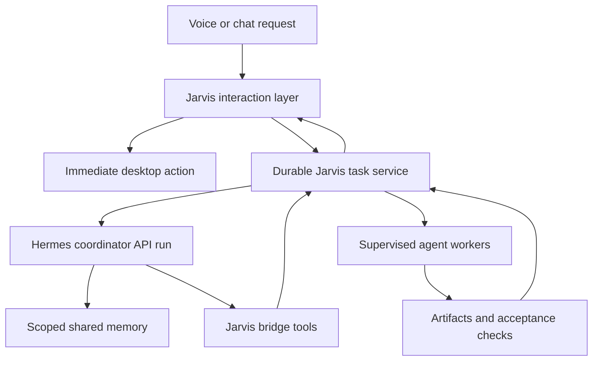

# Hermes as the orchestrator for Jarvis OS

Research assessment and implementation blueprint

Prepared for Gopi • 1 November 2026 • Version 1.0

## 1 Decision and scope

**Use Hermes as the planning and coordination brain for complex Jarvis tasks. Keep Jarvis responsible for voice, immediate desktop actions, execution policy, durable task records, and worker supervision.** Hermes should decide what work is needed and which verified capability should perform it. A small Jarvis bridge should turn that plan into tracked execution, return evidence, and deliver the result through the original voice or chat session.

This architecture can cover software development, research, documents, analysis, personal workflows, desktop operations, and scheduled monitoring. “Any task” means an extensible system that can discover a suitable capability, carry out authorized work, verify the outcome, or explain exactly which capability or input is missing. It does not mean unrestricted computer access or guaranteed success on every request.

The most important finding is that much of the foundation already exists. This machine has Hermes v0.22.5, relevant orchestration skills, several agent commands, a Jarvis CLI supervisor, a separate durable task system, and a shared memory MCP server. What remains is a reliable connection between these pieces. Their presence establishes implementation potential; authentication, live adapter behavior, and end-to-end orchestration still need acceptance testing. [L1–L7]

This document reviews the entire supplied report package, checks current official documentation, and specifies a proposed system. Recommendations, configuration examples, and interface contracts below describe work to implement; they do not claim that the system has already been deployed. No worker tasks, model calls, installations, configuration changes, or service restarts were performed for this assessment.

### 1.1 The central distinctions

| Term | What it means here |
| --- | --- |
| Model | The inference service doing reasoning, such as a configured Claude, Gemini, OpenAI, or local model |
| Agent application | A runtime such as Hermes, Codex CLI, Claude Code, OpenCode, OMP, or another local worker |
| Skill | A procedure and supporting assets that teach an agent how to do something |
| Tool or adapter | An executable, permissioned interface that actually performs an operation |
| Orchestrator | The component that decomposes goals, selects capabilities, coordinates dependencies, and assesses evidence |
| Supervisor | The component that starts, tracks, limits, stops, and reconciles worker processes |

Choosing a Claude model for a Hermes child does not launch Claude Code. Loading a Codex skill does not create a durable Codex adapter. Connecting to an MCP server exposes tools; it does not automatically establish a task lifecycle. These distinctions prevent most overstatements in the original report.

### 1.2 Recommended implementation choice

For this existing Jarvis installation, extend the durable Jarvis task system and place Hermes behind a service boundary. Reuse the older multi-CLI supervisor’s launch and cancellation logic after reconciling its flags and policy. Keep one authoritative task record.

Hermes Kanban is a credible alternative for owning complex workflow state, especially in a Hermes-first deployment. Adopt it only through an explicit ownership decision or migration. Do not allow Kanban and Jarvis to independently schedule, retry, or mark the same task complete.

## 2 Assessment of the complete supplied report

The package contains the main report, quickstart, skills catalog, and architecture HTML. The main report correctly identifies Hermes as a persistent agent framework with multiple interfaces, extensible tools, skills, scheduling, and delegation. Its Jarvis diagram, however, places Hermes in the worker layer. The requested design promotes Hermes to coordinator for complex tasks while retaining the existing Jarvis interaction and control foundation. [R1–R4]

### 2.1 Coverage and disposition

| Original topic | Assessment for this design |
| --- | --- |
| Architecture and agent loop | Useful conceptual foundation; separate reasoning from execution authority |
| CLI, TUI, desktop, dashboard, gateway, ACP, proxy | Useful interfaces; their existence does not prove identical context or orchestration semantics |
| Skills, memory, curator | Valuable reuse and recall mechanisms; require provenance and controlled promotion |
| Tools, MCP, plugins, widgets, pets | Tools and MCP enable integration; widgets and pets are optional presentation work |
| Delegation, cron, Kanban | Core coordination mechanisms; their durability and version-specific behavior need correction |
| Security, credentials, approvals, checkpoints | Useful controls; avoid absolute isolation, redaction, or rollback guarantees |
| Competitor comparison | Replace with capability-based integration decisions; the supplied comparison is unreliable |
| Jarvis examples and adoption phases | Reorder around a working task bridge and recovery before themes and UI extensions |
| Monitoring and troubleshooting | Keep health and logs; add task evidence, worker identity, restart recovery, and notifications |
| Configuration and commands | Validate against installed code and help; do not copy the large YAML block wholesale |
| Roadmap and conclusion | Treat future signals as speculation, not available implementation features |
| Quickstart and skills catalog | Useful navigation; distinguish installed, bundled, optional, custom, and merely mentioned packages |
| Architecture HTML | Useful visual summary; replace its worker hierarchy and repeated unsupported guarantees |

### 2.2 Corrections that affect implementation

**Delegation limits and roles.** The report uses a default concurrency of three. Installed v0.22.5 code defaults to ten concurrent children, 250 child iterations, depth one, and a finite one-shot limit of two children. These are code defaults, not a reading of the live configuration. The installed implementation computes effective orchestration privileges from depth and configuration; copying an old `role="orchestrator"` example is insufficient. Set deliberately smaller limits for initial operation. [S2, S3; L1]

**Background durability.** A running child is not a restartable durable worker. Hermes persists dispatch and completion information, including completion replay, but cannot infer whether unfinished external effects occurred after its owner disappears. The report’s “survive everything” language is incorrect. Model conversation persistence, task persistence, process persistence, and result delivery are separate properties. [S1; L1]

**Cron timing and memory.** The installed scheduler uses a 600-second inactivity default through `HERMES_CRON_TIMEOUT`, rather than the reported three-minute hard runtime. Zero disables that inactivity cap. The inspected cron agent construction uses `skip_memory=False`, contrary to the report and a stale comment. Validate scheduled jobs against the actual code path rather than comments. [L1]

**Memory storage and context.** Hermes curated memory includes bounded file-backed `MEMORY.md` and `USER.md`; session and lifecycle ledgers use SQLite. Profiles and child conversations have different scopes. There is no universal shared working context. Every handoff needs an explicit brief and artifact references. [L1]

**Local model requirements.** The inspected model metadata defines a minimum context length of 64,000 tokens, supporting the report’s large-context requirement. Verify a local model server’s actual configured context and tool-calling behavior before enabling it. A model advertised with a large window may be served with a smaller runtime setting. [L1]

**Skills inventory.** This snapshot contains 79 active local `SKILL.md` files and 58 in the checked-in Hermes source skills tree. Those are different inventories. The supplied “100+ bundled skills” list mixes custom, external, optional, and bundled material; several named packages are not in the active local tree. Skill descriptions also consume context, even when full procedures load progressively. [L6; R3]

**Isolation and secrets.** Hermes worktree isolation is off by default and applies only in supported Git/local-terminal contexts. A profile, board, or separate terminal is not an operating-system security boundary. A configuration file can contain credentials or authorization headers; it is not automatically safe to commit. Redaction reduces exposure but cannot establish universal PII removal. [S2, S9; L1]

**Approvals and commands.** Current documented unattended policies use `deny` or `approve`; old examples such as `cron_mode: smart` or `manual` should not be copied. Manual dangerous-command approval is not proof that every tool call receives a prompt. Running Hermes as a general MCP server now uses the optional `mcp-serve` plugin and `hermes mcp-serve`. No native `agent_send` tool was established in the inspected installation. [S8, S9; L1]

**Competitor claims.** Current Claude Code documentation describes skills, subagents, MCP and programmatic operation; current Codex documentation describes noninteractive execution and structured output. The supplied matrix’s claims that these systems lack such capabilities should not drive design. Compare verified interfaces rather than broad product rankings. [S15, S16]

## 3 The local foundation and its gaps

### 3.1 What is present

The Hermes checkout is `/home/g0pi/.hermes/hermes-agent` at commit `bf0203a794a07aac3ff764972ab9087baa4e4f4e`, identified locally as v0.22.5. The inspected checkout has a modified desktop Electron file; findings about core orchestration refer to the inspected core files, not a claim that every local file equals a pristine release. The official release page supplies a matching version reference. [L1; S4]

| Existing component | Observed capability | Gap to close |
| --- | --- | --- |
| Jarvis voice | Gemini Live integration and interruption handling | Route long work without blocking audio |
| Jarvis agent supervisor | Eight agent names, workspace reservation, four active jobs, timeouts, process-group cancellation | Jobs are held in process memory; validate per-agent invocation and policy |
| Visible execution | tmux execution and capability descriptors | Capability descriptions need live behavior checks |
| Durable Jarvis tasks | SQLite records, request keys, isolated workers, persisted results and notices | Providers currently only `responses` and `codex` |
| Jarvis memory MCP | Client identities, scoped reads, separate mutation permissions | Add a Hermes client policy and validate transport compatibility |
| Hermes skill library | Codex, Claude Code, OpenCode, Antigravity and other procedures | Skills need adapter tests and provenance review |
| Control and connectors | Desktop actions and integrations represented in source | Source presence does not establish account or runtime readiness |

The older supervisor exposes `start_agent_goal`, `delegate_agent`, `delegate_team`, job queries and cancellation through skill manifests. `delegate_team` sequences assignments in one workspace. Its process success currently means the worker exited successfully; independent acceptance checks must establish task success. [L2–L4]

The durable system is a separate implementation. It already treats SQLite as authority and avoids blind replay after uncertain exits. Extend this foundation rather than labelling the older eight-agent runner durable. The current source does not show an already working durable Hermes provider. [L5]

### 3.2 Agent readiness snapshot

All nine commands below resolve on this machine. No authentication checks or live worker tasks were performed.

| Agent command | Existing Jarvis support | Recommended disposition |
| --- | --- | --- |
| `hermes` | Process supervisor adapter | Coordinator through API; durable provider bridge still needed |
| `codex` | Process adapter and durable task provider | First worker to validate end to end |
| `claude` | Process adapter | Add durable result and policy mapping |
| `opencode` | Process adapter | Validate CLI or server contract; then enable |
| `gemini` | Process adapter | Validate supported flags and account route |
| `omp` | Process adapter | Keep disabled for automatic routing until tested |
| `pi` | Process adapter | Keep disabled for automatic routing until tested |
| `crush` | Process adapter | Keep disabled for automatic routing until tested |
| `agy` | Explicitly unsupported by current Jarvis adapter | Plan-dependent integration or human handoff |

“Installed,” “authenticated,” “adapter tested,” and “approved for unattended operation” must be separate registry fields. A worker should only receive automatic assignments after all relevant states are satisfied.

## 4 How Hermes can orchestrate work

### 4.1 Internal subagents

Native `delegate_task` launches Hermes child agent instances. Use it for bounded research, analysis, decomposition, or isolated review that benefits from a fresh context. Supply the goal, relevant inputs, constraints, and output contract explicitly. It is not a command to start an arbitrary external agent application. Keep durable, restart-sensitive implementation work in the task service. [S1]

The recommended initial configuration is two concurrent Hermes children, depth one, and explicit iteration limits. These are proposed conservative operating choices, not upstream defaults. An additional global supervisor limit must cover external workers and their descendants; per-Hermes-call limits cannot bound the whole fleet.

### 4.2 Skills that operate external agents

Hermes can learn how to invoke Codex, Claude Code, OpenCode and other tools through agent skills. Codex and Claude Code have bundled procedures; current official documentation also lists optional OpenCode and Antigravity CLI skills. Skill availability changes by release and installation. [S10–S13]

These procedures explain invocation, context, monitoring and result collection. Jarvis should replace ad hoc shell execution with a tested adapter that records a run ID, working directory, tool policy, timeout and results. Skill text can advise the planner; executable policy determines what the worker may actually do.

### 4.3 Model and profile routing

The official Advanced Delegation plugin adds `model_map` and `profile_routes` on Hermes 0.22.5 or newer. It exposes configured route names rather than arbitrary provider credentials. One mode is active at a time. A model route selects inference; a profile route selects another Hermes profile and its configured capabilities. Neither directly selects a Codex or Claude Code executable. Treat profile selection as a delegation of that profile’s authority. [S5]

This is useful after the first worker bridge is stable: a fast research route, a stronger planning route, or a local private-data route can reduce cost and control data movement. Do not assume the plugin is installed or enabled merely because this Hermes version supports it.

### 4.4 Kanban and durable workflow ownership

Hermes Kanban provides task dependencies, worker assignments, review transitions and a persistent audit trail. Default lanes launch Hermes profiles. Official worker-lane documentation explicitly says external CLI lanes are still integration work; the pluggable spawn mechanism is an extension point, not a finished Codex/Claude/OpenCode dispatcher. [S6, S7]

In a Hermes-owned deployment, a practical first lane is a Hermes worker profile that invokes a tested external adapter and reports back through Kanban. An external runner later needs explicit claim, heartbeat, workspace, exit-state and lifecycle mapping. Preserve the delegated-child scope at subprocess boundaries and enforce real filesystem restrictions separately.

For this Jarvis deployment, defer Kanban ownership until the durable Jarvis bridge works. It can initially be a read-only task view, or remain unused. If adopted as authority later, migrate workflow ownership and make Jarvis’s UI a projection of that state.

### 4.5 Cron and persistent goals

Cron supports scheduled, event-triggered, and script-only workflows. Use it to initiate a known workflow or inspect a known task, rather than start an untracked second copy. A periodic monitor should notify on meaningful changes, completion, failure or required action; unchanged observations should remain quiet. [S19]

Persistent `/goal` keeps an objective active across turns and supports deterministic quality gates. It can drive bounded improvement, but an LLM judge alone is insufficient evidence of success. Use explicit checks, cap attempts, and attach the goal to the authoritative task. Avoid multiple nested goal loops in Hermes and its workers. [S20]

### 4.6 API and library integration

Prefer the Hermes API for the Jarvis connection. Discover capabilities, create an API-owned run, retain its IDs, consume events, and map terminal states. Current documentation describes `/v1/capabilities`, `/v1/runs`, run events, status and stop controls. Idempotency and unknown-execution recovery depend on the server’s advertised mode. API access must not appropriate an existing desktop or CLI conversation. [S21]

Embedding `run_agent.AIAgent` is another option, but it binds Jarvis to a prepared Hermes source checkout and internal lifecycle assumptions. The Python-library guide is useful for controlled embedding; a service boundary makes independent upgrades and failure isolation easier. [S22]

### 4.7 Codex app server as an optional worker runtime

Hermes can optionally delegate its tool loop to Codex app-server. The documented beta requires Codex CLI 0.130.0 or newer and separate Codex authentication. It can migrate MCP/plugin settings and changes the runtime’s available tools. Native `delegate_task`, direct `memory`, `session_search` and `todo` are unavailable there. Current online documentation also excludes Hermes browser callbacks, while the inspected local documentation lists older browser callbacks as available. Test the selected version’s tool inventory. [S14; L1]

Keep the main coordinator on the default Hermes runtime. Evaluate app-server in a dedicated Codex worker profile after checking its configuration migration and callbacks. This is an optional execution architecture, not a prerequisite for orchestrating Codex CLI.

## 5 External agent integration choices

### 5.1 Preferred interfaces

Use structured noninteractive interfaces wherever available. Keep tmux for visible interactive sessions or a worker that actually requires it. Terminal screenshots and prompt-symbol detection are weak lifecycle evidence.

| Worker | Supported interface evidence | Adapter requirement |
| --- | --- | --- |
| Codex | `codex exec --json`, final output schema and file output | Parse JSONL events, preserve session ID and exit status, verify artifacts |
| Claude Code | `claude -p`, JSON or stream JSON, schema and turn/budget options | Map tool policy, result state, session identity and errors |
| OpenCode | Headless HTTP server, OpenAPI and SDK | Authenticate local server; map session, events and cancellation |
| Gemini CLI | `-p` or non-TTY operation, JSON and stream JSON | Parse final result and error states; validate account and sandbox |
| Other local agents | Local command presence and existing Jarvis launch table | Pin version; inspect help; implement and test each contract |

These interfaces are documented by their respective maintainers. A successful CLI exit or final event is necessary transport evidence; it is not a substitute for checking the requested outcome. [S15–S18]

Example invocation shapes, to validate in an isolated adapter test project:

```text
codex exec --sandbox workspace-write --json "Inspect this project and report findings"
claude -p "Inspect this project and report findings" --output-format json --max-turns 8
gemini -p "Inspect this project and report findings" --output-format json
opencode serve --hostname 127.0.0.1 --port 4096
```

These examples were not executed. Use an argument array and a resolved working directory in the adapter; never interpolate arbitrary task text into shell syntax. Existing Jarvis invocation flags must be reconciled with the installed versions before reuse. For Claude, `allowedTools` controls preapproval rather than establishing a complete sandbox; use actual tool restrictions and process confinement where required. OpenCode server authentication must be enabled before exposing it beyond a trusted local boundary. [L2; S16, S18]

### 5.2 Antigravity requires a separate decision

The local `antigravity-cli` skill and official Google headless documentation show that an `agy -p` interface exists. This does not establish that consumer Antigravity accounts can be used inside Hermes. Google’s current FAQ explicitly says that wrapping `agy` in third-party agents or applications is unsupported under consumer plans and distinguishes direct scripting/CI from such wrapping. [S13, S23, S24]

For the initial Jarvis system, mark Antigravity as a human-handoff capability. Hermes can prepare a brief, input paths and acceptance criteria for direct use in Antigravity. Automated integration should remain disabled until a supported plan or API arrangement is verified. Where appropriate, use a separately authorized Gemini API/CLI route as a distinct worker, with the substitution visible to the user.

Do not use UI automation or consumer-token extraction to bypass this boundary. This is an integration constraint affecting the architecture, not an instruction to remove Antigravity from the user’s toolset.

## 6 Target architecture and responsibility boundaries



Jarvis is the user-facing assistant and trusted execution service. Hermes is its complex-task planner. The broker owns the task record and constraints. Workers execute bounded assignments. Results return through a persisted event path so the voice session can reconnect without losing work.

### 6.1 Responsibilities

**Jarvis interaction layer.** Capture the user’s goal, resolve the workspace and attachment references, acknowledge admission, and maintain responsive speech and desktop controls. Immediate actions such as changing volume should use the existing deterministic control path. Multi-step work becomes a durable task. Silence, mute and ordinary follow-up questions do not cancel that task.

**Hermes coordinator profile.** Understand the goal, retrieve relevant context, decompose only when useful, select verified workers, sequence dependencies, request necessary clarification, and evaluate evidence. Give this profile access to the bridge and scoped memory. Do not rely on a persona prompt to prevent unrestricted host execution; restrict its actual tools.

**Jarvis task broker.** Validate authorization, deduplicate requests, allocate workspace and capacity, spawn supervised runs, record receipts, enforce deadlines and cancellation, and publish events. It must reject unsupported worker names and routing loops. The coordinator cannot silently enlarge its own permission scope or budget.

**Worker adapters.** Translate a common task contract into the selected worker’s native protocol. Each adapter reports progress, session/process identity, artifacts and terminal outcome. A worker cannot mark its parent task successful solely through prose.

**Verifier.** Run acceptance checks against the exact result and record their exit status and output. For code, review the final diff and test the actual candidate revision. For documents or research, verify structure, citations and requested artifacts. Tests should match the task rather than mirror implementation details.

### 6.2 Prevent orchestration recursion

The current supervisor can launch Hermes. After Hermes becomes coordinator, it must not recursively ask the same supervisor to launch another coordinator. Give every run a role, parent ID and remaining depth. The bridge should reject the coordinator’s own provider as a general child worker unless an explicit specialist Hermes profile is allowlisted. Tool permission should enforce this, not just a prompt.

### 6.3 One task authority

Choose the durable Jarvis store as the initial authority for user goals and execution states. Hermes run IDs and worker job IDs are child records. A Hermes conversation can end while a task remains active, and a voice session can disappear without changing task state.

If Kanban later becomes the authority, keep its lifecycle authoritative and map Jarvis controls into it. A subordinate execution receipt database is acceptable; an independent scheduler for the same work is not. A mapping must define which system may retry, cancel, request review and declare completion.

## 7 Proposed bridge and data contracts

The names in this section are a proposed interface. They are not existing Hermes or Jarvis tools.

### 7.1 Minimum bridge surface

| Proposed operation | Purpose |
| --- | --- |
| `jarvis_capabilities` | List enabled adapters, limits, allowed operations and readiness |
| `jarvis_submit` | Admit a bounded worker assignment with idempotency key |
| `jarvis_status` | Return authoritative state, latest evidence and blockers |
| `jarvis_artifact_read` | Read a bounded authorized artifact by task and relative path |
| `jarvis_cancel` | Cancel the intended task and descendants with a receipt |
| `jarvis_approval_request` | Present a concrete action outside existing authority |
| `jarvis_event_subscribe` | Deliver resumable events to the integration layer |

Expose control operations through a small authenticated local service or MCP server. Existing memory MCP handles knowledge operations separately. Do not export arbitrary shell or filesystem access merely because the bridge is local.

### 7.2 Task envelope

```json
{
  "schema_version": 1,
  "request_key": "voice-turn-184-add-export",
  "parent_task_id": "task-root-184",
  "goal": "Add CSV export for the selected report",
  "workspace_id": "jarvis-os-export-worktree",
  "worker": "codex",
  "role": "implementation",
  "inputs": ["artifact:requirements-184"],
  "acceptance_criteria": [
    "Export includes the filtered rows in documented column order",
    "Relevant tests pass and the final diff is available"
  ],
  "policy_id": "project-code-write-v1",
  "network_policy": "approved-package-sources",
  "limits": {
    "wall_seconds": 1200,
    "max_attempts": 2,
    "max_child_depth": 0
  },
  "reply_target": "jarvis-session-184"
}
```

The broker resolves `workspace_id`, `policy_id` and `reply_target`; the model cannot supply arbitrary host paths or recipient destinations. Pin the accepted input digest and policy version. Reuse the same request key only for the same logical submission. A new attempt under an existing task is different from admitting a new user request.

### 7.3 Result envelope

```json
{
  "task_id": "task-184-implement",
  "attempt_id": "attempt-2",
  "state": "awaiting_review",
  "worker_session_id": "provider-session-id",
  "summary": "CSV export implemented in the task worktree",
  "artifacts": [
    {"path": "result.patch", "sha256": "actual-digest-at-runtime"},
    {"path": "test-results.txt", "sha256": "actual-digest-at-runtime"}
  ],
  "checks": [
    {"criterion": 0, "exit_code": 0, "evidence": "test-results.txt"}
  ],
  "usage": {"cost_known": false},
  "blockers": []
}
```

Digests, IDs and evidence must come from runtime results. Unknown cost stays unknown. A verifier must account for every criterion before the parent task becomes complete; the illustrative single check above is not enough for both criteria.

### 7.4 State and event semantics

Use `accepted`, `planning`, `queued`, `running`, `validating`, `awaiting_review`, `succeeded`, `failed`, `blocked`, `cancel_requested`, `cancelled`, and `unknown` as proposed normalized states. Map these explicitly onto existing stores rather than assuming those names already exist.

Every state change carries a monotonically increasing event sequence, task ID, attempt ID, owner generation and timestamp. A stale worker cannot finalize a newer attempt. Events may arrive more than once; deduplicate by event ID and preserve a durable notification outbox. Delivery acknowledgement means a consumer received an event, not that the requested work succeeded.

## 8 Planning and execution lifecycle

1. **Admit the goal.** Record the exact request, task criteria, source session, inputs and request key before reporting that work started.
2. **Check capability and authority.** Confirm adapter readiness, workspace access, accounts and budget. Query `brain-who` before overlapping local work; treat it as an advisory view, not a lock.
3. **Prepare a compact brief.** Retrieve only relevant shared memory. Include goal, constraints, input paths, success checks and explicit action boundaries. Label external documents as data.
4. **Choose the smallest useful plan.** Use a direct tool for a deterministic action, one worker for a contained implementation, and multiple assignments only when dependencies or independent review justify them.
5. **Reserve resources.** Allocate a verified worktree or task directory and capacity before launch. Record the resolved path and process owner.
6. **Launch and collect events.** Start the adapter under an independent supervisor. Persist the native session ID, process identity, command version, logs and heartbeat.
7. **Validate outputs.** Check artifacts, apply task-specific gates, and review changes. Route rework with the failed criteria and existing evidence.
8. **Close and deliver.** Record the final outcome and artifact manifest. Send one completion or required-action notification to the authorized originating surface.

### 8.1 Parallel work

Start with at most two external workers globally and two Hermes research children, subject to one shared resource ceiling. These are proposed startup limits. CPU, memory, model quotas and local GPU capacity should lower concurrency when necessary.

Parallel code writers need separate worktrees and explicit integration ownership. Separate terminal sessions are insufficient. Verify that worktree creation actually succeeded; if isolation is unavailable, serialize writes. Independent research can run concurrently when inputs and outputs do not conflict. A reviewer should inspect the immutable candidate revision that will be integrated.

### 8.2 Retries and recovery

Retry transient transport failures within the same recorded attempt policy. Do not retry an uncertain external action as if it never happened. After a crash, inspect process identity, artifacts, receipts and native session state. Mark uncertain outcomes `unknown` until reconciled. Payments, messages, publishing and host changes need stronger action receipts than a model summary.

Use a broker deadline for wall time and the worker’s own progress watchdog for inactivity; they solve different problems. A heartbeat proves liveness, not useful progress. A repeated failure should produce a concise blocker with saved artifacts, rather than an unbounded coordinator loop.

### 8.3 Cancellation and conversation changes

“Mute” stops listening or speaking according to the existing voice controls. “Status” reads state. “Pause planning” prevents new assignments where supported. “Cancel this task” targets the named task and descendants. Stop requests remain pending until process termination or the external service’s cancellation receipt is confirmed.

Cancellation does not undo edits or external effects. After stopping, retain artifacts and explain what completed, what stopped, and what remains uncertain. An updated request can steer a running task only through an adapter that declares support; otherwise queue a follow-up against the saved result.

### 8.4 Worker results must wake the coordinator

Persist each worker completion or blocker before delivering it. Once the preceding Hermes run has terminated, the integration should submit one idempotent continuation into the same API-owned coordinator session, with the parent task, worker attempt, result state and authorized artifact IDs. Serialize turns for that session. Deduplicate worker events before scheduling the continuation so reconnects cannot produce duplicate reviews or dependent assignments.

Hermes should then assess the result, request review or rework, launch the next dependency, or finish the goal. API-side background completion records do not by themselves guarantee another model turn; the client owns that continuation. Record its admission before acknowledging the triggering event, and reconcile uncertain admission rather than resending under a new identity. This closes the loop between delegation and the next planning decision. [S1, S21]

## 9 Skills and routing design

### 9.1 Useful installed skills

The active local library includes `claude-code`, `codex`, `opencode`, `antigravity-cli`, `openhands`, `computer-use`, `hermes-agent`, `jarvis-os` and `skills-installer` under `autonomous-ai-agents`. Treat each as procedural material to inspect and adapt. Their example flags and permission choices are not automatically suitable for the Jarvis broker. [L6]

Three other installed names deserve care. `ethos-orchestrate` routes the creation of an agent intent document; it is not a worker scheduler. `agnt-os` is an instruction-level routing skill, not a process supervisor. `a2a-agent-protocol` contains protocol procedures; its presence does not establish a native Hermes A2A endpoint, and its protocol details need validation before use. None removes the need for durable execution. [L6]

### 9.2 Proposed Jarvis skill set

| Proposed skill | Responsibility |
| --- | --- |
| `jarvis-orchestrator` | Interpret goals, query readiness and build bounded plans |
| `jarvis-worker-routing` | Map task type and constraints onto tested adapters |
| `jarvis-task-handoff` | Prepare input briefs and result manifests |
| `jarvis-acceptance-review` | Check criteria and route evidence-based rework |
| `jarvis-recovery` | Reconcile failed or unknown runs without duplicate effects |
| `jarvis-memory-update` | Propose supported lessons and durable facts |
| `jarvis-monitor` | Schedule checks and notify only when action is needed |

These are proposed assets, not files installed by this assessment. Keep policy in executable controls; skill text should reference it. Avoid loading the entire catalog into every voice or planning turn. Select a few applicable procedures and attach the relevant version to the task record.

### 9.3 Routing policy

Route by required interface, verified competence, privacy, cost, availability and user preference. A request naming Codex should select Codex or explain its blocker; it should not silently become a different provider. A local-data requirement must restrict every nested model call, not merely the top-level model.

Use measured success on representative Jarvis tasks to assign roles. “Codex always implements,” “Claude always reviews,” or “more agents means better results” are hypotheses, not architectural facts. A reasonable pilot is one validated implementer plus one independent reviewer for material code changes. Simple tasks should remain simple.

## 10 Memory and context sharing

Use Jarvis’s scoped memory service as the shared knowledge authority. Hermes’s own curated memory may retain its identity and operational preferences, but avoid copying whole user histories into every worker. Shared knowledge should carry scope, author, source, time, confidence and evidence links. [L7]

Give Hermes read access to relevant scopes and permission to propose new records. Reserve commit, correction and deletion for an explicitly assigned policy owner. The existing MCP server already separates these permissions and records mutation metadata. Validate its protocol behavior with Hermes before relying on it. [L7]

A task brief should distinguish user instructions, project conventions, retrieved facts, inferred context and untrusted source text. External pages and attached reports cannot authorize account changes, messages or installations. A worker’s summary is evidence to review, not a new instruction with user authority.

Keep raw artifacts in task storage and store concise indexed facts with links in memory. Promote a successful workflow to a skill only after repetition or clear reusable value. Review generated skills for obsolete flags, overbroad permissions and unsupported claims before enabling them automatically.

MCP client support is built into Hermes and can connect a Jarvis memory server or a future task bridge. Running Hermes itself as a general MCP server is a separate optional plugin. Prefer this narrow tool direction for workers; avoid connecting two broadly privileged agents to each other without role and recursion controls. [S8]

## 11 Policy and execution boundaries

Autonomy should follow the authorized task. Routine reads, analysis, drafting, testing and permitted workspace edits can proceed without repeated confirmation. Actions outside the established scope should produce a concrete reviewable request identifying the action, destination, consequence and available evidence.

| Action class | Proposed default |
| --- | --- |
| Read approved project data and produce local drafts | Run within task scope |
| Edit isolated project files and run relevant checks | Run when task authorizes implementation |
| Install project dependencies | Apply the task’s package and network policy |
| Publish, send messages, merge, deploy or spend | Require explicit scope or a configured standing policy |
| Change host settings or credentials | Use the dedicated Jarvis control boundary |
| Unknown adapter or unavailable permission | Report a capability gap; preserve completed work |

Hermes documents layered approvals and sandbox options. Those should complement the broker’s action policy and filesystem confinement. Profile isolation and command-pattern checks alone cannot contain arbitrary code. [S9]

Pass only the credentials the chosen adapter needs. Keep secrets outside workspaces, task prompts, logs and shared-memory content. A child may require its own provider authentication; it does not need every credential available to Hermes or Jarvis. Use a dedicated process/account boundary where the task’s trust level requires it.

The inspected Jarvis orchestration presets contain `yolo` metadata and permissive invocation choices. Review their actual consumers and replace blanket bypass behavior with scoped authorization before unattended rollout. Likewise, do not reproduce skill examples that respond automatically to uninspected approval dialogs or recommend disabling the worker’s sandbox after an error. [L2–L4; L6]

Keep local APIs bound to a deliberate interface, authenticate access, and scope every operation to its task and session owner. Logs should include IDs and evidence paths, with bounded content and credential filtering. A snapshot can help restore local files but cannot undo messages, remote updates, financial actions or every process side effect.

## 12 Operations and observability

Run voice, Hermes gateway/API, task supervision and worker processes under independently observable service ownership. A voice reconnection must not spawn another worker. Do not start another Hermes gateway until existing service ownership and configuration are understood; the observed gateway was already running during this assessment.

The user-facing task view should show the goal, current phase, chosen worker, last useful progress, elapsed time, artifact links, verification results, blockers and controls. State whether usage/cost is measured or unavailable. Avoid invented percentages and completion times.

### 12.1 Required operational evidence

| Signal | What to record or inspect |
| --- | --- |
| Admission | Stable request key, input digest, policy and source session |
| Ownership | Service, process fingerprint, native session and attempt generation |
| Progress | Phase events, meaningful activity and heartbeat separately |
| Resources | Active workers, CPU/RAM/GPU pressure, quota and actual usage |
| Completion | Artifact digests, checks, final revision and review outcome |
| Delivery | Persisted outbox entry, destination and acknowledgement |
| Recovery | Reconciled process state and unresolved external effects |

### 12.2 Operator runbook

For a stalled task, inspect its latest events and process state first. Determine whether it is working, waiting on input, rate limited, or unable to execute. Read the saved artifact/log tail. Resume or retry only after identifying the current attempt and possible effects.

For a gateway restart, reconcile Hermes run IDs with Jarvis task IDs and preserve `unknown` outcomes. Check for pending notifications and duplicate admission attempts. For an adapter upgrade, test its command flags, result parsing, cancellation and workspace restrictions before restoring automatic routing.

Back up task records, configuration references and artifact manifests together using storage-aware procedures. Restore into an isolated location and verify references before reopening dispatch. Keep an operational kill switch that disables new assignments while allowing status inspection and controlled cleanup.

## 13 Phased implementation and acceptance gates

These phases are ordered deliverables, not elapsed-time promises. Advance only after the stated evidence exists.

### Phase 1 Establish the baseline

Record Hermes and worker versions, inspect supported CLI options, identify the currently active Jarvis paths, and build the readiness registry. Preserve existing service configuration and define task ownership. Use a small disposable project for adapter tests. Exit gate: each enabled adapter has a successful bounded task, a known failure case, and a verified cancellation result.

### Phase 2 Connect Hermes to durable Jarvis tasks

Create the authenticated Hermes client and API-owned coordinator session mapping. Extend the Jarvis task service to represent coordinator and external-worker runs. Expose the narrow bridge, persist native IDs, and implement an event outbox. Exit gate: one voice/chat request creates one task, reaches Hermes, runs Codex, produces a verified artifact, and delivers one result.

### Phase 3 Add review and recovery

Add Claude Code or another verified reviewer, normalized results, policy enforcement, workspace ownership and evidence-based rework. Exit gate: voice restart, Hermes restart, worker failure and cancellation tests preserve correct state without duplicate work. An uncertain external effect must remain explicit.

### Phase 4 Expand task families

Enable research, documents, data work, memory proposals and selected account connectors. Add recurring monitoring through one scheduling authority. Enable OpenCode, Gemini or other local adapters only after their own tests. Exit gate: representative tasks satisfy both outcome and action-boundary checks.

### Phase 5 Evaluate advanced features

Evaluate Advanced Delegation for model/profile routing, a dedicated Codex app-server profile, and Kanban if its workflow features justify migration. Add remote workers or A2A only when a specific need exists and the protocol is independently verified. Antigravity automation remains conditional on supported access. Exit gate: documented ownership, tested compatibility, and a practical rollback path for each addition.

### 13.1 Minimum acceptance suite

| Scenario | Passing evidence |
| --- | --- |
| Repeat the same submission | One logical task and one admitted operation |
| Same key with changed input | Conflict is rejected, not silently replayed |
| Voice reconnects | Worker continues and result reaches the returning session |
| Hermes disappears mid-run | No blind retry; task reconciles or becomes unknown |
| Worker exits successfully with missing artifact | Verification fails |
| Parallel writers target one directory | Second write is isolated or serialized |
| Child tries to re-enter the coordinator | Recursion policy rejects it |
| Worker requests a new credential or destination | Scope enforcement blocks or escalates it |
| Cancel a process tree | Descendants stop or remaining work is identified |
| Redeliver a completion event | User receives one logical notification |
| Provider is unauthenticated or rate limited | Honest blocker or authorized fallback |
| Worktree creation fails | No concurrent shared-directory writes |

## 14 Example workflows for daily use

### 14.1 Build a software feature

Request: “Add CSV export to the report page and verify it.” Jarvis records the goal and asks Hermes to inspect the approved project context. Hermes identifies acceptance criteria and assigns one implementer. The broker allocates a worktree, runs the adapter, then sends the exact candidate revision to a reviewer. Failed checks return to the implementer with evidence. Jarvis presents the changed behavior, checks and diff. Publishing or merging follows the task’s explicit authority.

### 14.2 Research and prepare a document

Request: “Research local voice models and prepare a comparison document.” Hermes decomposes research by the decision criteria, uses a bounded number of research children, and retains source links and dates. A document worker produces the artifact. Verification checks requested comparisons, citation support and rendering. Jarvis returns the document and material uncertainties. This does not require launching all coding agents.

### 14.3 Run an experiment or benchmark

Request: “Benchmark the selected model on this dataset and report latency.” Hermes translates the goal into measurable criteria and uses the existing durable isolated-task foundation. The worker records dataset/version, hardware, seed, commands and raw measurements. Checks distinguish setup success from benchmark success. A missing GPU or unavailable dataset becomes a blocker rather than an unannounced substitute. Jarvis can keep responding to desktop requests while the experiment runs.

### 14.4 Prepare a morning brief

Request: “Prepare a weekday brief at 7 AM with calendar, email and project blockers.” One scheduler triggers a recorded workflow in the Asia/Kolkata timezone. Hermes reads authorized connectors and summarizes evidence. Drafting and delivery scopes are distinct. Connector errors remain visible. Repeated identical observations do not create extra alerts unless the user requested every scheduled brief.

### 14.5 Diagnose a desktop issue

Request: “Find why my microphone is not working.” Jarvis first uses its existing status and control tools. Hermes coordinates a longer diagnosis only when needed, with access to approved logs and system information. It proposes a concrete repair and check. Host changes go through the dedicated control path. Opening a settings window does not establish that the microphone is fixed; verify capture or the relevant status result.

### 14.6 Work with Antigravity

Request: “Use Antigravity to build this screen.” Hermes prepares the workspace brief, references and review criteria, then reports the supported handoff path. If consumer wrapping remains unsupported, the user starts the task directly in Antigravity. Jarvis can later inspect the authorized resulting artifacts. A future automated adapter requires separately verified supported access.

## 15 Concrete engineering work map

| Work item | Existing location | Proposed change |
| --- | --- | --- |
| Durable provider registry | `jarvis_control/tasks.py` | Extend beyond the current two providers with versioned adapter capability records |
| Worker execution | `jarvis_control/task_worker.py` | Add external-worker protocol support while preserving confinement and evidence checks |
| Legacy launch reuse | `orchestration/agent_orchestrator.py` | Reuse tested spawn/cancel code; move lifecycle authority into durable records |
| Visible worker sessions | `orchestration/desktop_execution.py` | Make tmux a view of the authoritative run rather than its state store |
| Hermes client | New integration module | Capability discovery, run admission, events, stop and recovery |
| Bridge tools | New narrow service or MCP module | Capabilities, submit, status, artifact reads and scoped cancellation |
| Voice routing | `jarvis_control/skills.py` and active voice registration | Submit long tasks and return promptly; preserve immediate controls |
| Existing orchestration tools | `skills/domains/orchestration.py` and `skill_manifests/agent-orchestration.json` | Point enabled operations at durable authority and normalize results |
| Preset teams and policy | `orchestration/personas.py` and command builders | Replace unverified bypass choices and fixed role assumptions |
| Shared memory | `jarvis_memory/mcp_server.py` | Add least-privilege Hermes client and interoperability checks |
| Notifications | Durable task notices plus voice/UI delivery | Add acknowledged resumable delivery with deduplication |
| Verification | Relevant `tests/` suites | Add lifecycle, isolation and failure-injection checks |

The legacy orchestration README contains API examples that do not match the inspected class signatures. Implementation should follow tested code and current tool schemas, then update documentation. Do not copy the stale example’s method names or async assumptions. [L2]

The first implementation milestone should be small: **one recorded request, one Hermes planning run, one Codex worker, one verified artifact, and one delivered completion that survives a voice restart**. It proves the difficult integration before adding more agents, UI extensions or recurring jobs.

## 16 Practical setup reference

### 16.1 Readiness inspection

The following are intended inspection commands. They are not an instruction to start or reconfigure a service automatically.

```text
brain-who
hermes --version
hermes gateway status
hermes profile list
hermes mcp list
codex --version
codex exec --help
claude --version
claude --help
opencode --version
gemini --version
```

Use `hermes skills list --help` or the installed CLI’s relevant help before choosing an inventory command. Inspect live model/account readiness through each tool’s supported status path without copying credentials into a report. An implementation task should confirm command behavior in its own environment.

### 16.2 Illustrative coordinator configuration

This is a partial proposed configuration for a dedicated profile. Merge validated keys into that profile; do not overwrite the existing global file.

```yaml
delegation:
  max_concurrent_children: 2
  max_iterations: 40
  max_spawn_depth: 1
  oneshot_max_children: 2
  worktree_isolation: true
  subagent_auto_approve: false

approvals:
  mode: smart
  cron_mode: deny
  single_query_mode: deny
  unattended_mode: deny
```

The worktree flag does not remove the need to verify actual isolation. These settings do not configure the proposed bridge, global budget or worker registry; those are separate implementation work. Keep the coordinator on the default runtime unless a tested alternative is deliberately selected. [S2, S9]

For shared memory, use the existing Jarvis MCP server with an explicit database path, client identity and read scopes. Its actual command-line options include `--database`, `--client-id`, repeatable `--read-scope`, optional `--write-scope`, and individually granted mutation permissions. The correct database path must be resolved from the active Jarvis installation; do not create a second memory database accidentally. [L7]

## 17 Evidence and research method

The full supplied package was reviewed, including the HTML’s text and implementation. Current primary sources were searched and read for Hermes delegation, plugins, Kanban, worker lanes, scheduling, APIs, MCP, security, embedding and agent skills. External-agent claims were checked against their maintainers’ documentation. Local evidence came from read-only source and inventory inspection. Findings were reconciled across report claims, online documentation and the installed v0.22.5 code snapshot.

Confidence is high for the observed code structures and the cited documented interfaces. Confidence in operational readiness is limited until live adapter, account, cancellation and recovery tests pass. Upstream pages can change independently of the installed checkout; the browser-callback discrepancy in the Codex runtime is a concrete example. Pin implementation versions and retest upgrades.

### 17.1 Primary online sources

S1. [Hermes subagent delegation](https://hermes-agent.nousresearch.com/docs/user-guide/features/delegation) — native child lifecycle and context.

S2. [Pinned delegation configuration code](https://github.com/NousResearch/hermes-agent/blob/bf0203a794a07aac3ff764972ab9087baa4e4f4e/tools/delegate_tool_config.py) — defaults, depth, approval and isolation settings.

S3. [Pinned delegation implementation](https://github.com/NousResearch/hermes-agent/blob/bf0203a794a07aac3ff764972ab9087baa4e4f4e/tools/delegate_tool.py) — child iteration limit and runtime behavior.

S4. [Hermes v0.22.5 release](https://github.com/NousResearch/hermes-agent/releases/tag/v0.22.5) — release reference for the local version.

S5. [Official Advanced Delegation plugin](https://hermes-agent.nousresearch.com/docs/plugins/advanced-delegation) — named model/profile routes and compatibility requirements.

S6. [Hermes Kanban](https://hermes-agent.nousresearch.com/docs/user-guide/features/kanban) — durable workflow facilities.

S7. [Hermes Kanban worker lanes](https://hermes-agent.nousresearch.com/docs/user-guide/features/kanban-worker-lanes) — lifecycle contract and unfinished external-CLI lane integration.

S8. [Hermes MCP integration](https://hermes-agent.nousresearch.com/docs/user-guide/features/mcp) and [CLI reference](https://hermes-agent.nousresearch.com/docs/reference/cli-commands) — client integration and current MCP-server command.

S9. [Hermes security guide](https://hermes-agent.nousresearch.com/docs/user-guide/security) — approval configuration and layered boundaries.

S10. [Hermes Codex skill](https://hermes-agent.nousresearch.com/docs/user-guide/skills/bundled/autonomous-ai-agents/autonomous-ai-agents-codex) — procedural external-agent integration.

S11. [Hermes Claude Code skill](https://hermes-agent.nousresearch.com/docs/user-guide/skills/bundled/autonomous-ai-agents/autonomous-ai-agents-claude-code) — print and interactive workflows.

S12. [Hermes optional OpenCode skill](https://hermes-agent.nousresearch.com/docs/user-guide/skills/optional/autonomous-ai-agents/autonomous-ai-agents-opencode) — optional procedure, not a native dispatcher.

S13. [Hermes optional Antigravity CLI skill](https://hermes-agent.nousresearch.com/docs/user-guide/skills/optional/autonomous-ai-agents/autonomous-ai-agents-antigravity-cli) — skill availability, subject to provider restrictions.

S14. [Hermes Codex app-server runtime](https://hermes-agent.nousresearch.com/docs/user-guide/features/codex-app-server-runtime) — opt-in runtime, prerequisites and tool tradeoffs.

S15. [OpenAI Codex noninteractive mode](https://developers.openai.com/codex/noninteractive/) — JSONL events and output schemas.

S16. [Claude Code programmatic execution](https://code.claude.com/docs/en/headless) — print mode, structured results and programmatic control.

S17. [Gemini CLI headless reference](https://geminicli.com/docs/cli/headless/) — JSON modes and exit states.

S18. [OpenCode server reference](https://opencode.ai/docs/server/) — headless API, authentication and OpenAPI.

S19. [Hermes scheduled tasks](https://hermes-agent.nousresearch.com/docs/user-guide/features/cron) — scheduled, script-only and event-triggered workflows.

S20. [Hermes persistent goals](https://hermes-agent.nousresearch.com/docs/user-guide/features/goals) — continuation loops and quality gates.

S21. [Hermes API server](https://hermes-agent.nousresearch.com/docs/user-guide/features/api-server) — capability discovery, run lifecycle, identity, idempotency and recovery.

S22. [Hermes as a Python library](https://hermes-agent.nousresearch.com/docs/guides/python-library) — direct embedding option.

S23. [Google Antigravity headless mode](https://antigravity.google/docs/cli/headless/) — official CLI interface.

S24. [Google Antigravity FAQ](https://antigravity.google/docs/faq) — consumer-plan restrictions on third-party wrapping.

### 17.2 Supplied source files

R1. `/home/g0pi/Projects/Hermes-Next-Level-Assistant-Report/HERMES_NEXT_LEVEL_ASSISTANT_REPORT.md` — main report dated 26 October 2026, all sections and appendices.

R2. `/home/g0pi/Projects/Hermes-Next-Level-Assistant-Report/QUICKSTART_CHEATSHEET.md` — commands and adoption guidance.

R3. `/home/g0pi/Projects/Hermes-Next-Level-Assistant-Report/SKILLS_CATALOG.md` — skill inventory and extensibility procedures.

R4. `/home/g0pi/Projects/Hermes-Next-Level-Assistant-Report/ARCHITECTURE_DIAGRAM.html` — architecture and comparison visual source.

### 17.3 Local implementation evidence

L1. `/home/g0pi/.hermes/hermes-agent/` — v0.22.5 checkout and inspected files: `tools/delegate_tool_config.py`, `tools/delegate_tool.py`, `tools/async_delegation.py`, `tools/memory_tool_store.py`, `agent/model_metadata.py`, `cron/scheduler.py`, and relevant documentation. The cron timeout parser is near line 1198 and the inspected cron memory argument near line 2529.

L2. `/home/g0pi/JARVIS OS/orchestration/agent_orchestrator.py` — supported names, command construction, workspace reservation, in-memory jobs and process supervision. Companion `orchestration/README.md` contains stale API examples.

L3. `/home/g0pi/JARVIS OS/orchestration/desktop_execution.py`, `orchestration/execution_backend.py`, and `orchestration/personas.py` — visible execution, capability descriptors and preset teams.

L4. `/home/g0pi/JARVIS OS/skill_manifests/agent-orchestration.json`, `skills/domains/orchestration.py`, and `skills/skills.py` — declared tools and legacy runtime construction.

L5. `/home/g0pi/JARVIS OS/jarvis_control/tasks.py` and `jarvis_control/task_worker.py` — durable store, two current providers, isolated workers and acceptance enforcement.

L6. `/home/g0pi/.hermes/skills/` and `/home/g0pi/.hermes/hermes-agent/skills/` — active versus source-tree inventories; installed external-agent procedures and the three additional routing/protocol skill files discussed above.

L7. `/home/g0pi/JARVIS OS/jarvis_memory/mcp_server.py` — scoped shared-memory transport, permission separation and CLI arguments.

L8. `/home/g0pi/JARVIS OS/README.md`, `jarvis_control/skills.py`, and `jarvis_voice/` — voice, immediate control and memory integration foundation.
