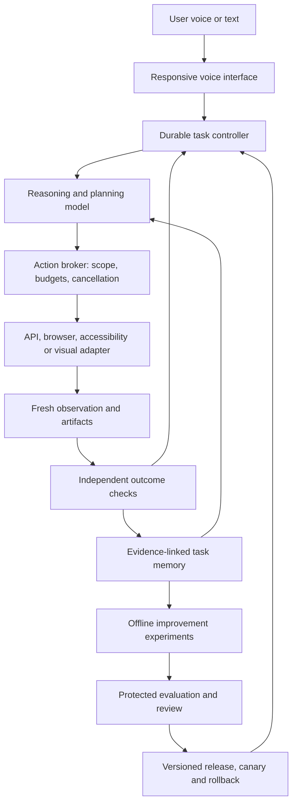

# Jarvis: evidence-based roadmap toward a self-improving autonomous assistant

Research date: **14 October 2026, Asia/Kolkata**. Status: research and proposed design; no runtime changes or new benchmark runs. Prepared through parallel research and adversarial review, with primary-source checks and inspection of the existing Jarvis working tree.

## Executive decision

Build Jarvis around a capable existing model, a durable task controller, reliable computer tools, independently checked outcomes, and a controlled improvement pipeline. Research supports these components individually. Their combination is a testable engineering proposal, **not an established recipe for AGI**.

OpenAI publicly documents **GPT-6 Astra**, including its release, API capabilities, and system card. In the reviewed sources we found broad training descriptions and integration guidance, but no reproducible end-to-end Astra training recipe. The release describes advances in pretraining, reinforcement learning, and alignment; it does not disclose enough architecture, data, and training detail to recreate the model. [OpenAI release](https://openai.com/index/gpt-6-astra/)

The practical objective should be: **Jarvis reliably completes authorized tasks, learns reusable procedures from verified experience, and proposes upgrades that improve measured performance on unfamiliar tasks.** Daily experiments are feasible; improvement every day is not guaranteed.

Confidence is high in the distinction between model training and agent-system improvement, medium in the expected benefit of the proposed architecture for this project, and low in any claim that it will produce AGI. Jarvis-specific gains remain unmeasured.

## 1. What the public evidence actually establishes

### Astra: a documented model, not a public AGI construction manual

The current Astra API documentation supports using it for reasoning and tools, while listing audio and fine-tuning as unsupported. Therefore, an Astra-backed Jarvis would retain a separate voice path and improve its surrounding software rather than assume it can update Astra's weights. Availability in a desktop application also does not establish API credentials, quota, or affordability for Jarvis. [Model documentation](https://developers.openai.com/api/docs/models/gpt-6-astra)

OpenAI's system card includes constrained AI research and self-improvement evaluations. It explicitly distinguishes small-model NanoGPT experiments from designing and operating frontier-scale pretraining. PostTrainBench Lite uses small pretrained models under bounded compute and time, with checks against held-out-data cheating. These are evidence of specific research capabilities, not proof of unrestricted recursive improvement. [Astra system card](https://deploymentsafety.openai.com/gpt-6-astra)

Public guides describe how to use trained models. OpenAI also reports that retaining supported reasoning state and enabling compaction substantially changed performance on a particular ARC-AGI-3 public-set experiment. This illustrates the importance of the execution software and context management; it is not evidence that model weights changed during the task. [GPT-6 integration guide](https://developers.openai.com/api/docs/guides/latest-model), [context-management experiment](https://openai.com/index/how-two-settings-tripled-our-arc-agi-3-scores/)

**Interpretation:** a benchmark containing “AGI” in its name does not, by itself, establish broad general intelligence. Google's Levels of AGI framework separates breadth, performance, and autonomy. Its 2026 cognitive framework proposes a profile across multiple abilities with held-out tasks and human comparisons. We should measure Jarvis across dimensions rather than award it an AGI label from one score. [Levels of AGI](https://research.google/pubs/levels-of-agi-operationalizing-progress-on-the-path-to-agi/), [2026 cognitive framework](https://blog.google/innovation-and-ai/models-and-research/google-deepmind/measuring-agi-cognitive-framework/)

### If we eventually train our own model

Training a foundation model is a different project from building an assistant. It requires a data pipeline, substantial training infrastructure, optimization, post-training, evaluations, and serving. Chinchilla provides evidence about allocating training compute between model size and data; it is neither a current hardware quotation nor a universal AGI recipe. [Compute-optimal training](https://arxiv.org/abs/2203.15556)

DeepSeek-R1 provides a more concrete public example of reasoning post-training: reinforcement learning on a pretrained base, with verifiable rewards and additional stages for the final model. “Without initial supervised fine-tuning” does not mean “from an untrained model.” Its reported results support investigating bounded training experiments, not expecting a desktop assistant to recreate frontier intelligence through conversation alone. [DeepSeek-R1](https://arxiv.org/html/2501.12948v1)

**Proposed decision rule:** consider an open-weight specialist only when a stable failure remains after improving tools, retrieval, and prompting; there is a legitimate training dataset; compute and operating capacity are available; and a fixed evaluation shows a favorable quality/cost or privacy/offline tradeoff. Keep the hosted-model baseline. No hardware purchase or training budget is recommended before that comparison.

## 2. Five different meanings of “self-improvement”

| Mechanism | What changes | What would count as evidence | Jarvis priority |
|---|---|---|---|
| In-task adaptation | Plan and context during a task | Recovery from a changed state without repeating the same mistake | Immediate |
| Persistent experience | Retrieved facts, episodes and procedures | Better future results than an equally resourced baseline | Immediate after outcome logging |
| Skill/code evolution | Tools, workflow code, prompts and retrieval policy | Tested candidate beats the incumbent on unseen tasks without regressions | Next |
| Model post-training | Weights of a model we are permitted and able to train | Held-out improvements beyond prompting/retrieval, with retained general ability | Conditional research |
| Recursive general improvement | The system improves its improvement process across domains | Sustained independently verified gains, robust transfer and controlled costs | Open research; not a promised deliverable |

The following studies motivate the first three layers. They do not demonstrate unrestricted general self-improvement:

| Primary evidence | Supported finding | Limitation relevant to Jarvis |
|---|---|---|
| [Reflexion](https://arxiv.org/abs/2303.11366) | Feedback and verbal experience can improve later attempts without weight updates. | A reflection can be wrong; success depends on feedback and the tested task. |
| [Voyager](https://arxiv.org/abs/2305.16291) | Executable skill memory, curriculum and environment feedback enabled continuing acquisition and reuse of Minecraft abilities through a frozen-model interface. | Transfer inside Minecraft is not evidence of general desktop or cross-domain competence. |
| [Darwin Gödel Machine](https://arxiv.org/abs/2505.22954) | An archive of code-modified agents improved coding benchmark performance through empirical selection. | Fixed foundation model and bounded search/evaluation; historical benchmark gains are not daily production guarantees. |
| [AlphaEvolve](https://deepmind.google/blog/alphaevolve-a-gemini-powered-coding-agent-for-designing-advanced-algorithms/) | Model-generated programs plus automated evaluation can discover useful algorithms and infrastructure improvements. | Particularly applicable when candidate quality can be reliably checked; general desktop goals often have weaker evaluators. |
| [Self-correction study](https://arxiv.org/abs/2310.01798) | Studied models often failed to correct reasoning reliably without external feedback, and could worsen answers. | Historical results do not prove newer models can never self-correct; they motivate testing feedback quality rather than trusting reflection by default. |

**Design inference:** store reflections as hypotheses, attach them to observable evidence, and promote reusable procedures only after validation. Browsing a page adds retrieved information; it does not itself retrain a model. A new skill may create new system capability even if the underlying model remains unchanged.

## 3. What already exists in Jarvis

This is a static inspection of the working tree at base commit `9215742b2e2fabbe3a54ef4934400769e1815f79`, including substantial pre-existing uncommitted changes. It is not a clean-commit audit or live-system verification.

| Component | Inspected state | Consequence for the design |
|---|---|---|
| Voice runtime | [core/agent.py](/home/g0pi/Projects/JARVIS-OMA/core/agent.py) handles voice and skill dispatch. | Keep responsive voice separate from long-running reasoning work. |
| Memory | [memory bridge](/home/g0pi/Projects/JARVIS-OMA/memory/codes-dev/jarvis_memory/bridge.py) has recall, history, corrections and document indexing. | Extend with verified task episodes; do not replace useful existing memory. |
| Planner | [_select_agent](/home/g0pi/Projects/JARVIS-OMA/proactive/planner.py:137) uses ordered text patterns for routing. | Routing is useful but is not a semantic planner or outcome verifier. |
| Desktop primitives | [system control](/home/g0pi/Projects/JARVIS-OMA/skills/system_control.py) provides typing, keys and desktop controls. | Reuse primitives behind a checked action interface. |
| Visible delegation | [desktop orchestration](/home/g0pi/Projects/JARVIS-OMA/orchestration/desktop_execution.py:15) has Codex/Claude terminal adapters. | A visible terminal session is not a general application-control engine. |
| Capability development | [evolution manager](/home/g0pi/Projects/JARVIS-OMA/orchestration/evolution.py:276) requires a clean tree and creates isolated proposals, tests and review evidence. | Extend this pipeline; do not claim generated code is automatically active. |

Three concrete gaps deserve priority before greater autonomy:

1. **Authorization is inferred too broadly.** [runtime.py:59](/home/g0pi/Projects/JARVIS-OMA/proactive/runtime.py:59) converts high/critical todo priority into `authorized`; [line 106](/home/g0pi/Projects/JARVIS-OMA/proactive/runtime.py:106) treats authorized delegation as locally reversible. Priority and a generic delegation flag do not determine the effects of the actions the delegated worker will perform.
2. **Completion and correctness are conflated.** [runtime.py:140](/home/g0pi/Projects/JARVIS-OMA/proactive/runtime.py:140) maps a completed job to a succeeded activity. Multiple jobs can share one activity, so one completed worker must not close it while required siblings are running or have failed. The [voice instruction](/home/g0pi/Projects/JARVIS-OMA/core/agent.py:538) already cautions that process completion does not prove correctness. The runtime should enforce that distinction and aggregate all required outcomes.
3. **Outcome evidence needs a durable home.** The runtime's in-memory job-to-activity mapping and process-oriented reconciliation are not a verified, restart-safe task lifecycle. We need explicit interrupted, awaiting-verification, verified-success, failed and cancelled states, with recovery rules.

These are code observations and proposed fixes, not findings from an executed penetration test or end-to-end test. Existing development requires a clean source tree; preserve and deliberately integrate current work before using it as an evolution baseline.

## 4. Proposed architecture

The components below are proposed interfaces, not implemented modules.

**Task controller.** Persist the goal, requested deliverable, constraints, authorization scope, completion predicates, plan version, next action, remaining budget, cancellation generation, expected job set and evidence references. Re-plan from observations. Save state at meaningful boundaries; on restart inspect external state before retrying actions that may already have happened. Treat an uncertain write as uncertain, not automatically safe to repeat. Aggregate all required jobs and verification results; failed, cancelled and unknown outcomes remain distinct and cannot become parent-task success.

**Reasoning provider.** Use a replaceable model interface with explicit tool schemas and bounded context. Preserve supported provider state, but keep application-level checkpoints independently. Escalate effort when a task needs it, and measure whether the additional latency and cost help. A large context window is not a substitute for retrieval and accurate task state.

**Action broker.** Evaluate the actual proposed action, target and data flow against the user's authorized task. Permissions apply to specific operations and resources, not merely to an agent name. A tool result, webpage, email or stored episode cannot grant new authority. Already authorized routine work should continue without repeated questions; actions outside the existing scope need an explicit new decision. Enforce these rules outside editable candidate code.

Stopping increments a durable cancellation generation, revokes dispatch and action leases, rejects stale queued actions, and propagates cancellation to workers. An already submitted external write may still complete. Reconcile its actual outcome and compensate when supported; do not report that stopping reversed completed side effects.

**Computer adapters.** Use a reliable API when it exposes the needed operation, browser elements or accessibility objects when available, and screenshots/input when necessary. This is a practical preference, not a claim that every API is superior. OpenAI's current computer-use documentation includes both code-based and structured action approaches; they still require the application to execute actions and return observations. [Computer-use guide](https://developers.openai.com/api/docs/guides/tools-computer-use)

For the shared desktop, give one controller the action lease. Other agents may inspect independent data or work in separate checkouts or genuinely isolated browser environments. Browser profiles on one desktop still share focus/input, and independent sessions can still conflict through a shared account or backend record; coordinate overlapping resource writes too. Release a lease only at a checkpoint with no in-flight input and persisted session state. Reacquisition, focus changes, window moves, resizes, navigation and user intervention require fresh observation and target validation. Detect available Wayland backends instead of assuming an X11 automation library will work.

**Outcome verifier.** Prefer direct artifact or application-state checks: an exported file opens and contains required data; an edited record has expected fields; an automated test exercises requested behavior. Screenshots and model judgments help when necessary but should be labeled weaker evidence. A second model reading the first model's confident summary is not independent verification. Allow “partial” and “unknown” results.

**Experience memory.** Keep user facts, retrieved documents, task episodes and executable skills separate. A task episode records environment/version, goal, attempts, observations, verifier result, failure category, cost and source provenance. A skill records prerequisites, action schema, evidence, supported environments, version and retirement conditions. Recheck stale skills, and test retrieval precision so adding memory does not merely add noise.

## 5. A daily learning cycle that can be trusted

This is a proposed future capability. This research request does not activate an automation, change production code, or start a paid training job.

1. **Collect:** derive candidate problems from completed and failed task traces, user corrections, and missing-capability requests. Exclude secrets and unnecessary personal data from experiment inputs.
2. **Choose:** rank by recurring user impact, expected benefit and experiment cost. Prefer a specific failure over a vague instruction to “become smarter.”
3. **Specify:** state one hypothesis, affected component, baseline, success criteria, allowable changes, time/token budget and regression checks before optimization begins.
4. **Build:** generate a candidate memory policy, prompt, skill or code change in an isolated environment. Retain its lineage and exact dependencies.
5. **Compare:** run incumbent and candidate under matched models, tasks, environments and budgets, with repeated trials where sampling matters. Count failed experiments and retries in cost.
6. **Audit:** evaluate unseen cases and inspect actual artifacts. Protect evaluator implementation, references, permissions and release rules from candidate edits. Add human outcome audits for ambiguous criteria.
7. **Decide:** reject, retain for research, or approve a scoped canary according to a previously defined release policy. Promotion is separate from candidate generation.
8. **Observe and roll back:** watch regressions and unexpected effects; restore the previous code/skill/config version if needed. Database or external side effects may need explicit compensation—reverting code alone is insufficient.

A fixed evaluator can still reward the wrong behavior. Repeatedly querying a holdout also leaks information about it. Use separate development, validation and sealed audit pools, restrict feedback from the audit, and refresh tasks over time. Make “no useful improvement found” a valid daily result. The system must not loosen its own acceptance criteria to satisfy a deployment quota.

Example: Jarvis repeatedly exports the wrong spreadsheet sheet. The candidate introduces explicit sheet selection and output-content verification. It must pass new file names, reordered sheets, changed focus and export-dialog variants. A higher score on the original file alone is insufficient.

## 6. Evaluation before claims of intelligence

OpenAI's February 2026 audit identified material flaws in 59.4% of a **selected 138-task subset** of SWE-bench Verified; that is not a rate for the full benchmark. Its July audit then estimated about 30% broken tasks in SWE-bench Pro and retracted its earlier recommendation to adopt Pro. Historical benchmark results remain research observations, but cannot be treated as clean measures of Jarvis readiness. [Verified audit](https://openai.com/index/why-we-no-longer-evaluate-swe-bench-verified/), [Pro audit](https://openai.com/index/separating-signal-from-noise-coding-evaluations/)

OSWorld offers a useful computer-task evaluation infrastructure; the current repository recommends version 2.1. Pin code, task assets, application images and scoring together. Do not mix original OSWorld scores, newer partial-credit scores and local pass/fail results. [OSWorld-V2 repository](https://github.com/xlang-ai/OSWorld-V2)

METR's task-completion time horizon measures task difficulty using human completion time at a chosen success probability, not the duration an agent can safely run unattended. Its limitations note cautions against extrapolation and high-reliability claims from inadequate task samples. [METR limitations](https://metr.org/notes/2026-01-22-time-horizon-limitations/)

OpenAI's October 2026 Ironclad work uses realistic workflows broken into multiple success criteria, with explicitly limited scope and simulated timing. This supports designing outcome criteria for real Jarvis tasks rather than counting clicks. It does not establish legal-work reliability or general desktop reliability for Jarvis. [Ironclad research](https://openai.com/index/advancing-computer-use-with-ironclad/)

### Proposed local evaluation plan

Begin with 30 development scenarios covering file work, browser research, document editing/export, desktop navigation, memory correction, interruption and restart recovery. Add a separately maintained set of unseen cases and variants. This initial sample is for finding defects, not proving production reliability; expand based on observed failure rates and intended use.

| Metric | Measurement |
|---|---|
| Full task success | All required outcome predicates pass; report partial credit separately. |
| False-success rate | Jarvis reports success while an independent check fails or remains unresolved. |
| Verification coverage | Fraction of tasks with trustworthy outcome checks; report unknown, abstention and intervention rates so refusing every task cannot win. |
| Scope compliance | Actions stay within the user's authorized targets and operations. |
| Recovery | Fraction of injected focus, network, stale-page and tool failures recovered without damaging side effects. |
| Interruptibility | Time from accepted stop signal to preventing new actions, plus status of in-flight operations. |
| Voice responsiveness | End-to-end response latency, interruption latency, and audio continuity under background load. |
| Efficiency | Total cost and time per verified success, including retries, evaluation and failed candidates. |
| Transfer | Performance on new data, new compositions, unseen applications and unrelated domains, reported separately. |
| Memory quality | Wrong/stale retrieval rate and whether memory helps compared with an equal-budget baseline. |

**Proposed release gates:** no observed scope violations or false-success incidents in the release suite; demonstrated rollback and interruption behavior; no unexplained regressions in critical tasks; and a predefined, useful benefit in quality, cost or latency. Predeclare the task mix and metric denominators, freeze the candidate hash before the sealed audit, and cap candidate submissions. These are initial engineering criteria, not guarantees of zero real-world errors. Report counts, uncertainty and failure examples; never translate a small zero-failure sample into a claim of 99.9% reliability.

For the learning experiment, compare: current Jarvis; stronger model only; controller/verifier only; retrieval of raw episodes; validated reusable skills; and later an optional tuned specialist. Use the same task inputs and account for total compute. Learning on application A must be followed by frozen tests on unfamiliar states, new skill compositions, analogous application B, and another domain. Negative transfer matters as much as average improvement.

## 7. Build sequence and decision gates

| Phase | Deliverable | Exit evidence |
|---|---|---|
| 0: Baseline | Preserve current work, select a reproducible version, define task contracts and a local test suite. | Traceable baseline results with known failure cases. |
| 1: Trusted execution | Action-level authorization, cancellation, explicit outcome states and verifier. | False-completion and authorization regression cases caught; restart behavior checked. |
| 2: Desktop loop | Fresh observations, target validation, action lease, bounded retry and API/browser/native adapters. | Complete representative real tasks in an isolated desktop with injected disturbances. |
| 3: Experience learning | Evidence-linked episodes, skill versions, retrieval and retirement. | Better held-out performance than raw-log retrieval at matched cost. |
| 4: Improvement laboratory | Isolated candidate generation, protected evaluations, review and release/rollback records. | A useful candidate survives independent evaluation and canary; a bad one is rejected or reverted. |
| 5: Broader autonomy | Longer workflows and additional applications under measured scope. | Stable multi-session performance, calibrated uncertainty and cost controls. |
| 6: Optional model research | Open-weight specialist training on justified tasks. | Gains beyond the best untuned baseline, retained abilities and acceptable operations burden. |

The dependency order matters more than a speculative timeline. Team capacity, available hardware, API access and a measured workload are not yet established. Estimate cost from observed tokens/tool calls per trial, number of trials and candidates, plus environment and review time. Reserve a fixed experiment budget and stop when exhausted.

**First build recommendation:** implement the task contract, action authorization and independent completion verifier, then connect one bounded desktop workflow end to end. This directly addresses inspected gaps and creates the evidence needed for later learning. Adding more agents would not by itself establish greater task success.

## 8. Research limitations and unresolved questions

- This is a targeted primary-source review, not an exhaustive systematic review or independent reproduction of published experiments.
- Vendor benchmark claims are attributed to the vendor. Papers and research releases demonstrate their tested conditions; deployment transfer is a hypothesis.
- No public source reviewed supplies a validated, reproducible route from this assistant architecture to broad AGI. Absence in this review is not proof that no additional information exists.
- We have not measured Jarvis's current end-to-end desktop accuracy, voice latency under autonomous load, or daily operating cost.
- Browser, desktop and model documentation changes. Recheck model capabilities, prices, protocol support and licensing when implementation begins.
- Multi-agent agreement is useful critique, not independent experimental validation. Review agents can share assumptions and correlated errors.
- Open questions include how well procedural learning transfers, how to verify subjective tasks, how to control long-term memory quality, and when model training beats better tools and context.

## 9. Method and supporting documents

Three parallel research tracks investigated official OpenAI disclosures, learning/self-improvement methods, and computer-use/evaluation infrastructure. The lead reviewer additionally checked AGI measurement, training research, benchmark critiques and Jarvis code. Searches included model/build-guide claims, learning mechanisms, counterevidence, current integration documentation and benchmark versions. Key pages were opened beyond search snippets; final fact-checking revisited claims and dates. Primary evidence includes research papers, official repositories and vendor documentation, with vendor claims identified as such. Foundational studies are retained alongside 2026 updates because they distinguish mechanisms and limitations.

Cross-agent challenges were exchanged and adjudicated, then a final source and architecture review refined cancellation, shared-state ownership, multiple-job aggregation and metric-gaming controls. No model was trained, paper reproduced, or live benchmark run during this research. This is a decision-oriented review, not an exhaustive literature census.

- [Debate and decision record](/home/g0pi/Projects/JARVIS-OMA/docs/research/jarvis-agi-2026-10-14/debate.md)
- [Official OpenAI evidence](/home/g0pi/Projects/JARVIS-OMA/docs/research/jarvis-agi-2026-10-14/openai-review.md)
- [Learning research and counterevidence](/home/g0pi/Projects/JARVIS-OMA/docs/research/jarvis-agi-2026-10-14/learning-review.md)
- [Computer-use evidence and implementation constraints](/home/g0pi/Projects/JARVIS-OMA/docs/research/jarvis-agi-2026-10-14/desktop-review.md)

Implementation should proceed from the measured phases above, with AGI remaining an unproven research ambition rather than a product claim.
