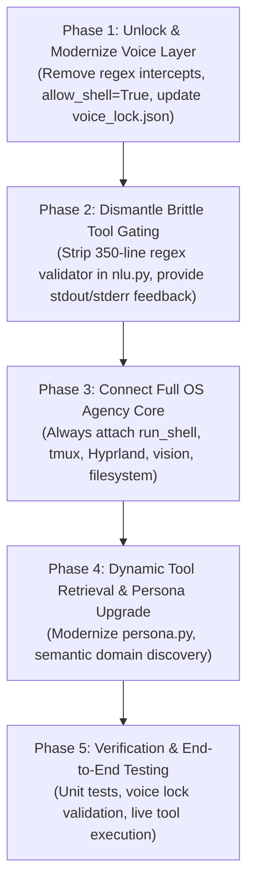

# Living JARVIS OS — Architectural Design Specification

**Status**: Approved by User (2026-11-07)  
**Scope**: Transition JARVIS from a rule-gated, regex-intercepted assistant into an autonomous, living OS agent with full-spectrum system agency.

---

## 1. Executive Summary & Problem Statement

### The Problem: The "Hardcoded" Illusion
JARVIS currently connects to state-of-the-art multimodal frontier models (Gemini Live 3.8 / Gemini Multimodal API). However, its behavior is largely dominated by:
1. **740+ lines of static regexes in [`jarvis_control/nlu.py`](file:///home/g0pi/JARVIS%20OS/jarvis_control/nlu.py)**, intercepting user intent before the LLM can interpret it, and blocking model tool calls unless exact magic keywords (`authorize`, `oauth`, `phone`) appear in the transcript.
2. **Offline fast-path shortcutting in [`voice_layer/local_speech.py`](file:///home/g0pi/JARVIS%20OS/voice_layer/local_speech.py)**, where regexes steal natural speech turns for common commands (volume, brightness, application launch) and execute offline.
3. **Canned spoken templates in [`voice_layer/offline_speech.py`](file:///home/g0pi/JARVIS%20OS/voice_layer/offline_speech.py)** and pre-recorded static `.pcm` audio clips, giving the assistant a rigid, robotic voice.
4. **Artificial tool gating in [`orchestration/tool_tiers.py`](file:///home/g0pi/JARVIS%20OS/orchestration/tool_tiers.py)**, where 247 real desktop capabilities are hidden behind a static 60-tool ceiling and regex-based `intent_domains`.
5. **Restricted shell execution**, preventing JARVIS from taking real autonomous actions across the Linux operating system.

### The Objective: A Living Cognitive Operating System
Transform JARVIS into a **living, autonomous AI operating system agent** that:
- Receives full-duplex natural speech and visual desktop telemetry continuously.
- Possesses unrestricted execution agency (`run_shell`, `run_in_terminal`, `hypr_dispatch`, `read_screen`, `file_operation`).
- Resolves intent semantically rather than via regex keyword matching.
- Self-heals: uses execution stdout/stderr to diagnose errors and iterate dynamically.
- Speaks naturally with contextual verbal confirmations rather than canned strings.
- Enforces safety boundaries cleanly: fast non-destructive actions run immediately; only catastrophic actions (reboot, disk wipe, power down) hold for confirmation.

---

## 2. Architecture Overview

```
                      ┌──────────────────────────────────────┐
                      │        User Natural Speech /         │
                      │     Desktop Context Telemetry        │
                      └──────────────────┬───────────────────┘
                                         │
                                         ▼
                 ┌────────────────────────────────────────────────┐
                 │       Streaming Full-Duplex Audio Bus          │
                 │      (PipeWire / Silero VAD / Barge-In)        │
                 └───────────────────────┬────────────────────────┘
                                         │ Direct Audio Stream
                                         ▼
                 ┌────────────────────────────────────────────────┐
                 │       Cognitive Kernel: Gemini Live 3.8        │
                 │   - Real-time semantic intent understanding    │
                 │   - Dynamic multi-turn reasoning               │
                 │   - Adaptive contextual speech generation      │
                 └───────────────────────┬────────────────────────┘
                                         │ Function Calling (JSON Schema)
                                         ▼
                 ┌────────────────────────────────────────────────┐
                 │          Dynamic Tool Router & Dispatch        │
                 │  - Always-On Sovereign Core Tools              │
                 │  - On-Demand Dynamic Domain Retrieval (247)    │
                 └───────────────────────┬────────────────────────┘
                                         │ Tool Invocations
                                         ▼
      ┌──────────────────────────────────┴──────────────────────────────────┐
      │                                                                     │
      ▼                                                                     ▼
┌──────────────────────────────┐                      ┌────────────────────────────────┐
│   Safe Non-Destructive       │                      │     Destructive Safety Gate    │
│   (Immediate Execution)      │                      │     (Verbal Confirmation)      │
├──────────────────────────────┤                      ├────────────────────────────────┤
│ • run_shell (bash/pacman)    │                      │ • rm -rf / System wipe         │
│ • tmux (terminals)           │                      │ • shutdown / reboot            │
│ • Hyprland (windows/spaces)  │                      │ • Overwrite active git origin  │
│ • Wayland pointer / keyboard │                      │ • Wipe production databases    │
│ • Filesystem read/edit       │                      │                                │
└──────────────┬───────────────┘                      └────────────────┬───────────────┘
               │                                                       │ Confirmed
               └───────────────────────┬───────────────────────────────┘
                                       │
                                       ▼
                 ┌────────────────────────────────────────────────┐
                 │           Linux Native Host Execution          │
                 │  (Returns exit_code, stdout, stderr, outcome)  │
                 └───────────────────────┬────────────────────────┘
                                         │
                                         │ Live execution feedback
                                         ▼
                 ┌────────────────────────────────────────────────┐
                 │       Gemini Live Natural Spoken Reply         │
                 │   (Context-aware, conversational confirmation) │
                 └────────────────────────────────────────────────┘
```

---

## 3. Detailed Component Design

### 3.1 Voice Subsystem Modernization (`voice_layer/`)
- **Remove Regex Fast-Paths**:
  - In [`voice_layer/local_speech.py`](file:///home/g0pi/JARVIS%20OS/voice_layer/local_speech.py), deprecate the `command_for()` regex hijacking that intercepts phrases like `open <app>` or `volume <direction>`. All natural speech is streamed directly to Gemini Live to allow natural conversational variations.
  - Keep Whistle / local Whisper purely for offline fallback when internet/API connectivity is lost.
- **Retire Canned Robotic Responses**:
  - In [`voice_layer/offline_speech.py`](file:///home/g0pi/JARVIS%20OS/voice_layer/offline_speech.py), replace static string templates (`"Opened {path}."`, `"Speakers muted."`) with dynamic speech synthesis.
  - In [`voice_layer/daemon.py`](file:///home/g0pi/JARVIS%20OS/voice_layer/daemon.py), eliminate reliance on static pre-recorded `.pcm` filler clips (`acknowledgements.json`). Gemini Live provides natural, brief vocal acknowledgments.
- **Enable Full OS Shell Access**:
  - Set `allow_shell = True` by default in [`voice_layer/config.py`](file:///home/g0pi/JARVIS%20OS/voice_layer/config.py).
- **Persona Modernization**:
  - Update [`voice_layer/persona.py`](file:///home/g0pi/JARVIS%20OS/voice_layer/persona.py) and [`jarvis_control/persona.py`](file:///home/g0pi/JARVIS%20OS/jarvis_control/persona.py). Remove the micromanaging 5-word rules and rigid pseudo-code directives. Re-orient JARVIS as an autonomous, capable Linux power-user and cognitive partner.
- **Voice Subsystem Lock Update**:
  - After modifications, re-calculate SHA256 checksums for changed files in `voice_layer/` and update [`audio/.voice_lock.json`](file:///home/g0pi/JARVIS%20OS/audio/.voice_lock.json) in accordance with the user's explicit authorization.

### 3.2 Cognitive Kernel & Gating Modernization (`jarvis_control/nlu.py`)
- **Dismantle Brittle `validate_tool_intent`**:
  - Remove the 350+ lines of keyword/regex checking that inspect the raw user text for words like `'authorize'`, `'oauth'`, `'github'`, `'phone'`.
  - Replace with **schema and parameter validation**:
    - Validate that arguments match expected JSON types (strings, numbers, booleans).
    - If arguments are invalid, return a structured error message (`{"ok": False, "error": "Invalid parameter: ..."}`) back to Gemini Live so it can re-plan and self-correct.
- **Preserve Confirmation Safety Boundaries**:
  - Keep `evaluate_confirmation` for high-consequence operations (e.g. system power, device wipe) with fail-closed negation precedence.

### 3.3 Dynamic Tool Router & Always-On Sovereign Core (`orchestration/`)
- **The Sovereign Core (Always-On Tools)**:
  Every session attaches these foundational OS control tools:
  1. `run_shell`: Execute arbitrary bash commands, manage systemd services, install packages (`pacman`, `paru`), check process tables, inspect logs.
  2. `run_in_terminal` / `read_terminal` / `watch_terminal`: Full interactive tmux terminal manipulation.
  3. `hypr_dispatch` / `hypr_query`: Full control of Hyprland (switching workspaces, moving windows, toggling floating/fullscreen, window focusing).
  4. `read_screen` / `click_text`: Multimodal Wayland visual perception and coordinate/text clicking.
  5. `file_operation`: Full filesystem traversal, read, write, edit, search.
  6. `system_control`: Native fast adjustments for volume, brightness, and media.
  7. `discover_domain_tools` / `execute_domain_tool`: On-demand retrieval for the other 200+ specialized domain tools (GitHub, Google Workspace, Composio, LinkedIn, Phone).
- **Deprecate Regex Keyword Routing**:
  - Replace `intent_domains` in [`orchestration/tool_tiers.py`](file:///home/g0pi/JARVIS%20OS/orchestration/tool_tiers.py) with semantic discovery based on tool descriptions and metadata tags.

---

## 4. Execution & Implementation Roadmap



---

## 5. Verification & Testing Plan

1. **Voice Baseline Verification**:
   - `python scripts/verify_voice_lock.py` must pass cleanly against the newly updated baseline.
2. **Unit & Regression Testing**:
   - Run existing suite: `.venv/bin/pytest tests/test_control/ tests/test_orchestration.py tests/test_ground_truth_contracts.py`.
   - Update `tests/test_nlu.py` to remove assumptions about regex-blocked conversational intents.
3. **End-to-End Action Verification**:
   - Verify `run_shell` executes standard Linux commands (`uname -a`, `pacman -Q`, `systemctl status`).
   - Verify Hyprland window/workspace management functions without regex errors.
   - Verify natural conversational commands (e.g., *"Could you lower the sound a little bit?"*) succeed without needing exact keyword phrasing.
