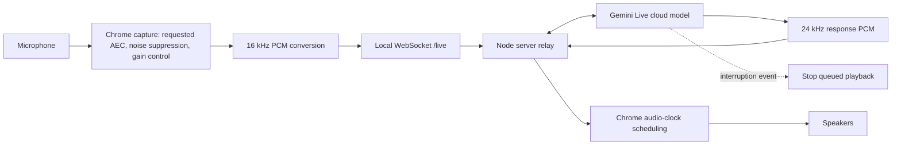
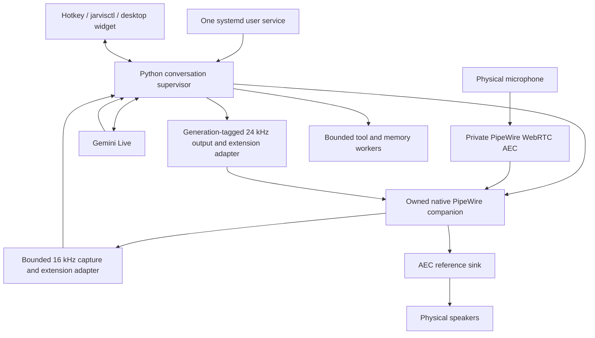

# From Chrome voice conversation to browserless JARVIS

Analysis and implementation guide · 24 October 2026 · Asia/Kolkata

## Decision

Use JARVIS's existing Gemini Live connection with its existing optional native PipeWire companion. Finish the integration and validate the audio experience before promoting that backend. Chrome does not need to be open, and the localhost web server does not need to remain part of the production voice path.

The reference is **http://localhost:3000/**, titled **Voice Companion — Natural Spoken Conversation**. Its running server was mapped through port 3000 → process 229106 → `/home/g0pi/Downloads/voice-buddy`. A similarly named project exists elsewhere; this report uses the running Downloads copy.

**What is established:** the app's served JavaScript, local server source, and JARVIS source explain how the feature is built. **What is not established:** measured microphone quality, effective Chrome capture settings, the user's current live/demo selection, or audible latency parity. No microphone, cloud conversation, or service restart was initiated for this report.

“Browserless” means a native desktop service. The proposed conversational model still runs in the cloud. Fully offline conversation would require a separate local speech/model design.

## 1. Evidence and investigation limits

| Evidence | Result and limits |
| --- | --- |
| Local HTTP response | The requested page was served successfully and identified the voice application. |
| Server health | `/api/health` returned `status: ok` and `hasApiKey: true` at 22:34:49 IST. This checks configuration presence, not credential validity or a successful model call. |
| Served application artifacts | Captured Vite-transformed `main`, `App`, audio utilities, and demo speech code directly from localhost. URLs, byte counts, and SHA-256 hashes are retained. |
| REA 6.7.0 static analysis | Completed for these four saved JavaScript artifacts. Evidence ID: `ev_db209c325722ab8e1246d3a8662b0a6f2970c3313b80b4e6de397c662dd10906`. |
| REA coverage | Inert syntax analysis; dependencies outside the four-file capture were not included. Unresolved imports and dynamic relationships remain unknown. It did not observe a live voice exchange. |
| Browser inspection | Connected Chrome tooling exposed a blank automation tab; navigation approval review timed out. The regular browser had no usable loopback CDP endpoint. HTTP artifact acquisition and source tracing supplied the usable evidence. |
| JARVIS | Inspected unlocked orchestration, locked audio interfaces, native backend, standby, configuration, services, and selected tests. |
| Shared workspace | Initial HEAD was `bb75151`; another agent advanced the repository to `5dbcfa5` during the investigation. Line references are working-tree references, not an immutable release specification. |

Evidence files: [acquisition manifest](/home/g0pi/.codex/visualizations/2026/10/24/01a16ec4-bb93-7760-bd1b-aa1c2bc06314/voice-browser-evidence/acquisition.json), [complete REA evidence](/home/g0pi/.codex/visualizations/2026/10/24/01a16ec4-bb93-7760-bd1b-aa1c2bc06314/voice-browser-evidence/rea-static-complete.json). The first sandboxed REA attempt failed at worker startup; the successful run used the same saved artifacts with subprocess access available.

## 2. What the reference application actually does

### Normal Gemini Live mode



1. The page opens a WebSocket to its own `/live` endpoint and sends an initialization message with the voice and conversational instructions. [App.tsx](/home/g0pi/Downloads/voice-buddy/src/App.tsx:315)
2. The Node server opens `ai.live.connect` with `gemini-3.8-live`, audio responses, and the selected voice. This is the conversation engine; Chrome supplies the capture/playback infrastructure. [server.ts](/home/g0pi/Downloads/voice-buddy/server.ts:89)
3. After the server reports connected, the page requests microphone capture with echo cancellation, noise suppression, and automatic gain control enabled. These are requested constraints; their effective values need a live `MediaStreamTrack.getSettings()` inspection. [App.tsx](/home/g0pi/Downloads/voice-buddy/src/App.tsx:254)
4. Input uses an `AudioContext` requested at 16 kHz and `createScriptProcessor(4096, 1, 1)`. Assuming that context rate is obtained, each callback contains **256 ms** of audio. Samples are converted to PCM16, base64 encoded, and sent in JSON. This implementation does **not** use an AudioWorklet for capture. [App.tsx](/home/g0pi/Downloads/voice-buddy/src/App.tsx:266)
5. The relay forwards microphone audio to `sendRealtimeInput`. No explicit VAD tuning is provided in its session setup, so the provider's effective defaults need verification. It uses WebSockets; the inspected code does not create an `RTCPeerConnection`. [server.ts](/home/g0pi/Downloads/voice-buddy/server.ts:111)
6. Response audio is decoded into 24 kHz buffers. Each buffer starts at the previous buffer's scheduled end. When the schedule has fallen behind, the player restarts at audio-context time plus 10 ms. That is a scheduling lead, **not** measured device or conversational latency. [audio.ts](/home/g0pi/Downloads/voice-buddy/src/utils/audio.ts:87)
7. A provider `interrupted` event stops and clears active playback sources. A completed model turn finalizes UI transcript state; model completion and the speaker finishing buffered audio are separate events. [App.tsx](/home/g0pi/Downloads/voice-buddy/src/App.tsx:362)

The default persona selects Zephyr and short, conversational turns. Tone and prompt differences can affect perceived naturalness independently of audio engineering. Compare the same model, voice, prompt, and devices when testing parity. [personas.ts](/home/g0pi/Downloads/voice-buddy/src/data/personas.ts:3)

### Demo mode is a separate path

Demo mode uses browser SpeechRecognition, keyword-based canned responses, and `speechSynthesis`. Its animated output volume is simulated. It is not evidence of native Gemini audio or measured output loudness. The app also starts the SpeechRecognition helper during normal capture, although its result handler only produces responses in demo mode. The name “local” in the helper does not establish that a browser recognition implementation operates offline. [recognition helper](/home/g0pi/Downloads/voice-buddy/src/App.tsx:118), [demo service](/home/g0pi/Downloads/voice-buddy/src/services/demoVoiceService.ts:1)

Do not transplant these limitations into JARVIS:

- Manual interrupt sends an `interrupt` message, but the relay's handler has no provider cancellation action. Local playback can stop while later response chunks still arrive. JARVIS should retain its stronger generation fencing.
- The player has no explicit maximum scheduled-audio backlog in the inspected class. Retain bounded native queues.
- The relay has no explicit resumption configuration in this setup. Retain JARVIS's existing session recovery mechanisms.
- Do not copy the caption wiring as a proven transcript pipeline: the reference does not explicitly request input/output transcription in its Live configuration, and its input-transcript lookup differs from the documented server-content shape.

## 3. Which Chrome capabilities need a native equivalent?

| Responsibility | Chrome/reference implementation | Native JARVIS destination |
| --- | --- | --- |
| Microphone access and device timing | Browser media capture and audio service | PipeWire streams in the existing C companion |
| Echo/noise processing | Requested browser processing | Existing private PipeWire WebRTC AEC; verify real routing and quality |
| Input level normalization | Requested automatic gain control | Measure first; add an optional bounded processor only if needed |
| PCM framing | 4,096-sample browser callback, PCM16/base64 | Keep existing 320-sample/20 ms, 16 kHz capture |
| Model connection | Browser → Node relay → Gemini | Existing direct Python Gemini Live session |
| Playback clock | Scheduled AudioBufferSource nodes | Device-driven PipeWire rendering with preallocated rings |
| Interruptions | Clear audio sources on provider event | Generation cancellation across router, adapter, and native render consumer |
| Ongoing conversation | Live session plus app state | Existing session supervisor, recovery, context and standby policy |
| Start/mute/stop/status | Buttons and tab keyboard handlers | Existing IPC, hotkeys and desktop widget |
| Background lifecycle | Open browser tab plus Node server | One systemd user service and its owned native audio child |

Chromium's published architecture separates OS audio work from the renderer and uses shared memory for samples. Its callback guidance prohibits blocking and allocation in deadline-sensitive work. The transferable requirement is predictable audio deadlines; copying Chromium's entire process architecture is unnecessary. [Chromium audio architecture](https://raw.githubusercontent.com/chromium/chromium/main/media/audio/README.md)

WebRTC APM provides speech enhancement including echo cancellation, noise suppression and gain control. PipeWire's echo-cancel module exposes a cleaned microphone source and a speaker-reference sink; both directions matter. These components can operate without a browser. [WebRTC APM](https://webrtc.googlesource.com/src/+/refs/heads/main/modules/audio_processing/g3doc/audio_processing_module.md), [PipeWire echo cancellation](https://docs.pipewire.org/page_module_echo_cancel.html)

## 4. JARVIS already has most of the foundation

| Existing implementation | Evidence | Remaining work |
| --- | --- | --- |
| Direct Gemini Live streaming | [core/agent.py](/home/g0pi/Projects/JARVIS-OMA/core/agent.py:2069) | Compare effective model, voice, VAD and prompt settings with the reference |
| 16 kHz input / 24 kHz output | [core/config.py](/home/g0pi/Projects/JARVIS-OMA/core/config.py:50) | Keep framing consistent across processors and backends |
| Server interruption and residual clearing | [core/agent.py](/home/g0pi/Projects/JARVIS-OMA/core/agent.py:1407) | Test cancellation during processing, queued playback and reconnection |
| Resumption and context compression | [core/agent.py](/home/g0pi/Projects/JARVIS-OMA/core/agent.py:1838) | Distinguish planned renewal, failure, mute and user cancellation |
| Optional native C PipeWire companion | [native README](/home/g0pi/Projects/JARVIS-OMA/audio/plugins/native/README.md:1) | Prove audible quality, recovery and parity before promotion |
| Native endpoint/process ownership checks | [native_backend.py](/home/g0pi/Projects/JARVIS-OMA/audio/plugins/native_backend.py:137) | Test device changes and graph failures |
| Local Hey Jarvis standby | [standby.py](/home/g0pi/Projects/JARVIS-OMA/audio/plugins/standby.py:89) | Make startup mode and wake-plus-first-command continuity explicit |
| Local controls and desktop service | [core/ipc.py](/home/g0pi/Projects/JARVIS-OMA/core/ipc.py:12), [service unit](/home/g0pi/Projects/JARVIS-OMA/systemd/jarvis-oma.service:1) | Standardize one unit name and effective configuration |

The native companion already has preallocated sample rings, capture aging, bounded backlog, short-turn drain handling and render-side generation acknowledgement. Its initial cushion is 80 ms. Its README explicitly says browser parity is unproven. It relies on server-confirmed interruption and uses fixed, rather than adaptive, priming.

The checked-in legacy configuration has a 320 ms cushion, requested 100 ms playback latency, and 500 ms VAD silence. Class defaults and older reports differ. These numbers belong to different stages; summing them does not produce a measured response time. [config.toml](/home/g0pi/Projects/JARVIS-OMA/config.toml:6)

An earlier read-only host snapshot found `jarvis-oma.service` running, PipeWire and WirePlumber active, and JARVIS idle/muted with model `gemini-3.8-live`. Other agents subsequently worked on service startup/shutdown. Recheck status before any rollout; this report does not claim those earlier states still hold.

### Concrete integration gap: extensions are not wired into the live path

Startup constructs the native or legacy engine directly. The microphone sender consumes `engine.async_input_queue` directly. The extension registry only processes input when its processed-input method is used. Registering a processor by itself therefore changes nothing in the current live path. [startup](/home/g0pi/Projects/JARVIS-OMA/core/agent.py:1932), [sender](/home/g0pi/Projects/JARVIS-OMA/core/agent.py:753), [wrapper](/home/g0pi/Projects/JARVIS-OMA/audio/extension.py:208)

The wrapper's output helper calls the legacy `enqueue_playback` API; the native adapter exposes `enqueue_output(generation, chunk)`. Passing an already-created engine into the existing wrapper also skips the constructor's callback attachment. A composition adapter needs to reconcile these explicit interfaces and hook wiring. The older report's raw-bytes queue bug is no longer current: the legacy helper now uses generation-safe submission.

## 5. Target design and conversation process



Normal operation:

1. The desktop session starts one JARVIS service. It selects live conversation or local wake standby according to explicit configuration.
2. The audio owner verifies the capture and playback routes. The native child continuously services device deadlines independently of model/tool work.
3. In live mode, cleaned microphone frames pass through the bounded processing path to Gemini. In wake standby, cloud audio transmission is closed and local wake detection owns consumption.
4. Gemini identifies speech turns and generates audio. Incoming PCM is framed, tagged with the current response generation, and rendered on the device clock.
5. A real interruption cancels the old generation, clears residual audio, and prevents late chunks from reviving that response.
6. Tool work proceeds outside device callbacks. Local mute and interrupt remain responsive even when the network or a tool stalls.
7. Reconnection restores only valid conversation state. Expired microphone audio is discarded; already-executed tool actions are not replayed.

## 6. Step-by-step implementation plan

### Step 1 — Establish a reproducible reference

**Action:** Record whether the reference is in normal Live mode; select the same voice, model, device, language and short prompt for both applications. Capture actual browser track settings, context sample rates and latency properties during an approved test call. Measure a fixed set of short turns, long turns and interruptions.

**Output:** A baseline table with p50/p95 response and interruption latency, audio-cut counts, conditions and raw timing evidence. Until this exists, describe parity as unmeasured.

### Step 2 — Freeze the boundary and choose one service

**Action:** Verify all seven locked files. Keep changes in unlocked orchestration, `audio/extension.py`, and isolated modules under `audio/plugins/`. Preserve the existing engine implementations and avoid monkeypatching. Coordinate with sibling agents before changing service state.

**Operational choice:** Use `jarvis-oma.service`, matching `jarvisctl`. The root installer targets `jarvis.service`, while the scripts installer targets `jarvis-oma.service`; do not run both. Normalize that difference in a separate implementation change.

**Exit condition:** One daemon owns the microphone/AEC lifecycle and the control socket; a saved rollback configuration exists.

### Step 3 — Verify the native companion already present

**Action:** Build and self-test it, then run offline adapter checks. Do not write a second native engine before evaluating this one.

```bash
cd /home/g0pi/Projects/JARVIS-OMA
python3 scripts/verify_voice_lock.py
make -C audio/plugins/native check
.venv/bin/pytest -q tests/test_audio/test_native_backend.py tests/test_audio/test_extension_playback.py tests/test_audio/test_standby.py tests/test_core/test_config.py
```

The build command is a future implementation step; this analysis tested the already-existing binary only. In a coordinated maintenance window, the existing local probe can then inspect routing and silent playback:

```bash
.venv/bin/python -m audio.plugins.native_probe --duration 20
```

That probe **opens the microphone locally**, creates a private AEC route, and renders silence. It does not demonstrate audible speech quality and was not run for this report. Avoid competing microphone owners during the comparison.

### Step 4 — Wire a real extension composition boundary

**Action:** Add an explicit adapter, for example `audio/plugins/voice_pipeline.py`, using `AudioExtensionRegistry`. Wire it through unlocked orchestration. Keep raw engine ownership explicit.

- Input processing must actually run before `send_realtime_input`; preserve mute, standby, cancellation and capture-age behavior.
- Output processing must fit the existing router's complete-frame contract. Capture the generation before processing, reject stale results, and dispatch through the appropriate existing public enqueue API.
- Connect hooks through supported constructor callbacks or orchestration event dispatch. Do not replace core methods at runtime.
- Keep optional heavy analysis off the audio callback and out of the serial microphone send deadline. Bound every tap queue.

**Exit tests:** A processor demonstrably changes one transmitted frame; dropped frames never transmit; output processing preserves 20 ms framing; interruption during processing rejects the stale result; hooks fire once in the intended order on both backends.

### Step 5 — Match acoustic behavior through measurement

**Action:** Verify that playback actually passes through the AEC reference sink and capture comes from its cleaned source. Test speaker-only playback, user-only speech and simultaneous speaking. Monitor PipeWire graph errors alongside native callback metrics.

JARVIS already uses WebRTC-based AEC; its existing configuration disables analog/digital AGC. The browser requests AGC. This is a useful experiment, not proof of the cause of better sound. If needed, add bounded post-AEC level normalization as an extension, checking clipping, noise pumping and low-volume speech. Do not stack two independent echo cancellers.

**Exit condition:** No repeated self-interruption during speaker-only output, clear user speech during double-talk, and no unexplained graph-error growth in the test interval.

### Step 6 — Tune playback and interruption separately

**Action:** Start with native 80 ms priming as the existing candidate setting. Sweep smaller/larger values under the same network conditions; log starvation and end-of-speech-to-speaker timing. Consider adaptive priming only if measured arrival jitter warrants it.

Retain 20 ms capture framing. Do not copy the browser's 256 ms callback or equate its 10 ms scheduling lead with a native buffer target. Separate local stop, server-confirmed interruption, model turn completion and audible drain in state/metrics.

**Exit tests:** Short utterances below the priming target still finish; interrupt at the start/middle/end of a reply; delayed old packets cannot resume speech; mute clears playback and prevents upstream transmission.

### Step 7 — Protect conversation scheduling and recovery

**Action:** Measure microphone queue age and send-lock wait time. The current session shares a send lock with other messages. If contention is material, introduce one bounded outbound owner with priority and expiry rules for control, microphone, tool results and optional vision. Do not merely add competing socket writers.

Retain existing resumption and context compression. Classify planned connection renewal separately from fatal failure, user stop and backend loss. Current cleanup cancels playback on reconnect; change that behavior only with tests proving which generation may safely finish. Tool calls need stable identities and deduplication across resumed sessions.

**Exit tests:** Tool/vision load does not accumulate stale speech; a brief outage recovers without replaying old microphone frames; interrupted responses remain cancelled; repeated tool execution does not occur on reconnect. Gemini's documented resumption mechanism restores session state across connections, but cannot guarantee gapless sound. [Session management](https://ai.google.dev/gemini-api/docs/live-api/session-management)

### Step 8 — Make hands-free startup explicit

**Action:** Define two modes: immediate Live connection, or local-only Hey Jarvis standby followed by Live activation. The current code has standby behavior but initial startup enters the Live path. Add startup policy in unlocked configuration/orchestration if local standby is desired.

Define how the first command after the wake phrase is preserved without replaying stale standby audio. Keep a bounded pre-roll only with explicit policy and tests. Provide visible listening/muted/reconnecting state and reliable local mute/interrupt controls. Do not depend on the browser's SpeechRecognition helper or its demo TTS for the native Live path.

**Exit tests:** Wake works with Chrome closed; mute works with the network disconnected; wake mode does not stream microphone audio to Gemini before activation.

### Step 9 — Controlled service rollout and rollback

After Steps 1–8 pass, edit the **effective** JARVIS configuration, merging into the existing audio section:

```toml
[audio]
backend = "native"
native_cushion_s = 0.08
queue_max_seconds = 10
```

The queue limit is a safety ceiling, not desired latency. Verify `JARVIS_CONFIG`, environment overrides, user configuration and the repository configuration in precedence order. `run.sh` sources `.env`, so a service-level variable can be overridden later. Do not expose secrets when inspecting those files.

During the coordinated rollout window:

```bash
cd /home/g0pi/Projects/JARVIS-OMA
JARVIS_AUDIO_BACKEND=native .venv/bin/python agent.py --check --no-skills
systemctl --user restart jarvis-oma.service
.venv/bin/python scripts/jarvisctl.py status
journalctl --user -u jarvis-oma.service -n 80 --no-pager
```

These are instructions, not actions performed by this report. Verify readiness and audio with Chrome closed. Roll back by setting the effective backend to `legacy` and restarting the same unit. Keep the legacy binary/configuration path available.

Use a **systemd user service** tied to the graphical session. This meets browserless desktop operation and accesses the user's PipeWire session. Operation before login or across logout is a different requirement; do not convert it into a root audio daemon implicitly.

### Step 10 — Promote only after the acceptance run

| Scenario | Acceptance evidence |
| --- | --- |
| 30 matched conversational turns | p50/p95 end-of-speech → first audible reply; compare against the reference |
| 20 interruptions | Stop delay and cancelled-generation replay count; replay count must be zero |
| Speaker-only and double-talk | False interruption count, intelligibility notes, clipping and AEC graph errors |
| Short and long responses | Complete short-turn tails; bounded backlog; no silent truncation |
| 60-minute conversation under ordinary desktop/tool load | Dropout count, callback duration, capture age, graph-error deltas, CPU and memory trend |
| Network loss and provider reconnect | Recovery outcome, expired frames discarded, no duplicated actions |
| Device unplug/replug and suspend/resume | Explicit loss/recovery state; no orphan companion or AEC owner |
| Browser closed | Start, wake/live, speak, interrupt, mute and status all function independently |

As initial engineering targets, aim for p95 interruption-to-silence below 250 ms, response p95 no worse than the matched browser baseline by more than 150 ms, and no unexplained audible cuts in the soak. These are proposed gates, not measured achievements or provider guarantees. Measure acoustic latency separately from enqueue timestamps; native callback execution time is not scheduler wake lateness.

## 7. Suggested implementation order

1. **Integration change:** composition adapter, actual input/output wiring, hook correctness and focused tests.
2. **Measurement change:** per-turn timing, capture age, backlog, interruption reason and PipeWire error deltas without raw-audio recording by default.
3. **Reliability change:** bounded send scheduling, explicit reconnect policy, device recovery and startup standby semantics.
4. **Deployment change:** single service name, configuration readback, matched comparison, rollout and rollback record.

Delay optional gain control, adaptive buffering and additional speech models until a measured gap justifies each one. The first milestone is a complete native conversation with Chrome closed, not a new UI or a new voice stack.

## 8. Validation performed for this report

| Check | Result |
| --- | --- |
| Native adapter, extension playback, standby and configuration tests | 37 tests and 44 subtests passed |
| Agent, legacy engine, AEC and lock selection, with IPC included | 153 tests and 10 subtests passed; 9 IPC tests initially failed during sandbox-forbidden Unix socket binding |
| IPC rerun with local socket access, excluding lifecycle test | 8 passed, 1 deselected |
| Full IPC retry | The lifecycle test stalled and was terminated; it remains unresolved, not passing |
| Existing native executable `--self-test` | Passed; existing binary, not a fresh compilation |
| Voice-lock verifier | All 7 protected files intact |
| REA saved-script analysis | Completed; static partial-application coverage |
| Acoustic/browser parity | Not measured |

Across the completed selections: **198 passing tests and 54 passing subtests**, with **one unresolved IPC lifecycle test**. Passing fixture tests do not prove real device, network or audible performance.

Reproduction commands for the completed selections:

```bash
cd /home/g0pi/Projects/JARVIS-OMA
.venv/bin/pytest -q -o cache_dir=/tmp/jarvis-voice-inventory-pytest tests/test_audio/test_native_backend.py tests/test_audio/test_extension_playback.py tests/test_audio/test_standby.py tests/test_core/test_config.py
.venv/bin/pytest -q -o cache_dir=/tmp/jarvis-voice-inventory-pytest tests/test_core/test_agent.py tests/test_core/test_ipc.py tests/test_audio/test_engine.py tests/test_audio/test_echo_cancel.py tests/test_audio/test_voice_lock.py
timeout --kill-after=5s 30s .venv/bin/pytest -q -o cache_dir=/tmp/jarvis-chrome-report-pytest tests/test_core/test_ipc.py -k 'not test_agent_run_ipc_server_lifecycle'
audio/plugins/native/jarvis-audio --self-test
python3 scripts/verify_voice_lock.py
```

The middle command records the initial mixed result, not an all-green suite. Diagnose the lifecycle test before treating it as a deployment gate.

## 9. Primary technical references

- [Gemini Live audio formats and capabilities](https://ai.google.dev/gemini-api/docs/live-api/capabilities): PCM input/output and event semantics. Input is natively 16 kHz; output is 24 kHz PCM16. The API can resample declared input rates, but JARVIS's current native contract deliberately fixes 16 kHz.
- [Gemini Live WebSocket reference](https://ai.google.dev/api/live): the model session is independent of a browser frontend.
- [Chromium audio architecture](https://raw.githubusercontent.com/chromium/chromium/main/media/audio/README.md): native audio service and callback responsibilities.
- [WebRTC Audio Processing Module](https://webrtc.googlesource.com/src/+/refs/heads/main/modules/audio_processing/g3doc/audio_processing_module.md): reusable speech-processing functionality.
- [PipeWire stream API](https://docs.pipewire.org/group__pw__stream.html): native device stream lifecycle and processing callbacks.
- [Media Capture and Streams](https://w3c.github.io/mediacapture-main/): distinction between requested constraints and actual track settings.

The localhost source and saved artifacts establish the reference's implementation. The official documents explain the underlying components; they do not substitute for the remaining real-call comparison.
